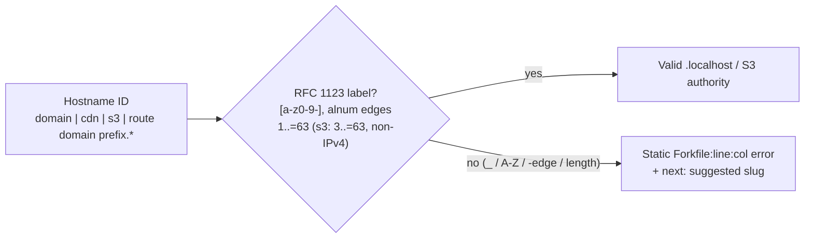

# 01 — The `Forkfile` Specification

Slipfork runs your cloud environment locally in a box; CI is the clutch. One `Forkfile` at your repository root declares your backing resources, runtime `env` and secrets, and container `image`s enclosing the `service`s that run inside them.

```forkfile
# forkfile: 0.1

features {
  default = [dev]
  dev = [mail]
  mail
}

domain main
postgres pg { database app-db }
redis cache
s3 uploads
s3 assets {
  policy public-read
  cdn static-cdn
}

env common {
  DATABASE_URL         = app-db.url
  REDIS_URL            = cache.url
  UPLOADS_URL          = uploads.url
  AWS_S3_CUSTOM_DOMAIN = static-cdn.domain
  PUBLIC_URL           = main.url
  SECRET_KEY           = secret(SECRET_KEY) ?? random_hex(32)
  on mail: SMTP_ADDR   = "127.0.0.1:1025"
}

image backend . {
  on dev: stage dev
  use env common

  service api {
    port 8000
    route /api
    pre-deploy: @uv run alembic upgrade head
    run: uv run gunicorn app.main:app --bind 0.0.0.0:$port
    on dev: run: @uv run uvicorn app.main:app --reload --host 0.0.0.0 --port $port
  }

  service worker {
    run: uv run celery -A app.worker worker
    on dev: run: @uv run celery -A app.worker worker
  }
}

image frontend ./front {
  arg VITE_CDN_URL = static-cdn.url
  on dev: stage dev

  service front {
    port 4173
    route /
    run: pnpm run preview -- --host 0.0.0.0 --port $port
    on dev {
      port 5173
      run: @pnpm run dev -- --host 0.0.0.0 --port $port
    }
  }
}

on mail {
  image mailpit from axllent/mailpit:latest {
    service mailpit {
      port 8025
      route / domain mail.*
    }
  }
}
```

---

## 1. Format Header & Identifier Rules (`# forkfile: 0.1`)

While `< 1.0`, every `Forkfile` starts on line 1 with `# forkfile: 0.1` so Slipfork and CI fail fast with a clear version diagnostic before evaluating declarations. Inside `{ ... }` blocks, statements separate by newline or `;` (`s3 assets { policy public-read; cdn static-cdn }`).

Hyphenated identifiers (`static-cdn`, `app-db`) are valid everywhere, including property access (`static-cdn.domain`, `static-cdn.url`). All top-level declarations and named child declarations (`database <id>`, `cdn <id>`) share one flat, globally unique symbol namespace.



- **Strict RFC 1123 labels (`domain`, `cdn`, `route` & `s3`):** `domain <id>`, `cdn <id>`, and `route ... domain <prefix>.*` `<prefix>` must be `1..=63` lowercase ASCII `[a-z0-9-]` characters starting and ending with `[a-z0-9]`; `s3 <bucket>` enforces the same `[a-z0-9-]` single-label rule with length `3..=63` and rejects IPv4-shaped literals (`1.2.3.4`). Underscores (`_`), uppercase letters, dots, leading or trailing `-`, and out-of-range lengths are statically rejected at `Forkfile:line:col`.
- **`.localhost` slug normalization:** Repository folder and git branch names normalize `_` and `/` to `-`, lowercase ASCII, collapse interior `--+` to single `-` (keeping `--` unambiguous in `<fork>--<world>.localhost`), trim edge `-`, and enforce the `63`-byte DNS label limit.

---

## 2. `image <id>` & Build-Time `arg` (Enclosing Scope)

Each `image` declares a container rootfs and encloses the `service`s and hooks that run inside it — built and cached natively on Btrfs + `crun` with **zero Docker dependency**.

- **`Dockerfile` vs OCI registry:** `image backend . { ... }` builds `<dir>/Dockerfile` natively (with optional `dockerfile <path>`, `stage <name>`, and `arg`), while `image mailpit from axllent/mailpit:latest { ... }` pulls OCI layers over HTTPS into a read-only Btrfs subvolume.
- **Non-secret build `arg`:** `arg KEY = <expr>` and `arg { ... }` pass build-time `Dockerfile` `ARG`s (such as `arg VITE_CDN_URL = static-cdn.url` or `deployment.commit_sha`) and statically reject `secret(...)` or any secret-tainted property across every `on` branch.
- **Scope inheritance:** Nested `service`s and hooks inherit the image rootfs, `<dir>` as default `workdir` (overridable via `workdir <subpath>`), `use env` / `env { ... }`, `before-start` hooks, and the bind-mounted Btrfs project subvolume.

---

## 3. `features` & `on <expr>` — Local vs Cloud Parity

Cargo-style `features` let one `Forkfile` express both production and local development: `default` activates automatically on local commands (`slipfork up`), while CI evaluates production with `--no-default-features` or explicit `--features`.

`on <expr> { ... }` and `on <expr>: ...` accept boolean feature expressions (`dev`, `!dev`, `dev & mail`, `staging | preview`) to switch `Dockerfile` target stages, pass conditional `arg`s, swap `run:` to `@`-prefixed hot-reloaders, or gate dev-only services.

---

## 4. Backing Resources & Explicit `s3` Access Policy

Slipfork runs local backing services matching cloud semantics (`slipfork migrate` converts legacy `snow.yml` manifests to `# forkfile: 0.1`).

| Declaration | Local Behavior & Access Policy | Typed Properties |
| :--- | :--- | :--- |
| `postgres <id> { database <db> }` | PostgreSQL `18` (`version` optional) | `<db>.url` (secret), `<db>.host`, `<db>.port`, `<db>.name`, `<db>.user`, `<db>.password` (secret) |
| `redis <id>` | Redis `7` (`version` optional) | `<id>.url`, `<id>.host`, `<id>.port` |
| `s3 <bucket>` | Defaults to **`policy private`** (`403` anonymous `GET`/`HEAD`) | `<bucket>.url` (secret), `<bucket>.endpoint`, `<bucket>.bucket`, `<bucket>.access_key`, `<bucket>.secret_key` (secret) |
| `s3 <bucket> { policy public-read }` | Anonymous `GET`/`HEAD` -> `200`; `PUT`/`DELETE`/list require SigV4 | Bucket properties on `<bucket>` |
| `s3 <bucket> { policy public-read; cdn <id> }` | `public-read` bucket + CDN edge `http://<id>.<world>.localhost` | Bucket properties on `<bucket>` + non-secret **`<id>.domain`**, **`<id>.url`** |
| `domain <id>` | Primary `<world>.localhost`; extra `<id>.<world>.localhost` | Non-secret **`<id>.domain`**, **`<id>.url`** |

!!! warning "`cdn <id>` requires explicit `policy public-read`"
    `s3 <bucket>` defaults to `policy private`, and Slipfork never silently makes a private bucket public when you attach a CDN. Declaring `cdn <id>` without `policy public-read` (or alongside `policy private`) is a static check failure:

```text
error: 'cdn static-cdn' inside 's3 assets' requires 'policy public-read'
  --> Forkfile:18:13
   |
18 | s3 assets { cdn static-cdn }
   |             ^^^^^^^^^^^^^^
next: add 'policy public-read' inside 's3 assets' to enable 'cdn static-cdn'
```

---

## 5. Runtime `env` & Secrets (`env`, `var()`, `secret()`)

`env` (`env <group>`, `use env <group>`, inline `env { ... }`) is **strictly runtime** — injected into `service`s and lifecycle hooks on an in-memory `tmpfs`, never into `Dockerfile` builds.

`var(KEY) ?? "default"` resolves non-secret configuration, while `secret(KEY) ?? random_hex(32)` (`random_base64(n)`, `random_alnum(n)`, `random_uuid()`) streams encrypted cloud secrets over `OSPP v1` when paired or persists local fallback secrets offline. `slipfork-forkfile` wraps secret-tainted values in `SecretValue` (redacted `Debug`/`Display` printing `"[REDACTED]"`, zeroize-on-drop) alongside `BucketPolicy` (`Private` | `PublicRead`).

---

## 6. Ports & Cloud-Identical Ingress Routing (`port`, `route`, `domain`)

Each HTTP `service` declares one public `port <u16>` (available as `$port` in commands and auto-injected as `PORT` in runtime `env`, plus optional `internal_ports [8081, ...]`). `route` preserves matched path prefixes by default (`preserve_path_prefix: true` in cloud):

| `Forkfile` Route | Path Match & Prefix Handling | Authority (`Host`) Filter |
| :--- | :--- | :--- |
| `route /api` | Prefix `/api` — **preserves `/api` by default** (`/api/users` -> `/api/users`) | Primary `<world>.localhost` and every declared app `domain` |
| `route /api strip-prefix` | Prefix `/api` — strips `/api` (`/api/users` -> `/users`) | Primary `<world>.localhost` and every declared app `domain` |
| `route /api rewrite /v1` | Prefix `/api` — rewrites prefix (`/api/users` -> `/v1/users`) | Primary `<world>.localhost` and every declared app `domain` |
| `route exact /healthz` | Exact path `/healthz` only | Primary `<world>.localhost` and every declared app `domain` |
| `route / domain admin` | Prefix `/` | Exact declared `domain admin` (`admin.<world>.localhost`) |
| `route / domain mail.*` | Prefix `/` | RFC 1123 subdomain prefix `mail.` (`mail.<world>.localhost`) |

`strip-prefix` and `rewrite <path>` are mutually exclusive, and `domain <id>` filters must reference a declared top-level `domain`.

---

## 7. Services, `before-start when changed(...)` & `@<tool>` Auto-Prequels

- **Hooks & `run`:** `service <id>` supports `before-start`, `pre-deploy`, `post-deploy`, `failed-deploy`, and `run:` / `run { ... }` (optional when a `from <ref>` image defines an OCI `ENTRYPOINT`/`CMD`), expanding `$port` and `$env.KEY` without shell word-splitting.
- **Conditional `before-start`:** `before-start when changed(prisma/schema.prisma): @pnpm exec prisma generate` hashes matched inputs against `.slipfork/` stamps in the Btrfs project subvolume, skipping unchanged runs in `< 1ms`.
- **`@<tool>` auto-prequels:** Prefixing `@uv`, `@poetry`, `@pnpm`, `@npm`, `@yarn`, `@bun`, `@composer`, `@bundle`, `@go`, or `@cargo` synthesizes one deduplicated `(image, lockfile_dir)` install node (`uv sync`, `pnpm install`, etc., walking up to workspace root lockfiles) before downstream hooks and services.

---

## 8. Whole-File Validation, Formatting & Editor Tooling

Slipfork type-checks **every `on` feature combination at once** before booting any container (`Forkfile:line:col` caret diagnostics + `next:` remedy). It ships comment-preserving `slipfork fmt` (`--check`), a standalone cross-platform `slipfork-lsp` stdio server, and a Zed extension.
