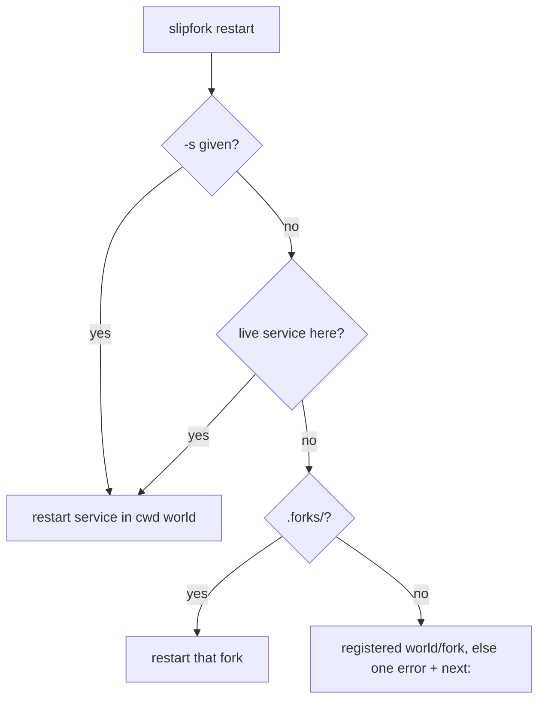
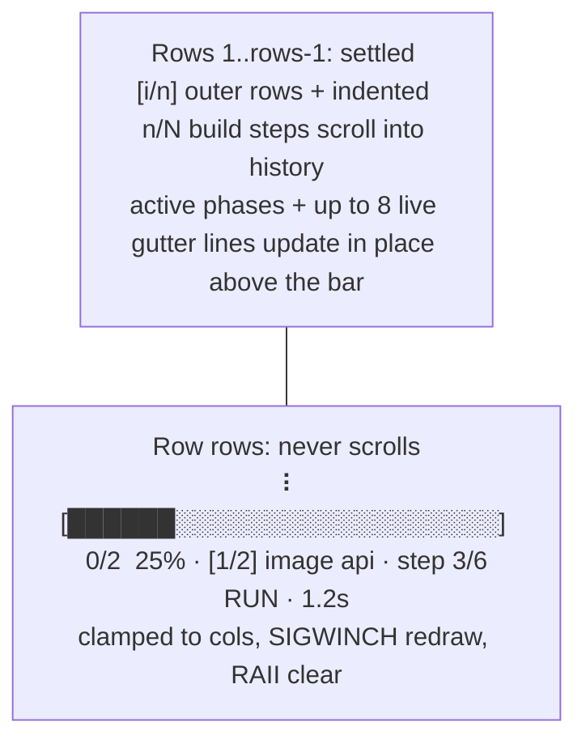
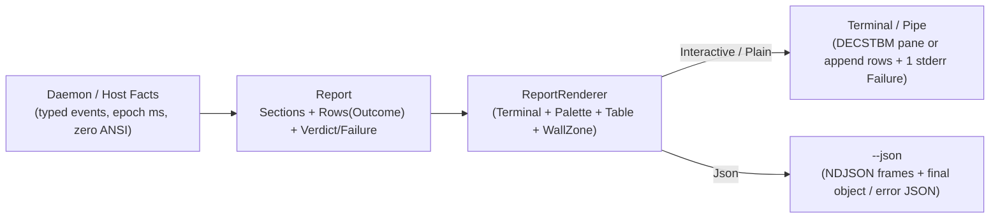

# 02 — The CLI UX

Slipfork runs your cloud environment locally in a box; CI is the clutch. One `clap` tree owns argv, one `Report` renderer owns every terminal and `--json` byte, and every failure ends in one `next:` command.

```console
$ slipfork up
✓ Ready -> http://acme-shop.localhost

$ slipfork restart -s worker
✓ Restarted worker

$ slipfork ps
● acme-shop  ~/projects/acme-shop
  http://acme-shop.localhost
    /api  -> web      service              running
  support
    worker  service       running
    pg      postgres 18   running
```

Interactive colour terminals apply one role-based SGR palette, while `NO_COLOR`, `TERM=dumb`, pipes, and `--json` emit zero escapes:

| Role | SGR | Tokens |
| :--- | :--- | :--- |
| Settled / live | `32` (green) | `●`, `✓`, `built`, `pulled`, `ready`, `running`, `cached`, `up to date`, `done`, closing `Ready`/`Restarted`/`Stopped`/`Dropped` |
| Transitional / warning | `33` (yellow) | `starting`, `ps`/`status` `stopped`, `orphaned`, stderr gutter `┃` |
| Failure / refusal | `31` (red) | `✗`, `!`, `error:`, `failed`, `failed at i/n`, `refused` |
| Keywords | `35` / `38;5;132` | Outer verbs (`image`, `setup`, `start`, `hook`, `RUN`) / inner Dockerfile steps (`from`, `copy`, `run`) |
| Links & remedies | `1;4;36` / `36` | Primary `.localhost` URLs (`1;4;36`) / copyable `next:` commands (`36`) |
| Neutral metadata | `38;5;244` (never `2`) | `[i/n]`, `n/N`, timings, clocks, paths, `#run_id`, 12-char `sha256:` digests, `•`, `○`, stdout `│` |

## 1. `clap` surface, completions and manpage

`clap` (`derive`) is the only argv parser, flag validator and help renderer; there are zero hand-rolled argv loops or legacy aliases. `up`, `down` and `restart` take one optional positional `[TARGET]`, and `restart` adds `-s/--service <SERVICE>`.

`clap_complete` generates `slipfork completions <bash|zsh|fish>` at runtime from the same `Cli::command()`; no completion file is checked in. `clap_mangen` generates the packaged `slipfork(1)` from that same tree, so help, completions and manpage never drift.

## 2. Target resolution for `up`, `down` and `restart`

Resolution is deterministic and happens before any daemon mutation.

| Verb | Usage | No target | Bare target resolution |
| :--- | :--- | :--- | :--- |
| `up` | `slipfork up [TARGET] [--no-cache]` | this directory's `Forkfile` | `.forks/<name>` under cwd, then a registered world/fork |
| `down` | `slipfork down [TARGET]` | this directory's world | `.forks/<name>` under cwd, then a registered world/fork |
| `restart` | `slipfork restart [TARGET] [-s SERVICE]` | every service here | a live service here, then `.forks/<name>`, then a world/fork |

Resolution order for a bare target:

1. **Service of this directory's live world:** `restart` only, matching a declared or live service id.
2. **Local fork checkout:** `<cwd>/.forks/<TARGET>` when that directory exists.
3. **Registered world or fork:** an exact project match, then a unique registry name.

`restart -s <SERVICE>` / `--service <SERVICE>` always names a service, never a world. A bare target that matches a service in this directory's live world restarts that service; anything else resolves as a world or fork.

With no target, `restart` restarts every service in this directory's world.



`up` preflights this directory and a `<cwd>/.forks/<name>` checkout: it compiles that `Forkfile` before contacting the daemon, so an invalid file fails in one line without booting or stopping anything. A registered world or fork is resolved through the daemon's `ps` first.

!!! warning "Worlds and forks are positional"

    There is no world flag and no deprecated alias. `-s` is reserved for services (`slipfork restart -s worker`); a world or fork is named as the positional target (`slipfork down feat-auth`).

## 3. `status` and `ps`: flat worlds, honest rows

Worlds are **flat**: one header per world, a blank line between worlds, and no ports or uptime ages in human output. Every domain has the same shape — its URL, then `<path>  -> <target>  <kind>  <status>`:

```text
● demo  ~/demo
  http://demo.localhost
    /     -> web      service              running
    /api  -> api      service              running
  http://uploads.demo.localhost
    /     -> uploads  s3 (private)         running
  support
    worker  service       running
    pg      postgres 18   running
  ○ feat-auth  ~/demo/.forks/feat-auth  stopped
```

A non-default route mode is the only suffix: `(strip-prefix)`, `(rewrite /v1)` or `(exact)`. `support` holds workers and resources; `--json` keeps `state` (`live`/`stopped`), `port`, `started_at_ms`, `url`, `routes` (each `{prefix, port, mode, domain?}`), `orphaned` and `stopped_forks`.

A `stopped_forks[]` entry is stopped by membership alone — no duplicate boolean rides on it — and a stopped row carries no `supervisor_pid` or `started_at_ms`.

When state cannot be honest, `ps` names the one real problem instead of inventing rows:

| Situation | Row |
| :--- | :--- |
| Stopped fork still on disk | neutral `○ <fork>  ~/demo/.forks/<fork>  stopped` |
| Stopped root world still on disk | neutral `○ <world>  ~/<world>  stopped` (its `.forks` family stays visible) |
| Fork checkout vanished | `! checkout missing — run \`slipfork drop <fork>\`` |
| World checkout vanished | `! checkout missing — restore it or run \`slipfork down <world>\`` |
| Uncompilable or missing `Forkfile` | `! Forkfile invalid: <line>:<col>: <message>` |

A `!` row sits directly under its world header, live pods keep their `running` rows, and no `orphaned` row is fabricated. A stopped fork row is directly usable with `slipfork up <fork>` or `slipfork drop <fork>`.

A project root keeps its whole family visible after `slipfork down`: the root row becomes `○ demo  ~/demo  stopped`, every stopped `.forks/*` sibling prints the same row, and every running fork keeps its `●` header. Inside `~/demo/.forks/<fork>`, `ps` scopes strictly to that one fork, running or stopped.

`orphaned` (yellow) appears only after a successful recompile that no longer declares a live pod, and the next `up` clears it. Bare `slipfork` is `status`; with nothing running it prints `○ No worlds running` and exits `0`.

## 4. `up` reconciliation and the `DECSTBM` bottom bar

Repeating `slipfork up` on an unchanged world is Idle (`~0.1s`): the detector prints `• [1/1] world <w> up to date` plus `✓ Ready -> <url>`, never an image row. Idle requires `<world>/.slipfork-lease.json` to match the fresh plan's head across the `Forkfile`, resolved features, world plan, and every image's `Dockerfile` + copied-context digest.

A matching head with a pod down heals only that service, and `restart` on a matching head recycles pods in place on the leased images without rebuilding. A changed head reconciles while the old world keeps serving, stopping undeclared pods (`orphaned`) and booting changed services only after new heads seal; `--no-cache` rebuilds every image from `FROM` down, and the next plain `up` is cached again.

On an interactive ANSI TTY with `rows >= 3`, `up`, `restart` and `fork` establish a VT100 scroll region (`\x1b[1;{rows-1}r`) above a one-line `apt`-style panel on row `rows` (§9).



- **Two-level `plan` frame:** before the first `started`, the daemon emits `{"event":"plan","rows":[{"kind","name"}…],"total":N}` (`fork` prepends `snapshot` and `branch <name>`; `down`/`drop` announce pods plus teardown). The renderer latches outer `keyword` and `target` widths once from that frame and inner lowercase instruction widths from the planned stage, so columns never shift mid-stream.
- **Outer `[i/n]` and inner `n/N` rows:** outer steps sit at column 0 (`✓ [1/2] image  web  built 3 steps  1.4s  #b7f2a1`); cold image builds open `→ [1/2] image  web  running` and nest indented `  ✓ 1/3 from  python:3.13-slim  <1ms` rows (no `[` brackets, no repeated target), while a cached image emits `✓ [1/2] image  web  cached  8ms` with zero inner rows.
- **Two-level bar math:** while an image builds, fill uses `(outer_done * inner_total + inner_settled) / (outer_total * inner_total)` (`filled = round(num / den * 24)`, `pct = round(num / den * 100)`) while the counter stays `outer_done/outer_total` and the label reads `[i/n] image <id> · step k/K <VERB>`.
- **Resize and narrow terminals:** `SIGWINCH` pushes `Resize { cols, rows }` into the live driver, re-applying the region and redrawing; below `cols < 80` the 24-cell bar drops without shearing counters, and with `rows < 3` or `NO_COLOR` TTY the panel rewrites one `\r` line.

A successful `up` restores `\x1b[r`, clears row `rows`, and prints `✓ Ready -> <url>` with no trailing reminder. On failure, the RAII guard restores the screen, expands the failing phase and its full arrival-ordered `│`/`┃` output once, settles the image row at its failing step, and emits one verdict plus one `next:` on stderr:

```text
  ✗ 3/6 run   pnpm run build
    ┃ ELIFECYCLE Command failed with exit code 1.
✗ [1/2] image  backend  failed at 3/6
✗ RUN backend failed (exit 1)
  next: slipfork logs -r 3f9c21
```

`NO_COLOR`, `TERM=dumb` and pipes emit zero `\x1b[` bytes and zero SGR; pipes emit append-only `→`/`✓`/`•`/`✗` rows with zero `\r`, and `--json` is pure NDJSON.

## 5. Two-tier `fork` and `drop`

`slipfork fork [name]` CoW-snapshots your checkout and world data (`snapshot_ms` `~150–365ms`, asserted `< 500ms`) and reuses parent image subvolumes (`cached`, `~1ms`); omitting `[name]` derives the slug from the current git branch.

The fork then boots the ordinary `up` path, reaching all 8 demo components ready and first `200 OK` at a median `~5.5s` on the 4-vCPU dev VM (`< 8.0s` ceiling on 2-vCPU CI runners); a warm fork prints `cached` images and `up to date` setup/hooks and re-runs nothing.

A failed `fork` rolls back atomically: it stops its supervisor and pods and drops the ledger entry before unlinking snapshots, so no half-booted fork survives. `slipfork drop <name>` stops the fork and deletes its project, data and log snapshots, refusing a dirty checkout without `-f`.

## 6. Unified real-PTY `shell`, `logs`, `doctor` and the daily verbs

`slipfork shell <target>` is the only interactive entry point for every pod (`<target>` required; `clap` exits `2` when omitted). Services and images attach a real PTY `/bin/bash` (`(<world>:<target>) \w$ `) or `/bin/sh`, postgres runs `psql`, redis runs `redis-cli`, and `s3` buckets fail closed on stderr with exit `1`.

`slipfork logs [-f] [-a] [target]` merges application `service`s by default, `-a` adds images and resources, and naming one target reads `<store>/logs/<world>/<id>.log` even after a failed `up` or `down`. `slipfork doctor` leads with `✓ Ready` or `✗ N issue(s) found` across its four rows `Storage`, `Containers`, `Daemon` and `Domains`.

### Per-step run ids

Every step that executes work (`image` `built`/`pulled`, `setup`, and every `hook`) mints one 6-character lowercase hex `run_id`, streams stdout/stderr into `<store>/logs/<world>/runs/<run_id>.log` + `.idx`, and appends one catalog record to `runs/index.jsonl`. `cached` and `up to date` steps ran zero commands, so they mint no id and write no run files.

Boot rows reserve a trailing 7-cell `#id` slot (`38;5;244`) for executed steps, and a step failure ends in one verdict plus one `logs -r` remedy:

```text
✓ [1/3] image  backend  built 4 steps  4.1s  #b7f2a1
✗ [2/3] setup  backend  failed
  ┃ error: Failed to resolve dependencies
✗ setup backend failed (exit 1)
  next: slipfork logs -r c91e04
```

`slipfork logs -r [<id>|last|failed]` replays one recorded run (`c91e04`, `#c91e04`, `last`, or `failed`), honouring `--since`/`--until`/`-t`/`--json`; bare `-r` defaults to `failed`.

An image build replays as one `#<id>  image  <target>  <started>` header, one local-clocked row per executed instruction with `│`/`┃` child output beneath it, and one closing verdict:

```text
#b7f2a1  image  backend  2026-11-22 23:09:12

  23:09:12.104  1/4 FROM python:3.13-slim
  23:09:12.118  2/4 COPY . /app
  23:09:12.290  3/4 RUN sh -c "npm run build"
  23:09:12.517 ┃ npm ERR! code ELIFECYCLE

✗ RUN backend failed (exit 3)
```

Setup and hook runs keep `#<id>  setup  <target>  <command>  <started>` and settle with `✓ setup backend done (1.8s)` or one failure verdict; a closed stdout (`… | head -1`) exits `0` quietly. With no failed record, bare `-r` fails closed with `error: no failed run in this world` and `next: slipfork up`; `slipfork logs --runs` renders the borderless catalog table:

```text
#run_id  kind   step             status  duration  recorded
#b7f2a1  image  backend          built       4.1s  2026-11-22 23:09:12
#c91e04  setup  backend uv sync  failed      84ms  2026-11-22 23:10:03
```

| Command | Behaviour |
| :--- | :--- |
| `slipfork up [TARGET] [--no-cache]` | Boot this directory, `.forks/<name>`, or a registered world/fork; preflight `Forkfile` first; `--no-cache` rebuilds every image step |
| `slipfork down [TARGET]` | Stop this directory's world or the named world/fork; remove run subvolumes, keep data and logs |
| `slipfork restart [TARGET] [-s SERVICE]` | Restart one service, a world/fork, or every service here through the bottom-bar TUI |
| `slipfork logs [-f] [-a] [-t] [--since <ms>] [--until <ms>] [targets]...` | Services by default; `-a` adds images and resources; several targets merge in timestamp order |
| `slipfork logs -r [<id>\|last\|failed]` | Replay one catalog run (`#<id>` accepted) with local wall-clock rows, `│`/`┃` gutters, and one verdict; bare `-r` means `failed` |
| `slipfork logs --runs` | Borderless `#run_id`, kind, step, status, duration, recorded table of every executed step |
| `slipfork shell <target>` | Required target: PTY bash/sh, `psql`, `redis-cli`; refuses `s3` and unknowns |
| `slipfork exec [service\|image] -- <cmd>` | Ad-hoc command inside the target with a real PTY on a terminal; exit code forwarded |

`slipfork exec` allocates a real kernel PTY whenever stdin and stdout are terminals and `--json` is off; `-i` fails closed without both terminals, and `--no-interactive` keeps a plain pipe. The PTY relay forwards the child's own escapes untouched while Slipfork's own rows obey `NO_COLOR`.

```bash
slipfork exec api -- uv run ipython               # interactive REPL on a real PTY
echo 'select 1;' | slipfork exec pg -- psql -tA   # piped stdin still streams
slipfork exec --no-interactive api -- python3 -c 'import sys; print(sys.stdin.isatty())'  # False
```

### Features

`dev` is built in and active for every `up`, `fork` and `env`. `slipfork features` prints the resolved set with `IMPLIES` and persists edits (`+mail`, `-dev`, `enable`, `disable`, `reset`) into `.slipfork/features.json`.

`up`, `fork` and `env` accept `-F/--features` and `--no-default-features` (`up` and `fork` persist; `env` evaluates only, and forks inherit the parent's `.slipfork/features.json`). With `dev` active Slipfork bind-mounts the live checkout; with `dev` off nothing is bound and pods run their image's native `ENTRYPOINT`/`CMD`.

## 7. Terminal gate split and `--json`

- **Modes:** colour TTY uses the `DECSTBM` region and panel; `NO_COLOR` / `TERM=dumb` TTY rewrites one `\r` plain line with zero `\x1b[`; a pipe emits append-only rows with zero `\x1b[` and zero `\r`; `--json` serializes the same typed `Report` events and final payload.
- **Plan frame:** `up`, `restart`, `fork`, `down`, and `drop` stream `{"event":"plan","rows":[{"kind","name"}…],"total":N}` before the first `started`; `--json` forwards it verbatim with zero escapes.
- **Payloads:** `up`/`restart` → `{world, url, elapsed_ms, nodes:[{kind,name,state,duration_ms}]}` (`up` adds `no_cache`); `down` → `{world, elapsed_ms}`; `fork` → `{fork, world, project, url, elapsed_ms, snapshot_ms}`; `drop` → `{dropped, elapsed_ms}`; `doctor` → `{ready, checks:[{name,ok,detail,next?}]}`; `status`/`ps` → `{worlds:[...]}`; failures → `{"error":{code,message,next}}`.
- **Ephemeral daemon:** auto-start emits one `Entry::Notice` (`•`, `38;5;244`) on stderr through `ReportRenderer` when the user service is not enabled (`docs/install.sh` and distro packages enable both units).

## 8. Docker-compatible registry verbs

`slipfork docker` is a Docker-shaped surface, never a daemon claim: no `dockerd`, no socket, and no second build pipeline. Every image path reuses the daemon's `OciPuller`/`NativeImageBuilder` and sealed snapshot store.

| Command | Behaviour |
| :--- | :--- |
| `slipfork docker login [HOST] [--username USER] [--password-stdin]` | Default `docker.io`; verifies through the registry probe, then saves `0600` |
| `slipfork docker logout [HOST]` | Removes the host from `<config>/slipfork/registries.json` (`~/.docker/config.json` stays read-only fallback) |
| `slipfork docker list` | Borderless `HOST USERNAME` report table; never prints a secret |
| `slipfork docker images` | Borderless `SOURCE NAME IMAGE` report table (`sha256:<12-hex>` in `38;5;244` for humans, full digest in `--json`) |
| `slipfork docker pull <REFERENCE>` | Pulls into the sealed store through the report stream and prints `sha256:<12-hex>` (`38;5;244`) |
| `slipfork docker build <COMPONENT> [--target STAGE] [--no-cache]` | Builds one `Forkfile` image through the same inner-step report rows as `up` and prints `sha256:<12-hex>` (`38;5;244`) |

`login` reads from `--password-stdin` or a no-echo TTY prompt, never argv, and fails closed as one error plus `next:` without writing on bad credentials. `--json` emits `{"host","username","stored":true}` (`login`), `{"host","removed"}` (`logout`), arrays with full `sha256:<64-hex>` digests (`list`/`images`), and NDJSON `step`/`log` frames followed by `{"component","target","image_id","cache_key","digest?","rootfs","cache_hits","cache_misses","no_cache"}` (`build`).

## 9. One Report Layer

Every CLI surface — live `up`/`restart`/`fork`/`down`/`drop`, `docker`, `logs`, `status`/`ps`, `doctor`, `env`, `secret`, `features`, `open`, `fmt`, `migrate`, and `main`/usage errors — speaks through **one** typed `Report` model and **one** `ReportRenderer` (`crates/slipfork/src/ui/report/`). No command formats raw SGR codes, guesses column widths, or calls `println!`/`eprintln!` directly, so state, colour, alignment, and `next:` remedies cannot drift.



### 9.1 Vocabulary: `Report`, `Row`, and `Outcome`

A `Report` is `{ sections: Vec<Section>, verdict: Option<Verdict>, remedy: Option<String> }`, where `Verdict` pairs `Outcome::Ok` with a closed `VerdictKind::{Ready, Forked, Restarted, Stopped, Dropped, Built, Pulled, Set, Unset, LoggedIn}` (green `32`) or `Outcome::Failed`/`Refused` with `Failure`, and each `Section` pairs an optional header with ordered `Entry` items (`Row`, `Stream { indent, stream, line, ts_ms }`, non-`-v` `Notice { stream, text }`, or `-v` `Note(String)`). Each `Row` carries `{ level, counter, keyword, target, state: Outcome, command, timing, id }` (`level` is `Outer` `[i/n]`, `Inner` indented `n/N` substep without target, or `Tree` branch); **both `icon` and the state word/SGR derive strictly from `Outcome`**, never a free string:

| `Outcome` variant | Icon & SGR | State word & SGR | Contract |
| :--- | :--- | :--- | :--- |
| `Ok(Done)` | `✓` green (`32`); `●` (`32`) on live world headers | `Done::{Built { steps }, Pulled, Ready, Running, Settled, Step}` → `built N step(s)` (`built` `32`, `N: NonZeroUsize` plain), `pulled`, `ready`, `running`, `done` (`32`), or empty (`Step`) | Executed work succeeded (`Ok` and `Cached` are the **only** producers of `✓`) |
| `Cached` | `✓` green (`32`) | `cached` green (`32`) | Completed cache hit (`0` steps executed, never `built N`, no `#run_id`) |
| `Skipped` | `•` neutral (`38;5;244`) | `up to date` green (`32`) | Lease/effect key matched (`0` commands run, no `#run_id`) |
| `Running` | `⠋..⠏` TTY / 4-frame ASCII spinner / `→` pipe (unstyled) | `running` green (`32`); `starting` yellow (`33`) on booting `ps` pods | In-flight phase row prior to settlement |
| `Failed { at }` | `✗` red (`31`) | `failed` or `failed at i/n` red (`31`) | Started work failed at optional inner step `(i, n)` |
| `Refused` | `✗` red (`31`); `!` (`31`) on `ps` problem rows | `refused` red (`31`) | Rejected before execution (`Forkfile`, dirty fork, target, TTY) |
| `Stopped` | `○` neutral (`38;5;244`) | `stopped` yellow (`33`) | Inactive world/fork or `○ No worlds running` in `ps`/`status` |
| `Orphaned` | `•` yellow (`33`; omitted on indented `ps` rows) | `orphaned` yellow (`33`) | Live pod removed from `Forkfile`, awaiting next `up` |

### 9.2 Single renderer ownership & impossible states

`compose.rs` resolves `Terminal { cols, rows, mode, stdin_tty }` once at startup and forwards `SIGWINCH` geometry updates into `ReportRenderer` as `Resize { cols, rows }` values, so no print site calls `ioctl` or `/proc`. `ReportRenderer` is the sole owner of `Palette` (`pub(super)` inside `ui`), `UiMode`, ANSI-stripped `Table` measurement (padding outside SGR resets so `strip_ansi(&styled) == plain`), outer `[i/n]` and inner `n/N` lowercase keyword alignment, stream gutters (`│` stdout `38;5;244`, `┃` stderr `33`, indent `2` outer / `4` inner), and blank lines (`\n\n\n` is impossible: one blank line separates `ps` worlds and non-empty `logs -r` bodies, and failure blocks follow the last row with zero blank padding).

!!! warning "Impossible states enforced by types"

    `Row` has no `icon` or `state: String` field, and `Done::built_or_cached(executed)` maps `0` executed steps (`cache_misses == 0`) to `Outcome::Cached` (`✓ … cached`) and `n >= 1` to `Outcome::Ok(Done::Built { steps: NonZeroUsize })` (`✓ … built N step(s)`). Each step settles through `StepSettlement` (`Completed { done, duration, run_id } | Cached { duration } | Skipped { duration } | Failed(FailureFacts)`), and `FailureFacts { code, kind, phase, target, at, exit_code, run_id, reason, runtime, next }` constructs one CLI `Failure` that drives **both** the `Palette`-styled stderr failure lines (`✗ <VERB> <target> failed (exit N)` / `error: <reason>`, `-v` `  runtime: …`, and one `next: <cyan command>`) **and** `--json`'s `{"error":{code,message,next}}`.

### 9.3 Injected local wall clock (`WallZone`)

Daemon events and run logs store epoch milliseconds (`ts_ms: u64`) only; neither the daemon nor any print site calls `Utc::now`, `tzset`, or `libc::localtime_r`. `compose.rs` reads `$TZ` / `/etc/localtime` RFC 8536 TZif transitions once into a plain `WallZone` value struct (replacing `LocalClock` / `LocalClock::Fixed` — zero `*Clock` types, zero `unsafe`) injected into `ReportRenderer` to format local `YYYY-MM-DD HH:MM:SS` (`-t`, `--runs`, replay headers) and `HH:MM:SS.mmm` (replay rows).

Unit tests pin `WallZone::from_tzif(...)` directly against fixed epoch integers across CET/CEST DST boundaries in safe parallel Rust, and CLI lab journeys pass `.env("TZ", "Europe/Paris")` to `Command::new`.

### 9.4 Streaming performance, daemon boundary & two-level `up`

- **Bounded live work, zero re-render:** column widths latch once from `plan`, `planned_instruction_width`, or `roster`; settled rows and piped/replay `Entry::Stream` lines flush once and drop (`BrokenPipe` shuts down the stream and exits `0`), while the `DECSTBM` live block repaints at most active `Phase` headers + `LIVE_LINES` (`8`) tail lines + 1 panel line (`O(active + 8)`).
- **Escape-free daemon facts:** `__daemon` and `__supervise` strip child CSI escapes on captured build/hook lines, never construct `Palette`, and send typed `FailureFacts` instead of `"...\nnext: ..."` strings.
- **Intact two-level `up` plan:** `RowLevel::Outer` (`[i/n]`) and `RowLevel::Inner` (`n/N`) share `BootProgress`, whose `(outer_done * inner_total + inner_settled)` fill clears `building` atomically when the image's single outer slot settles.

### 9.5 Migration map, slices & mechanical grep gate

| Existing call site | Becomes (`ui/report/`) | Deleted | Slice |
| :--- | :--- | :--- | :---: |
| `ui/{palette,failure,paint,table,terminal}.rs`, `compose.rs`, `commands/timeparse.rs`, `main.rs`, `cli/dispatch.rs`, `daemon/handoff.rs` | `Report`, `Row`, `Outcome`, `Failure`, `WallZone`, `Terminal { cols, rows }`, `ReportRenderer`; `main`/`dispatch`/`handoff` `--listen` errors render `Failure` (`ui/{palette,paint,table,failure}.rs` stay `pub(crate)` and `LocalClock` delegates to `WallZone` until Slice 4) | `unsafe` `tzset`/`localtime_r`, raw `eprintln!` in `main.rs` and `cli/dispatch.rs` | 1 |
| `daemon/reconcile/{mod,progress,diagnosis}.rs`, `daemon/client.rs`, `boot.rs`, `boot/**` (including `boot/**/tests*.rs`), `world/{up,fork,mod,supervise}.rs` | `StepSettlement` + `FailureFacts`, `ConnectNotice::EphemeralDaemon`, `ui/report/live.rs` over `BootProgress` + `Pane` (`Resize { cols, rows }`), `boot` unit tests rewritten on `Report`, plain log stderr in `supervise.rs` (zero `critical_*.rs` edits) | `boot/failure.rs`, `boot.rs` `Palette`/`println!`, `Node { success, state }`, `ImageEnd`, `ImageTally` `self.total` bug, `world::fail` | 2 |
| `commands/docker/{build,printer,registry}.rs`, `commands/{streams,streams/render,runs,exec}.rs` | `ReportRenderer` inner-step + `Stream` rows (`docker build/pull`, `logs`, `logs -r`), 12-char digest tables (`list`, `images`, `--runs`), `Refused` `Failure` | `commands/docker/printer.rs` (`EventPrinter`), `commands/streams/render.rs`, SGR-`2` `paint` in `runs.rs`, raw `eprintln!` in `exec.rs` | 3 |
| `status/{mod,rows,tree,model}.rs`, `doctor/mod.rs`, `commands/{mod,auth,env,secret,features,open,fmtmigrate}.rs`, `ui/{palette,paint,table,failure}.rs`, `tools/guard.py` | `Report` trees/tables/verdicts; `Palette`, `paint`, and `table` narrowed to `pub(super)` inside `ui`; mechanical no-raw-print gate in `tools/guard.py` | `commands/auth.rs` (dormant), `ui/failure.rs` (`split_remedy`, `failure_block`), `LocalClock`/`LocalClock::Fixed`/`Session::clock`, `status::rows::State`, `Session::{fail,report,report_details}` | 4 |

**Grep gate (`tools/guard.py`):** zero `println!`, `eprintln!`, `print!`, `eprint!`, `Palette::`, or `ui::paint` outside `crates/slipfork/src/ui/report/**` across CLI modules — exempting only `clap` `--help`/`--version` output, one no-echo `ui::prompt_secret` helper, and detached `__daemon`/`__supervise`/`__ingress` background journal stderr.
