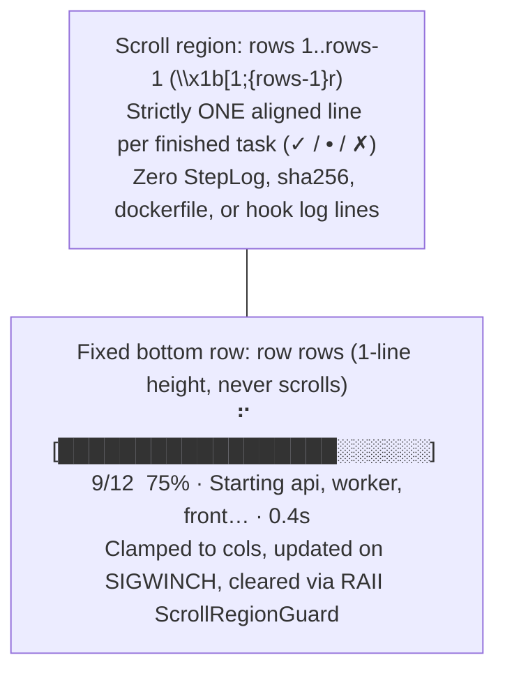

# 02 — The CLI UX

Slipfork runs your cloud environment locally in a box; CI is the clutch. Every command follows four rules: **high signal, aligned visual hierarchy, an `apt`-style fixed 1-line bottom progress bar on interactive terminals, and zero escape noise anywhere else.**

```console
$ slipfork up
• image     backend   cached                     1ms
✓ resource  assets    s3 public-read -> cdn      1ms
✓ resource  cache     redis 7 ready              7ms
✓ resource  pg        postgres 18 ready         38ms
• setup     backend   uv sync (up to date)       0ms
✓ hook      api       pre-deploy                84ms
✓ service   api       listening :8000 -> /api   42ms
✓ service   front     listening :5173 -> /      51ms
✓ Ready -> http://demo.localhost  (218ms)
```

**Semantic ANSI palette (color-capable interactive TTY only):**
- **Green:** `●` active world dot, `✓` completed node, `running` / `listening` state
- **Bold cyan:** clickable `http://*.localhost` URLs; **Bold default:** node/world names
- **Red:** `✗` failed step and failure remedy line, `failed` / `crashed` state; **Yellow:** `!` ephemeral/dirty warnings
- **Dim:** `•` zero-work cache hit, fixed-width node kinds (`8` chars + `2` spaces), paths, ages, and right-aligned durations (`38ms`)

---

## 1. `clap` 4.6 Derive Surface, Completions & Manpage

`clap` `4.6` (`derive`) is the **only** argv parser, flag validator, and `--help` / `--version` renderer in `slipfork`. There are zero hand-rolled argv loops, custom verb tables, or legacy command aliases.

- **Single source of truth:** `clap_complete` generates `slipfork completions <bash|zsh|fish>` and `clap_mangen` generates the packaged `slipfork(1)` roff manpage directly from `Cli::command()`, so `--help`, completions, and `man slipfork` never drift.
- **Dynamic column measurement:** Terminal tables and DAG columns measure visible character width via `console::measure_text_width` (after stripping ANSI escapes, `.max()` across rows) — never shearing long service or fork names with hardcoded `{:<16}` widths.

---

## 2. `slipfork` (Status Tree) & `slipfork ps`

Running bare `slipfork` (alias `slipfork status`) renders every active world on your machine as one clean tree with dynamic columns, real ports and routes, human ages, and nested forks:

```text
● demo  http://demo.localhost  ~/projects/demo
  ├─ api      running      :8000 -> /api          12m
  ├─ worker   running      -                      12m
  ├─ front    running      :5173 -> /             12m
  ├─ mailpit  running      :8025 -> mail.*/       12m
  ├─ pg       postgres 18  :5432                  12m
  ├─ cache    redis 7      :6379                  12m
  ├─ uploads  s3 (private) :8333                  12m
  ├─ assets   s3 + cdn     -> static-cdn.*        12m
  └─ forks
     └─ ● feat-auth  http://feat-auth--demo.localhost  ~/projects/demo/.forks/feat-auth
        ├─ api      running      :8000 -> /api          4m
        ├─ worker   running      -                      4m
        ├─ front    running      :5173 -> /             4m
        ├─ mailpit  running      :8025 -> mail.*/       4m
        ├─ pg       postgres 18  :5432                  4m
        ├─ cache    redis 7      :6379                  4m
        ├─ uploads  s3 (private) :8333                  4m
        └─ assets   s3 + cdn     -> static-cdn.*        4m
```

When nothing is running, `slipfork` prints a dim `○ No worlds running` and exits `0`. `slipfork ps` renders the identical tree scoped to the current directory's world or fork; both accept `--json` (zero ANSI) and `-v` (adds supervisor PID and resource mount details).

---

## 3. Fixed-Bottom-Bar Live TUI (`DECSTBM`) & `down`

On an interactive ANSI TTY (`rows >= 3`), `up`, `restart`, and `fork` establish a **VT100 `DECSTBM` scroll region (`\x1b[1;{rows-1}r`)** in `crates/slipfork/src/boot/` so completed tasks scroll naturally above a fixed 1-line `apt`-style bottom panel on row `rows` (never bouncing height or appearing mid-screen):



**Mid-flight interactive TTY frame (`9` finished rows above `9/12  75%`, `filled = round(done / total * 24) = 18`):**

```text
• image     backend   cached                     1ms
• image     frontend  cached                     1ms
✓ resource  uploads   s3 private                 1ms
✓ resource  assets    s3 public-read -> cdn      1ms
✓ resource  cache     redis 7 ready              8ms
✓ resource  pg        postgres 18 ready         39ms
• setup     backend   uv sync (up to date)       0ms
• setup     frontend  pnpm install (up to date)  0ms
• hook      api       pre-deploy (up to date)    0ms

⠋ [██████████████████░░░░░░]  9/12  75% · Starting api, worker, front… · 0.4s
```

- **24-cell math, `cols < 80` drop order & `rows < 3` guard:** Row `rows` renders `<spinner> [<24-cell bar>]  <done>/<total>  <pct>% · <active summary> · <elapsed>` with `filled = round(done / total * 24)` and `pct = round(done / total * 100)`. Width clamping truncates/drops `· <active summary>` first, omits the 24-cell `[█░]` bar when `cols < 80`, and **never** shears `done/total`, `pct%`, or `elapsed`; when `rows < 3`, `DECSTBM` is a no-op (never emitting `\x1b[1;1r` or `\x1b[1;2r`, using an in-place `\r` line instead).
- **`SIGWINCH` & RAII `ScrollRegionGuard`:** On `SIGWINCH`, `BootTui` re-queries `(cols, rows)`, re-applies `\x1b[1;{rows-1}r` (`rows >= 3`), and redraws row `rows`. `ScrollRegionGuard` always clears row `rows` and restores `\x1b[r` on success, error, panic unwind, and `SIGINT` before printing `✓ Ready -> http://demo.localhost  (218ms)`.
- **Strictly 1 line per task & truthful words:** Zero `StepLog`, `[3/11] sealed sha256:...`, `dockerfile ...`, or hook stdout lines ever print to the terminal — all build, setup, hook, and pod output writes strictly to `<store>/logs/<world>/<id>.log` (`slipfork logs <image|service|resource>`). Cached OCI `from <ref>` images and cached `Dockerfile` images print dim `• image     <name>   cached                    1ms` — **never** `pulled` or `built` on a cache hit.
- **Streamed `slipfork down`:** `down` streams each stopped pod and run-subvolume teardown row (`✓ pod api stopped  40ms`, `✓ removed run subvolumes  312ms`, `✓ Stopped demo (370ms)`) while keeping persistent Btrfs data subvolumes and `<store>/logs/<world>/*.log` intact.

!!! info "Crisp 1-sentence failure remedy & inspectable logs"
    On error, `ScrollRegionGuard` clears row `rows` and restores `\x1b[r`, prints the failed task row, and emits **one** crisp sentence on stderr pointing to `slipfork logs <name>` (which reads `<store>/logs/<world>/<name>.log` even after a failed cold `up`):

```text
✗ image     backend   failed                    84ms
✗ Failed to build image backend — check logs with: slipfork logs backend
```

---

## 4. Sub-Second `< 1.0s` `slipfork fork` & `slipfork drop`

`slipfork fork [name]` clones your project, world data, and PG18 `PGDATA` subvolumes via Btrfs CoW (zero pre-fork SQL `CHECKPOINT`), reuses parent `image` subvolumes (`cached`, `~1ms`), and boots an 8-component stack in **`< 1.0s`**:

```text
✓ Forked feat-auth (310ms) -> http://feat-auth--demo.localhost
  path  ~/projects/demo/.forks/feat-auth
```

Omitting `[name]` derives the slug from the current git branch. `slipfork drop <name>` stops and deletes the fork's snapshots and `<store>/logs/<fork>--<world>/`, refusing dirty checkouts without `-f` / `--force` (`next: slipfork drop <name> -f`).

---

## 5. Unified Real-PTY `slipfork shell <target>`, `logs` & `doctor`

`slipfork shell <target>` is the **only** interactive entry point for every container and data store (no separate database or cache subcommands). `<target>` is **required** (`clap` exits `2` on stderr when omitted) and dispatches by declared `Forkfile` component kind:

| `<target>` Kind | Interactive TTY (`stdin` + `stdout` TTY) | Piped / Non-TTY (`stdin` or `stdout` pipe) |
| :--- | :--- | :--- |
| `service` \| `image` (`api`, `backend`) | Real PTY: `/bin/bash` if in rootfs (`(<world>:<target>) \w$ ` prompt), fallback `/bin/sh` | Piped stdio to `/bin/bash` or `/bin/sh` |
| `postgres` \| `database` (`pg`, `app-db`) | Real PTY: `psql` connected to that database inside the `postgres` container | `psql -X -q -v ON_ERROR_STOP=1` against that database |
| `redis` (`cache`) | Real PTY: `redis-cli` inside the `redis` container | Piped `redis-cli` inside the `redis` container |
| `s3` bucket (`uploads`) | Refused on stderr (`1 line + next:` shellable targets, exit `1`) | Same stderr refusal (exit `1`) |

On interactive TTYs, `crun exec --tty --console-socket <sock>` (`"terminal": true` in the `0600` tmpfs spec) sends the `/dev/pts/N` master fd back via `SCM_RIGHTS`, while a `crossterm` `RawModeGuard` restores cooked mode on `Drop` and forwards initial + `SIGWINCH` `(cols, rows)` via `ioctl(TIOCSWINSZ)`. Targeting an `s3` bucket or unknown `<target>` prints `1 line + next:` on **stderr** (exit `1`):

```text
✗ 'uploads' is an s3 bucket, not a shell
  next: slipfork shell api, pg, cache

✗ No shellable target 'apii'
  next: slipfork shell api
```

`slipfork logs [-f]` streams app `service`s by default (`-a` adds `image`s + resources, or `<target>` reads `<store>/logs/<world>/<id>.log` for one `image`, `service`, or `resource` across `── restarted <id> ──` dividers). `slipfork doctor` leads with `✓ Ready` or `✗ N issue(s)` across `Btrfs`, `Namespaces`, and `Runtime` with one `next:` per failure:

```text
✓ Ready
  ✓ Btrfs       /home is btrfs (subvolume snapshots enabled)
  ✓ Namespaces  unprivileged user + netns available
  ✓ Runtime     crun 1.20, :80 .localhost ingress active
```

| Command | Behavior |
| :--- | :--- |
| `slipfork logs [-f] [-a\|--all] [target]` | App `service`s by default; `-a`/`--all` adds `image`s + resources, or `<target>` reads one `image`, `service`, or `resource` log. |
| `slipfork shell <target>` | Required `<target>`: real-PTY `bash`/`sh` (`service`\|`image`), `psql` (`postgres`\|`database`), `redis-cli` (`redis`); refuses `s3`/unknown on stderr. |
| `slipfork exec [service\|image] -- <cmd>` | Runs an ad-hoc command (`pytest`, `pnpm test`) inside the target container and forwards stdin + exit code. |
| `slipfork restart [service]` | Restarts one or all services in place from their existing rootfs with the `DECSTBM` bottom-bar TUI. |
| `slipfork down` | Streams per-pod stop rows + `removed run subvolumes` while keeping Btrfs data subvolumes and `<store>/logs/<world>/` intact. |
| `slipfork env [--reveal] [component]` | Prints runtime variables (`[REDACTED]` unless `--reveal` on an interactive TTY; refused on pipes). |
| `slipfork secret list\|set\|unset` | Manages local offline secrets (`set` reads stdin without echo). |
| `slipfork open [service]` | Opens the port-less `.localhost` world or route URL (SSH/headless-safe). |
| `slipfork auth [<endpoint-url>]` | Pairs with an `OSPP v1` endpoint (`--ospp-endpoint` > positional > `<state_dir>/ospp.json`). |
| `slipfork daemon install [--ingress]` | User unit without `sudo`; `--ingress` installs the system `:80` socket + AppArmor profile under `sudo`. |
| `slipfork fmt [--check]` / `migrate` | Formats `Forkfile` canonically / migrates legacy `snow.yml` -> `# forkfile: 0.1` `Forkfile`. |
| `slipfork completions <bash\|zsh\|fish>` | Emits `clap_complete` scripts from `Cli::command()`; `clap_mangen` builds `slipfork(1)`. |

---

## 6. Terminal Gate Split & `--json` Schemas

- **Four-mode `UiMode` split:** `ColorTty` uses the VT100 `DECSTBM` (`\x1b[1;{rows-1}r`) scroll region + row `rows` panel (`ScrollRegionGuard`, falling back to `\r` when `rows < 3`); `AsciiTty` (TTY with `NO_COLOR` or `TERM=dumb`) redraws one `\r`-rewritten plain-ASCII bottom line (`|/-\` spinner, 24-cell `[#.]` bar when `cols >= 80`, **zero `\x1b[` bytes** and zero SGR); `PlainPipe` (non-TTY) emits `→ [i/n] <kind> <name>` headers + `✓`/`•` rows (`0` `\r` and `0` `\x1b[`); `Json` emits pure JSON (`0` `\x1b[`).
- **Exact `--json` payloads (on verbs that accept `--json`):** `up` / `restart` → `{world, url, elapsed_ms, nodes:[{kind, name, state, duration_ms}]}`; `down` → `{world, elapsed_ms}`; `fork` → `{fork, project, url, elapsed_ms}`; `drop` → `{dropped, elapsed_ms}`; `doctor` → `{ready, checks:[{name, ok, detail, next?}]}`; `status` / `ps` → `{worlds:[...]}`; `logs` → `{pod, stream, line, kind}` lines + `{"exit":0}`; `env` → `{env:{...}}`; failures → `{"error":{code, message, next}}`. Auto-starting an ephemeral daemon warns on stderr naming `slipfork daemon install` and `sudo slipfork daemon install --ingress`.
