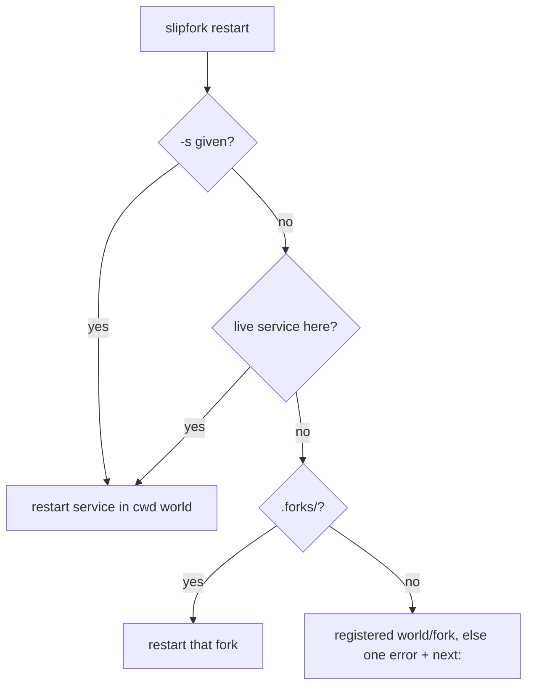
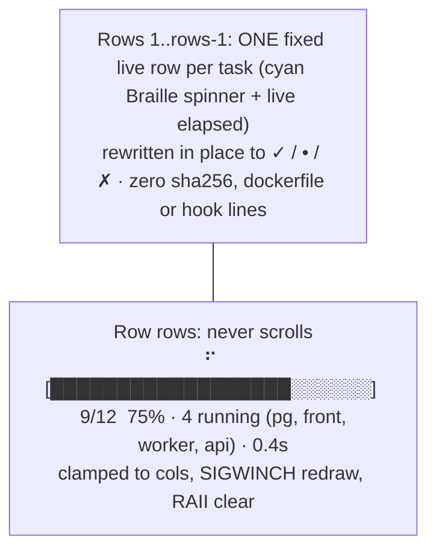

# 02 — The CLI UX

Slipfork runs your cloud environment locally in a box; CI is the clutch. One `clap` tree owns argv, one domain tree renders state, and every failure ends in one `next:` command.

```console
$ slipfork up
✓ Ready -> http://acme-shop.localhost

$ slipfork restart -s worker
✓ Restarted worker

$ slipfork ps
● acme-shop  ~/projects/acme-shop
  http://acme-shop.localhost
    /api  -> web      service              running
  support
    worker  service       running
    pg      postgres 18   running
```

**Semantic palette (interactive colour TTY only):** green `●`/`✓`/`running`/`ready`; cyan `cached` and `up to date`; yellow `built`, `pulled` and `orphaned`; bold red `✗`, `failed` and `stopped`; bold cyan underlined URLs; bold green copyable commands; dim paths, stopped forks and prose.

## 1. `clap` surface, completions and manpage

`clap` (`derive`) is the only argv parser, flag validator and help renderer; there are zero hand-rolled argv loops or legacy aliases. `up`, `down` and `restart` take one optional positional `[TARGET]`, and `restart` adds `-s/--service <SERVICE>`.

`clap_complete` generates `slipfork completions <bash|zsh|fish>` at runtime from the same `Cli::command()`; no completion file is checked in. `clap_mangen` generates the packaged `slipfork(1)` from that same tree, so help, completions and manpage never drift.

## 2. Target resolution for `up`, `down` and `restart`

Resolution is deterministic and happens before any daemon mutation.

| Verb | Usage | No target | Bare target resolution |
| :--- | :--- | :--- | :--- |
| `up` | `slipfork up [TARGET]` | this directory's `Forkfile` | `.forks/<name>` under cwd, then a registered world/fork |
| `down` | `slipfork down [TARGET]` | this directory's world | `.forks/<name>` under cwd, then a registered world/fork |
| `restart` | `slipfork restart [TARGET] [-s SERVICE]` | every service here | a live service here, then `.forks/<name>`, then a world/fork |

Resolution order for a bare target:

1. **Service of this directory's live world:** `restart` only, matching a declared or live service id.
2. **Local fork checkout:** `<cwd>/.forks/<TARGET>` when that directory exists.
3. **Registered world or fork:** an exact project match, then a unique registry name.

`restart -s <SERVICE>` / `--service <SERVICE>` always names a service, never a world. A bare target that matches a service in this directory's live world restarts that service; anything else resolves as a world or fork. With no target, `restart` restarts every service in this directory's world.



`up` preflights this directory and a `<cwd>/.forks/<name>` checkout: it reads and compiles that `Forkfile` before contacting the daemon, so an invalid file fails in one line without booting or stopping anything. A registered world or fork is resolved through the daemon's `ps` first.

!!! warning "Worlds and forks are positional"

    There is no world flag and no deprecated alias. `-s` is reserved for services (`slipfork restart -s worker`); a world or fork is named as the positional target (`slipfork down feat-auth`).

## 3. `status` and `ps`: flat worlds, honest rows

Worlds are **flat**: one header per world, a blank line between worlds, and no ports or uptime ages in human output. Every domain has the same shape — its URL, then `<path>  -> <target>  <kind>  <status>`:

```text
● demo  ~/demo
  http://demo.localhost
    /     -> web      service              running
    /api  -> api      service              running
  http://uploads.demo.localhost
    /     -> uploads  s3 (private)         running
  support
    worker  service       running
    pg      postgres 18   running
  ○ feat-auth  ~/demo/.forks/feat-auth  stopped
```

A non-default route mode is the only suffix: `(strip-prefix)`, `(rewrite /v1)` or `(exact)`. `support` holds workers and resources; `--json` keeps `state` (`live`/`stopped`), `port`, `started_at_ms`, `url`, `routes` (each `{prefix, port, mode, domain?}`, where `domain` is the declared `domain <id>`), `orphaned` and `stopped_forks` for automation.

A `stopped_forks[]` entry is stopped by membership alone — no duplicate boolean rides on it — and a stopped row carries no `supervisor_pid` or `started_at_ms`.

When state cannot be honest, `ps` names the one real problem instead of inventing rows:

| Situation | Row |
| :--- | :--- |
| Stopped fork still on disk | dim `○ <fork>  ~/demo/.forks/<fork>  stopped` |
| Stopped root world still on disk | dim `○ <world>  ~/<world>  stopped` (its `.forks` family stays visible) |
| Fork checkout vanished | `! checkout missing — run \`slipfork drop <fork>\`` |
| World checkout vanished | `! checkout missing — restore it or run \`slipfork down <world>\`` |
| Uncompilable or missing `Forkfile` | `! Forkfile invalid: <line>:<col>: <message>` |

A `!` row sits directly under its world header. Live pods keep their `running` rows and no `orphaned` row is fabricated. A stopped fork row is directly usable with `slipfork up <fork>` or `slipfork drop <fork>`.

A project root keeps its whole family visible after `slipfork down`: the root row becomes a dim `○ demo  ~/demo  stopped`, every stopped `.forks/*` sibling prints the same dim row, and every running fork keeps its `●` header (even when the daemon was restarted without the root). Inside `~/demo/.forks/<fork>`, `ps` scopes strictly to that one fork, running or stopped.

`orphaned` (yellow) appears only after a successful recompile that no longer declares a live pod, and the next `up` clears it. Bare `slipfork` is `status`; with nothing running it prints a dim `○ No worlds running` and exits `0`.

## 4. `up` reconciliation and the `DECSTBM` bottom bar

Repeating `slipfork up` is idempotent (`0ms`) only when the `Forkfile` content digest and feature set are unchanged. After an edit it reconciles: pods no longer declared stop and show `orphaned` until then, and added or changed services boot.

On an interactive ANSI TTY with `rows >= 3`, `up`, `restart` and `fork` establish a VT100 scroll region (`\x1b[1;{rows-1}r`); finished tasks scroll above a one-line `apt`-style panel on row `rows`.



- **Six-column rows:** icon, kind, name, state, duration (right, `>= 6`), and the `#run_id` slot
  (left, `>= 7`, reserved for a later release and empty today).
- **`plan` frame first:** before the first `started`, the supervisor announces
  `{"event":"plan","rows":[{"kind","name"}…],"total":N}` for every step it will run; `fork` prepends
  its `snapshot` and `branch <name>` rows and `down` announces every known pod plus its final
  `removed run subvolumes` row. The CLI measures all six columns from that one frame, so a later
  long name or `up to date` state never shifts a row already printed.
- **One fixed slot per task:** a `started` row allocates its own line immediately and spins there;
  `finished`/`up-to-date`/`failed` rewrites that same slot. A full region scrolls one line and the
  top task leaves it — no other row moves.
- **Counter math:** `filled = round(done / total * 24)`, `pct = round(done / total * 100)`, rendered
  as `<spinner> [<24 cells>]  <done>/<total>  <pct>% · <active summary> · <elapsed>`; the active
  summary is `Starting <name>…` for one task and `N running (<a>, <b>, …)` for several.
- **Flow cursor and resize:** finished rows advance through a real 2D VT100 grid, so the prompt returns to the row the shell expects; `SIGWINCH` re-queries `(cols, rows)`, re-applies the region and redraws.
- **Narrow and short terminals:** below `cols < 80` the bar is omitted, then `· <summary>`; `done/total`, `pct%` and `elapsed` are never sheared. With `rows < 3` the panel rewrites one line with `\r`.
- **Truthful rows, zero log spam:** all build, setup, hook and pod output goes to `<store>/logs/<world>/<id>.log`, read with `slipfork logs <id>`; a cache hit prints `cached`, and every step that really executes mints a dim `#run_id` in the reserved last column (see §6).

A successful `up` ends at `✓ Ready -> <url>` with no trailing reminder line. A RAII guard clears row `rows` and restores `\x1b[r` on success, error, panic and `SIGINT`; `down` streams one stop row per pod plus `removed run subvolumes`, keeping data subvolumes and logs.

On error the guard clears the panel, restores the screen, prints the failed row and one stderr sentence pointing at the log:

```text
✗ image     backend   failed                    84ms
  Forkfile:12: `RUN pnpm run build` failed: `crun` exited with code 1
  next: fix the `RUN` command above, then rerun `slipfork up`
✗ Failed to build image backend — check logs with: slipfork logs backend
```

The indented detail rows carry the `Forkfile:<line>:` context the daemon reported and exactly one
`next:` remedy (`next:` dim, the command bold), so a failure never ends in prose.

`NO_COLOR`, `TERM=dumb` and pipes emit zero `\x1b[` bytes and zero SGR; the ASCII path uses `\r` only and `--json` is pure JSON.

## 5. Two-tier `fork` and `drop`

`slipfork fork [name]` CoW-snapshots your checkout and world data (`snapshot_ms` measures `~150–365ms`, asserted `< 500ms`) and reuses parent image subvolumes (`cached`, ~1 ms); omitting `[name]` derives the slug from the current git branch.

The fork then boots the ordinary `up` path, so the real FastAPI (`uvicorn --reload`) + SvelteKit (`vite dev`) stack reaches all 8 components ready and its first `200 OK` at a median `~5.5s` on the 4-vCPU dev VM, asserted `< 8.0s` on 2-vCPU CI runners. That ceiling measures `uvicorn` first-request transforms and `vite dev` SSR, not Slipfork's clone; a warm fork prints `cached` images and `up to date` setup/hooks and re-runs nothing.

A failed `fork` rolls back atomically: it stops its supervisor and pods and drops the registry entry before unlinking snapshots, so no half-booted fork survives. `slipfork drop <name>` stops the fork and deletes its project, data and log snapshots, refusing a dirty checkout without `-f`.

## 6. Unified real-PTY `shell`, `logs`, `doctor` and the daily verbs

`slipfork shell <target>` is the only interactive entry point for every pod. `<target>` is required (`clap` exits `2` on stderr when omitted) and dispatches by declared kind: services and images get a real PTY `/bin/bash` (prompt `(<world>:<target>) \w$ `) or `/bin/sh`, postgres gets `psql`, redis gets `redis-cli`, and `s3` buckets are refused on stderr with exit `1`.

`slipfork logs [-f] [-a] [target]` merges application `service`s by default; `-a` adds images and resources, and naming one target reads `<store>/logs/<world>/<id>.log`, including an `image` build log after a failed cold `up`. `slipfork doctor` leads with `✓ Ready` or `✗ N issue(s)` across its four shipped rows `Storage`, `Containers`, `Daemon` and `Domains`.

### Per-step run ids

Every step that executes work (`image` `built`/`pulled`, `setup`, and every `hook`) mints one 6-character lowercase hex `run_id`, streams that step's stdout and stderr into `<store>/logs/<world>/runs/<run_id>.log` with its `<run_id>.idx` companion, and appends one `{run_id, ts_ms, kind, name, command, state, duration_ms}` line to `runs/index.jsonl`. `runs/last` and `runs/last-failed` point at the newest id. A `cached`/`up to date` step ran zero commands, so it mints no id and writes no run files; long-lived services keep `<store>/logs/<world>/<service>.log`.

The boot row reserves its last seven cells for a dim `#id`:

```text
✓ image     backend          built      4.1s  #b7f2a1
✓ setup     backend          ready      812ms
```

A failure names the exact replay command, one `✗` per line:

```text
✗ Failed to run setup 'uv sync' (backend) — check logs with: slipfork logs -r c91e04
```

`slipfork logs -r <id>` accepts `c91e04`, `#c91e04`, `last`, or `failed`, replays the run log cleanly through the indexed reader, and honours `--since`/`--until`/`-t`/`--json` exactly like service logs. `slipfork logs --runs` prints the catalog as a borderless table, so any past id can be found:

```text
#run_id  kind   step               status  duration  recorded
#b7f2a1  image  backend            built      4.1s  2026-11-22 23:09:12
#c91e04  setup  backend uv sync    failed      84ms  2026-11-22 23:10:03
```

Both render zero `\x1b[` bytes under `NO_COLOR`, a pipe, or `--json`.

| Command | Behaviour |
| :--- | :--- |
| `slipfork up [TARGET]` | Boot this directory, a `.forks/<name>` checkout, or a registered world/fork; preflight that `Forkfile` first |
| `slipfork down [TARGET]` | Stop this directory's world or the named world/fork; remove run subvolumes, keep data and logs |
| `slipfork restart [TARGET] [-s SERVICE]` | Restart one service, a world/fork, or every service here through the bottom-bar TUI |
| `slipfork logs [-f] [-a] [-t] [--since <ms>] [--until <ms>] [targets]...` | Services by default; `-a` adds images and resources; several targets merge in timestamp order |
| `slipfork logs -r <id>\|last\|failed` | Replay one recorded step run (`#<id>` accepted), honouring `--since`/`--until`/`-t`/`--json` |
| `slipfork logs --runs` | Borderless `#run_id`, kind, step, status, duration, recorded table of every executed step |
| `slipfork shell <target>` | Required target: PTY bash/sh, `psql`, `redis-cli`; refuses `s3` and unknowns |
| `slipfork exec [service\|image] -- <cmd>` | Ad-hoc command inside the target with a real PTY on a terminal; exit code forwarded |

`slipfork exec` allocates a real kernel PTY whenever stdin and stdout are terminals and `--json` is off, so `ipython`, `bash`, `psql`, and coloured progress bars keep their prompts and line editing. `-i` requires both terminals and fails closed without them; `--no-interactive` keeps a plain pipe so prompts see immediate EOF while piped stdin still streams.

The relay forwards the child's own escapes untouched; only Slipfork's own output obeys `NO_COLOR`.

```bash
slipfork exec api -- uv run ipython            # interactive REPL on a real PTY
echo 'select 1;' | slipfork exec pg -- psql -tA   # piped stdin still streams
slipfork exec --no-interactive api -- python3 -c 'import sys; print(sys.stdin.isatty())'  # False
```

### Features

`dev` is built in and active for every `up`, `fork` and `env`. `slipfork features` prints the resolved set with what each group implies, and persists edits for the next boot.

| Form | Effect |
| :--- | :--- |
| `slipfork features` | Resolved features and `IMPLIES`; no write |
| `slipfork features +mail` / `-dev` | Persist one ordered edit |
| `slipfork features enable <f>...` / `disable <f>...` / `reset` | Persist named changes; `reset` restores the built-in default |

`up`, `fork` and `env` accept `-F/--features` (`mail`, `+mail`, `-dev`, comma lists) and `--no-default-features` to start from an empty base. `up` and `fork` write the result to `.slipfork/features.json`; `env` evaluates only. A fork inherits its parent's `.slipfork/features.json`, so `slipfork fork prod-check -F -dev` boots the production shape.

With `dev` active Slipfork bind-mounts the live checkout at `/project`, so `uvicorn --reload` and `vite dev` see every save. With `dev` off (`-F -dev` or `--no-default-features`) nothing is bound and Slipfork runs the image's native `ENTRYPOINT`/`CMD` on the declared ports — built assets, no `else` branch required.

## 7. Terminal gate split and `--json`

- **Modes:** colour TTY uses the `DECSTBM` region and panel; ASCII TTY rewrites one `\r` plain line with zero `\x1b[`; a pipe emits `→ [i/n] kind name` headers plus `✓`/`•` rows; `--json` is pure JSON.
- **Plan frame:** `up`, `restart` and `fork` stream `{"event":"plan","rows":[{"kind","name"}…],"total":N}`
  before the first `started`; `--json` forwards it verbatim (extra keys are forward-compatible) with
  zero escapes. `down` carries the same frame on its event stream and still answers one final object.
- **Payloads:** `up`/`restart` → `{world, url, elapsed_ms, nodes:[{kind,name,state,duration_ms}]}`; `down` → `{world, elapsed_ms}`; `fork` → `{fork, world, project, url, elapsed_ms, snapshot_ms}`; `drop` → `{dropped, elapsed_ms}`; `doctor` → `{ready, checks:[{name,ok,detail,next?}]}`; `status`/`ps` → `{worlds:[...]}` including `state` (`live`/`stopped`), `port`, `started_at_ms`, `url`, `routes` (each `{prefix, port, mode, domain?}`), `orphaned` and `stopped_forks` (membership means stopped; stopped rows omit `supervisor_pid`/`started_at_ms`); failures → `{"error":{code,message,next}}`.
- **Ephemeral daemon:** auto-start warns once on stderr; distribution packages installed with
  `sudo` enable and start the per-user unit and the `:80` socket for the installing user, so the
  fallback appears only on tarball, headless, or rootless installs.
