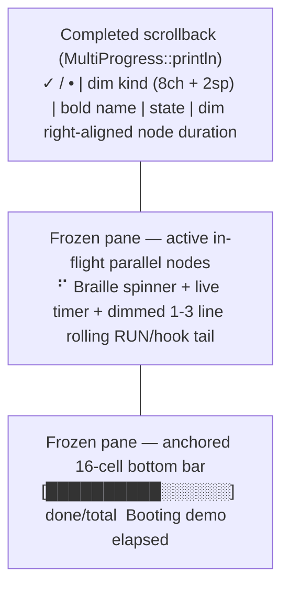

# 02 — The CLI UX

Slipfork runs your cloud environment locally in a box; CI is the clutch. Every command follows four rules: **high signal, aligned visual hierarchy, live bottom-anchored progress on interactive terminals, and zero escape noise anywhere else.**

```console
$ slipfork up
• image     backend   cached                     1ms
✓ resource  assets    s3 public-read -> cdn      1ms
✓ resource  cache     redis 7 ready              7ms
✓ resource  pg        postgres 18 ready         38ms
• setup     backend   uv sync (up to date)       0ms
✓ hook      api       pre-deploy                84ms
✓ service   api       listening :8000 -> /api   42ms
✓ service   front     listening :5173 -> /      51ms
✓ Ready -> http://demo.localhost  (218ms)
```

**Semantic ANSI palette (color-capable interactive TTY only):**
- **Green:** `●` active world dot, `✓` completed node, `running` / `listening` state
- **Bold cyan:** clickable `http://*.localhost` URLs; **Bold default:** node/world names
- **Red:** `✗` failed step, `failed` / `crashed` state; **Yellow:** `!` ephemeral/dirty warnings
- **Dim:** `•` zero-work cache hit, fixed-width node kinds (`8` chars + `2` spaces), paths, ages, rolling log tails, and right-aligned durations (`38ms`)

---

## 1. `clap` 4.6 Derive Surface, Completions & Manpage

`clap` `4.6` (`derive`) is the **only** argv parser, flag validator, and `--help` / `--version` renderer in `slipfork`. There are zero hand-rolled argv loops, custom verb tables, or hand-templated docs.

- **Single source of truth:** `clap_complete` generates `slipfork completions <bash|zsh|fish>` and `clap_mangen` generates the packaged `slipfork(1)` roff manpage directly from `Cli::command()`, so `--help`, shell completions, and `man slipfork` never drift.
- **Dynamic column measurement:** Terminal tables and DAG columns measure visible character width via `console::measure_text_width` (after stripping ANSI escapes, `.max()` across rows) — never shearing long service or fork names with hardcoded `{:<16}` widths.

---

## 2. `slipfork` (Status Tree) & `slipfork ps`

Running bare `slipfork` (alias `slipfork status`) renders every active world on your machine as one clean tree with dynamic columns, real ports and routes, human ages, and nested forks:

```text
● demo  http://demo.localhost  ~/projects/demo
  ├─ api      running      :8000 -> /api          12m
  ├─ worker   running      -                      12m
  ├─ front    running      :5173 -> /             12m
  ├─ mailpit  running      :8025 -> mail.*/       12m
  ├─ pg       postgres 18  :5432                  12m
  ├─ cache    redis 7      :6379                  12m
  ├─ uploads  s3 (private) :8333                  12m
  ├─ assets   s3 + cdn     -> static-cdn.*        12m
  └─ forks
     └─ ● feat-auth  http://feat-auth--demo.localhost  ~/projects/demo/.forks/feat-auth
        ├─ api      running      :8000 -> /api          4m
        ├─ worker   running      -                      4m
        ├─ front    running      :5173 -> /             4m
        ├─ mailpit  running      :8025 -> mail.*/       4m
        ├─ pg       postgres 18  :5432                  4m
        ├─ cache    redis 7      :6379                  4m
        ├─ uploads  s3 (private) :8333                  4m
        └─ assets   s3 + cdn     -> static-cdn.*        4m
```

When nothing is running, `slipfork` prints a dim `○ No worlds running` and exits `0`. `slipfork ps` renders the identical tree scoped to the current directory's world or fork; both accept `--json` (zero ANSI) and `-v` (adds supervisor PID and resource mount details).

---

## 3. Frozen-Bottom-Pane Live TUI (`up`, `restart`, `fork`) & `down`

On an interactive TTY, `up`, `restart`, and `fork` drive an `indicatif::MultiProgress` **frozen bottom pane** while completed DAG nodes pop permanently above it via `MultiProgress::println`:



**Mid-flight interactive TTY frame (parallel build + hook in progress):**

```text
✓ resource  uploads   s3 private                1ms
✓ resource  assets    s3 public-read -> cdn     1ms
✓ resource  cache     redis 7 ready             8ms
✓ resource  pg        postgres 18 ready        39ms
• image     backend   cached                    1ms
• setup     backend   uv sync (up to date)      0ms
⠋ image     frontend  building stage dev       1.2s
  │ [3/5] RUN pnpm fetch --frozen-lockfile
  │ Progress: resolved 412, reused 410, downloaded 2
⠹ hook      api       pre-deploy               0.2s
  │ INFO  [alembic.runtime.migration] Running upgrade -> 9c41a2b0
[██████████░░░░░░] 6/10  Booting demo  1.2s
```

- **Pinned frame geometry:** `done` counts popped rows (`6`), `total` is total DAG nodes (`10`), the kind column is `8` visible chars + `2` trailing spaces (`10` cols after `✓ `/`• `/`⠋ `), and the anchored bar is `16` cells (`[██████████░░░░░░]`). Terminals narrower than `48` columns omit the 16-cell bracket bar and render `6/10  Booting demo  1.2s`.
- **Opaque-free tails & non-TTY replay:** Active spinners show up to 3 dimmed rolling `RUN`/hook lines clamped via `console::truncate_str` before clearing on `✓ Ready -> http://demo.localhost  (218ms)`. On non-TTY stdout/stderr, the bar is suppressed (`ProgressDrawTarget::hidden()`) and Slipfork streams `→ [i/n] <kind> <name>` phase headers plus one `eprintln!("✓ <kind> <name> <state>  <dur>")` per popped node (`•` when cached/up to date).
- **Streamed `slipfork down`:** `down` streams each stopped pod and run-subvolume teardown row while keeping persistent Btrfs data subvolumes intact:

```console
$ slipfork down
✓ pod api stopped           40ms
✓ pod worker stopped        18ms
✓ removed run subvolumes   312ms
✓ Stopped demo (370ms)
```

!!! info "Failure keeps the world inspectable"
    If a setup step, hook, or service fails, the frozen pane clears, Slipfork prints `✗ <kind> <name>`, `Forkfile:<line>`, `error: ...`, and **one** `next:` remedy, and keeps surviving pods registered so `slipfork logs` and `slipfork down` work immediately.

---

## 4. Sub-Second `slipfork fork` & `slipfork drop`

`slipfork fork [name]` snapshots your project subvolume, world data subvolume, and PG18 `PGDATA` subvolume via Btrfs CoW, verifies matching `world_epoch` stamps (`0` image rebuilds, `0` redundant hooks), and boots the full fork stack in **`< 500ms`** (`< 1.0s` ceiling):

```text
✓ Forked feat-auth (310ms) -> http://feat-auth--demo.localhost
  path  ~/projects/demo/.forks/feat-auth
```

When `[name]` is omitted, `fork` derives the normalized slug from the current git branch (creating the branch on the snapshot if needed). `slipfork drop <name>` stops and deletes the fork's snapshots, refusing dirty checkouts without `-f` / `--force` (`next: slipfork drop <name> -f`).

---

## 5. Daily Developer Commands & `doctor`

`slipfork logs [-f]` streams **application `service`s only by default**; pass `-a` / `--all` (or an explicit `<resource>` like `slipfork logs pg`) to include backing resources:

```text
api    │ INFO:     Uvicorn running on http://0.0.0.0:8000
worker │ [2026-11-21 14:21:04] celery@demo ready.
       ── restarted api (14:22:09) ──
api    │ INFO:     Application startup complete.
```

`slipfork doctor` leads with `✓ Ready` or `✗ N issue(s)` across the **only 3 host checks** (`Btrfs`, `Namespaces`, `Runtime`), attaching one `next:` remedy per failing row (AppArmor stays inside `Namespaces`):

```text
✓ Ready
  ✓ Btrfs       /home is btrfs (subvolume snapshots enabled)
  ✓ Namespaces  unprivileged user + netns available
  ✓ Runtime     crun 1.20, :80 .localhost ingress active

✗ 2 issue(s)
  ✓ Btrfs       /home is btrfs (subvolume snapshots enabled)
  ✗ Namespaces  unprivileged user + netns unavailable
     next: sudo sysctl -w kernel.unprivileged_userns_clone=1
  ✗ Runtime     crun is not on PATH
     next: install crun (for example `sudo apt-get install crun`) and retry
```

| Command | Behavior |
| :--- | :--- |
| `slipfork logs [-f] [-a\|--all] [target]` | App `service`s only by default; `-a`/`--all` adds resources, or `<target>` selects one pod. Stays attached across `restart`. |
| `slipfork restart [service]` | Restarts one or all services in place from their existing rootfs with the frozen-pane TUI. |
| `slipfork down` | Streams per-pod stop rows + `removed run subvolumes` while keeping Btrfs data subvolumes intact. |
| `slipfork exec [service\|image] -- <cmd>` | Runs an ad-hoc command (`pytest`, `pnpm test`) inside the target container and forwards stdin + exit code. |
| `slipfork shell [service\|image]` | Pipes stdio to `sh -i` inside the target container (`user`, `workdir`, runtime `env`; no PTY allocated). |
| `slipfork db [database]` / `redis [id]` | Opens `psql` (or runs piped SQL) / `redis-cli` against the world's instance; auto-selects when unambiguous. |
| `slipfork env [--reveal] [component]` | Prints runtime variables (`[REDACTED]` unless `--reveal` on an interactive TTY; refused on pipes). |
| `slipfork secret list\|set\|unset` | Manages local offline secrets (`set` reads stdin without echo). |
| `slipfork open [service]` | Opens the port-less `.localhost` world or route URL (SSH/headless-safe). |
| `slipfork auth [<endpoint-url>]` | Pairs with an `OSPP v1` endpoint (`--ospp-endpoint` > positional > `<state_dir>/ospp.json`). |
| `slipfork daemon install [--ingress]` | User unit without `sudo`; `--ingress` installs the system `:80` socket + AppArmor profile under `sudo`. |
| `slipfork fmt [--check]` / `migrate` | Formats `Forkfile` canonically / migrates legacy `snow.yml` -> `# forkfile: 0.1` `Forkfile`. |
| `slipfork completions <bash\|zsh\|fish>` | Emits `clap_complete` scripts from `Cli::command()`; `clap_mangen` builds `slipfork(1)`. |

---

## 6. Terminal Gate Split & `--json` Schemas

- **Split TTY vs color gates:** On an interactive TTY with `NO_COLOR` set or `TERM=dumb`, Slipfork **keeps the frozen bottom pane in plain ASCII** (`|/-\` spinner, `[##########......]` 16-cell bar, zero SGR and zero `\x1b[` bytes). `ProgressDrawTarget::hidden()` activates **only** when stdout/stderr is non-TTY (using the `→ [i/n]` + `eprintln!` replay path, zero `\r` and zero `\x1b[`) or when `--json` is passed.
- **Exact `--json` payloads (on verbs that accept `--json`):** `up` / `restart` → `{world, url, elapsed_ms, nodes:[{kind, name, state, duration_ms}]}`; `down` → `{world, elapsed_ms}`; `fork` → `{fork, project, url, elapsed_ms}`; `drop` → `{dropped, elapsed_ms}`; `doctor` → `{ready, checks:[{name, ok, detail, next?}]}`; `status` / `ps` → `{worlds:[...]}`; `logs` → `{pod, stream, line, kind}` lines + `{"exit":0}`; `env` → `{env:{...}}`; failures → `{"error":{code, message, next}}`. Auto-starting an ephemeral daemon warns on stderr naming `slipfork daemon install` and `sudo slipfork daemon install --ingress`.
