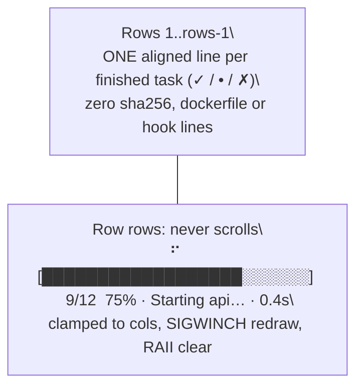

# 02 — The CLI UX

Slipfork runs your cloud environment locally in a box; CI is the clutch. Every command follows four rules: **high signal, an aligned domain tree, an `apt`-style fixed one-line bottom bar on interactive terminals, and zero escape noise anywhere else.**

```console
$ slipfork up
• image     backend   cached                     1ms
✓ resource  pg        postgres 18 ready         38ms
✓ setup     backend   uv sync (up to date)       0ms
✓ service   api       running -> /api           42ms
✓ Ready -> http://demo.localhost  (218ms)
```

**Semantic palette (interactive colour TTY only):** green `●`/`✓`/`running`/`ready`; cyan `cached` and `up to date`; yellow `built`, `pulled` and `orphaned`; bold red `✗`, `failed` and `stopped`; bold cyan underlined URLs; bold green copyable commands; dim paths and prose.

## 1. `clap` 4.6 derive surface, completions and manpage

`clap` (`derive`) is the only argv parser, flag validator and help renderer; there are zero hand-rolled argv loops, custom verb tables or legacy aliases. `clap_complete` generates `slipfork completions <bash|zsh|fish>` and `clap_mangen` generates the packaged `slipfork(1)` from the same `Cli::command()`, so help, completions and the manpage never drift. Tables measure visible width after stripping ANSI, so a long id never shears the tree.

## 2. `slipfork`, `ps` and `up` reconciliation

Worlds are **flat**: one header per world, a blank line between worlds, and no ports or uptime ages in human output. The second level is the domain, and every domain has the same shape — its URL, then `<path>  -> <target>  <kind>  <status>`:

```text
● demo  ~/demo
  http://demo.localhost
    /     -> web      service              running
    /api  -> api      service              running
  http://uploads.demo.localhost
    /     -> uploads  s3 (private)         running
  http://assets.demo.localhost
    /     -> assets   s3 (public-read)     running
  support
    worker  service       running
    pg      postgres 18   running
    cache   redis 7       running

● feat-auth  ~/demo/.forks/feat-auth
  http://feat-auth--demo.localhost
    /     -> web      service              running
  http://uploads.feat-auth--demo.localhost
    /     -> uploads  s3 (private)         running
  support
    pg      postgres 18   running
```

A non-default route mode is the only suffix: `(strip-prefix)`, `(rewrite /v1)` or `(exact)`. `support` holds workers, resources and orphaned pods (yellow). `--json` keeps `port`, `started_at_ms`, `url`, `routes` and `orphaned` for automation.

`slipfork ps` renders the same tree scoped to this directory's world or fork. Bare `slipfork` is `status`; with nothing running it prints a dim `○ No worlds running` and exits `0`.

Repeating `slipfork up` is idempotent (`0ms`) only when the `Forkfile` content digest and feature set are unchanged. After an edit it reconciles: pods no longer declared stop and show `orphaned` in `ps` until then, and added or changed services boot.

| State | Meaning | `next:` |
| :--- | :--- | :--- |
| `running` | pod is alive and serving | `slipfork logs <id>` |
| `stopped` | declared but not running | `slipfork up` |
| `cached` | image or step resolved from cache, no rebuild | `slipfork logs <id>` |
| `up to date` | `when changed()` stamp matched, skipped in under 1 ms | `slipfork up` |
| `orphaned` | pod is no longer declared after a `Forkfile` edit (yellow) | `slipfork up` |

## 3. Fixed-bottom-bar TUI (`DECSTBM`)

On an interactive ANSI TTY with `rows >= 3`, `up`, `restart` and `fork` establish a VT100 scroll region (`\x1b[1;{rows-1}r`); finished tasks scroll above a one-line `apt`-style panel on row `rows`.



- **Counter math:** `filled = round(done / total * 24)`, `pct = round(done / total * 100)`, rendered as `<spinner> [<24 cells>]  <done>/<total>  <pct>% · <active summary> · <elapsed>`.
- **Narrow and short terminals:** below `cols < 80` the bar is omitted, then `· <summary>`; `done/total`, `pct%` and `elapsed` are never sheared. With `rows < 3` the region is a no-op and the panel rewrites one line with `\r`.
- **Resize and cleanup:** `SIGWINCH` re-queries `(cols, rows)`, re-applies the region and redraws; a RAII guard clears row `rows` and restores `\x1b[r` on success, error, panic and `SIGINT`.
- **Truthful rows, zero log spam:** all build, setup, hook and pod output goes to `<store>/logs/<world>/<id>.log`, read with `slipfork logs <id>`. A cache hit prints `cached`, never `pulled` or `built`.
- **`down`:** streams one stop row per pod plus `removed run subvolumes`, keeping data subvolumes and logs intact.

!!! info "One crisp failure line"

    On error the guard clears the panel, restores the screen, prints the failed row and one stderr sentence pointing at the log:

```text
✗ image     backend   failed                    84ms
✗ Failed to build image backend — check logs with: slipfork logs backend
```

`NO_COLOR`, `TERM=dumb` and pipes emit zero `\x1b[` bytes and zero SGR; the ASCII path uses `\r` only and `--json` is pure JSON.

## 4. Sub-second `fork` and `drop`

`slipfork fork [name]` CoW-snapshots your checkout and world data, reuses parent image subvolumes (`cached`, ~1 ms) and boots the fork in under 1.0s. Omitting `[name]` derives the slug from the current git branch.

```text
✓ Forked feat-auth (310ms) -> http://feat-auth--demo.localhost
  path  ~/projects/demo/.forks/feat-auth
```

`slipfork drop <name>` stops the fork and deletes its project, data and log snapshots, refusing a dirty checkout without `-f`.

## 5. Unified real-PTY `shell`, `logs` and `doctor`

`slipfork shell <target>` is the only interactive entry point for every pod. `<target>` is required (`clap` exits `2` on stderr when omitted) and dispatches by declared kind:

| `<target>` kind | Interactive TTY | Piped |
| :--- | :--- | :--- |
| `service` \| `image` (`api`) | real PTY, `/bin/bash` when present (prompt `(<world>:<target>) \w$ `), else `/bin/sh` | stdio to bash/sh |
| `postgres` \| `database` (`pg`, `app_db`) | real PTY `psql` on that database | `psql -X -q -v ON_ERROR_STOP=1` |
| `redis` (`cache`) | real PTY `redis-cli` | piped `redis-cli` |
| `s3` bucket (`uploads`) | refused on stderr, exit `1` | same refusal |

On a TTY, `crun exec --tty --console-socket <sock>` returns the `/dev/pts/N` master via `SCM_RIGHTS`; a `crossterm` raw-mode guard restores cooked mode on `Drop`, and initial + `SIGWINCH` sizes go through `ioctl(TIOCSWINSZ)`. Refusals are one line plus one `next:`:

```text
✗ 'uploads' is an s3 bucket, not a shell
  next: slipfork shell api, pg, cache

✗ No shellable target 'apii'
  next: slipfork shell api
```

`slipfork logs` accepts several targets and `--since`/`--until` (epoch milliseconds) plus `-t` for timestamps; every `--json` line carries `ts_ms`, and a malformed boundary exits `2` with one stderr line plus `next:`.

`slipfork logs [-f] [-a] [target]` merges application `service`s by default; `-a` adds images and resources, and naming one target reads `<store>/logs/<world>/<id>.log`, including an `image` build log after a failed cold `up`. `slipfork doctor` leads with `✓ Ready` or `✗ N issue(s)` across `Btrfs`, `Namespaces` and `Runtime`.

| Command | Behaviour |
| :--- | :--- |
| `slipfork logs [-f] [-a] [-t] [--since <ms>] [--until <ms>] [targets]...` | Services by default; `-a` adds images and resources; several targets merge in timestamp order |
| `slipfork shell <target>` | Required target: PTY bash/sh, `psql`, `redis-cli`; refuses `s3` and unknowns |
| `slipfork exec [service\|image] -- <cmd>` | Ad-hoc command inside the target, exit code forwarded |
| `slipfork restart [service]` | Restart one or all services in place through the bottom-bar TUI |
| `slipfork down` | Stop pods, remove run subvolumes, keep data and logs |
| `slipfork env [--reveal] [component]` | Resolved runtime variables, `[REDACTED]` unless revealed on a TTY |
| `slipfork secret list\|set\|unset` | Local offline secrets; `set` reads stdin without echo |
| `slipfork open [service]` | Open the world or route URL, print it when headless |
| `slipfork auth [url]` | Pair with an `OSPP v1` endpoint (`--ospp-endpoint` wins) |
| `slipfork daemon install [--ingress]` | User unit without sudo; `--ingress` adds the system `:80` socket |
| `slipfork fmt [--check]` / `migrate` | Format canonically / convert legacy `snow.yml` |
| `slipfork completions <bash\|zsh\|fish>` | `clap_complete` scripts from the same verb tree |

## 6. Terminal gate split and `--json`

- **Modes:** colour TTY uses the `DECSTBM` region and panel; ASCII TTY rewrites one `\r` plain line with zero `\x1b[`; a pipe emits `→ [i/n] kind name` headers plus `✓`/`•` rows; `--json` is pure JSON.
- **Payloads:** `up`/`restart` → `{world, url, elapsed_ms, nodes:[{kind,name,state,duration_ms}]}`; `down` → `{world, elapsed_ms}`; `fork` → `{fork, world, project, url, elapsed_ms, snapshot_ms}`; `drop` → `{dropped, elapsed_ms}`; `doctor` → `{ready, checks:[{name,ok,detail,next?}]}`; `status`/`ps` → `{worlds:[...]}` including `port`, `started_at_ms`, `url`, `routes`, `orphaned`; failures → `{"error":{code,message,next}}`.
- **Ephemeral daemon:** auto-start warns on stderr and names `slipfork daemon install`.
