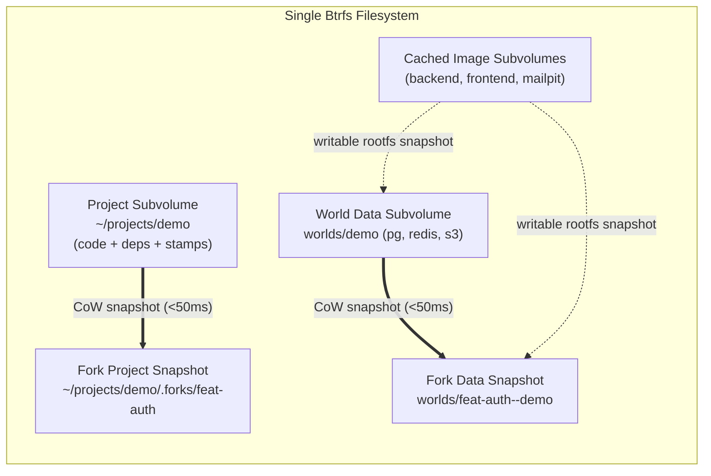
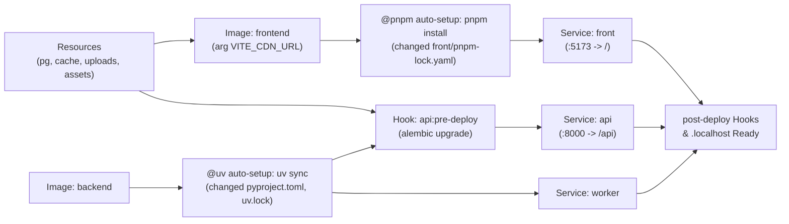
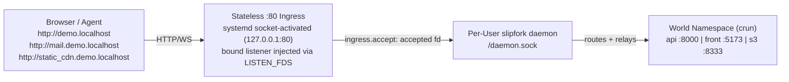

# 03 — How It Works Under the Hood

Slipfork achieves cloud parity, instant incremental builds, zero-config dependency deduplication, and `< 50ms` branch cloning **100% free of any external container daemon** by combining five focused building blocks:

1. **Pure Btrfs subvolumes** for source code, `.slipfork/` input stamps, cached image steps, and live databases/buckets
2. **Native OCI registry pulls & a Btrfs + `crun` `Dockerfile` builder** (with build-time `arg`s strictly separated from runtime `env`)
3. **A parallel World Boot DAG** with deduplicated `@<tool>` and `before-start when changed(...)` setup nodes
4. **Per-service `crun` OCI pods** managed by **one per-user daemon** behind a cloud-identical `:80` `.localhost` edge
5. **In-memory `OSPP v1` secret streaming** and automatic worktree hooks for AI coding agents

---

## 1. Pure Btrfs Layout (Zero Hybrid Filesystem Tricks)

Everything lives natively on a single Btrfs filesystem — there are no loopback disk files, ext4-to-Btrfs copy layers, or per-folder workarounds.

- **Project directory = Btrfs subvolume:** Your checkout (`~/projects/demo`) is itself a Btrfs subvolume containing `.git`, source code, `.venv`, `node_modules`, and `.slipfork/` input-hash stamps. If you clone a repo as a regular directory on your Btrfs drive, `slipfork up` transparently converts it in-place into a Btrfs subvolume once on first run.
- **Slipfork store on the same Btrfs mount:** Under `<btrfs_mount>/.slipfork-store` (or `/var/lib/slipfork`), Slipfork stores unpacked read-only `image` and build-step subvolumes, build cache mounts, and per-world database/cache/bucket state subvolumes:

```text
<btrfs-drive>/
├── home/you/projects/demo/                 # Btrfs subvolume (code + .venv + node_modules + .slipfork/stamps)
│   └── .forks/
│       └── feat-auth/                      # Instant CoW snapshot (inherits deps + input stamps!)
└── .slipfork-store/
    ├── images/                             # Cached read-only OCI & Dockerfile step subvolumes
    └── worlds/
        ├── demo/                           # World state subvolume (pg + redis + s3 + container rootfs)
        └── feat-auth--demo/                # Instant CoW snapshot of world state subvolume
```



**What `slipfork fork feat-auth` does in `< 50ms`:**
1. Flushes/checkpoints active databases cleanly so on-disk pages are consistent.
2. Snapshots the **project subvolume** at `~/projects/demo/.forks/feat-auth` and switches git to branch `feat-auth` — `.venv`, `node_modules`, and `.slipfork/` stamps exist immediately with zero disk duplication and complete CoW separation.
3. Snapshots the **world data subvolume** (PostgreSQL 18, Redis 7, and S3 buckets).
4. Boots the fork's DAG in a fresh network namespace (skipping `uv sync` / `pnpm install` in `< 1ms` unless the branch changed lockfiles) and registers `http://feat-auth--demo.localhost` (plus extra app domains, `mail.*` routes, and CDN subdomains like `http://static_cdn.feat-auth--demo.localhost`).

---

## 2. Native Image Engine, S3 Policies & Per-Service `crun` Pods

- **Direct OCI Registry Pulls:** Upstream images (`postgres:18`, `redis:7`, `python:3.13-slim`, `axllent/mailpit:latest`, etc.) are pulled directly over HTTPS via the standard OCI Distribution API, unpacking and caching layers once as read-only Btrfs subvolumes.
- **Native Btrfs + `crun` `Dockerfile` Builder (`arg` Only, Zero Secrets):** Slipfork evaluates `Dockerfile`s (`FROM ... AS`, `ARG`, `ENV`, `WORKDIR`, `COPY [--from] [--chown]`, `ADD`, `RUN` including heredocs and `--mount=type=cache`, `USER`, `EXPOSE`, `CMD`/`ENTRYPOINT`, and `.dockerignore`) natively, passing only declared non-secret `image` `arg` values (`arg VITE_CDN_URL = static_cdn.url`). Every `FROM` starts as a `< 1ms` Btrfs CoW snapshot and every `RUN` snapshots into a cached Btrfs step subvolume.
- **Cloud-accurate S3 (`private` vs `cdn <id>`):** Plain `s3 uploads` runs locally with bucket policy `private` (anonymous HTTP `GET` returns `403`, matching DigitalOcean Spaces). `s3 assets { cdn static_cdn }` sets bucket policy `public-read` and mounts `http://static_cdn.<world>.localhost` matching `static_cdn.domain` and `static_cdn.url`.
- **Shared world namespace & individual `crun` containers:** Each world creates one unprivileged **User + Network + IPC namespace** (`127.0.0.1` shared inside the world, separated from the host and sibling forks). Every service (`port` auto-injected as `PORT` + optional `internal_ports`), setup step, and resource runs in its own `crun` container backed by a writable Btrfs snapshot of its enclosing `image` subvolume, bind-mounting the project subvolume as `$UID:$GID`:

| Container | Enclosing `image` Rootfs | Default `workdir` / Mount | Network (`127.0.0.1` Inside Pod) |
| :--- | :--- | :--- | :--- |
| `api`, `worker` | `image backend .` | `.` on project subvolume (`$UID:$GID`) | `:8000` (`/api`), outbound |
| `front` | `image frontend ./front` | `./front` on project subvolume (`$UID:$GID`) | `:5173` (`/`) |
| `pg`, `cache`, `uploads`, `assets` | `postgres:18`, `redis:7`, `s3` | `worlds/<world>/*` data subvolumes | `:5432`, `:6379`, `:8333` (`static_cdn.*`) |

- **Tmpfs-only runtime `env` & clean teardown:** Runtime `env` variables, secrets, and OCI `config.json` bundles live strictly on a mode-`0700` in-memory `tmpfs` mount (`$XDG_RUNTIME_DIR/slipfork/pods/<world>`) — secrets never touch persistent disk, image layers, or `/proc/<pid>/cmdline`. Stopping or dropping a world signals the entire container process tree cleanly.

---

## 3. World Boot & Auto-Prequel DAG (`@<tool>` & `before-start`)

When Slipfork evaluates an `image` block, every `@<tool>` command (`@uv`, `@pnpm`, etc.) automatically synthesizes a `before-start when changed(<lockfiles>)` node keyed by `(image, lockfile_dir)` (walking up to detect workspace root lockfiles), scheduled alongside explicit `before-start` hooks in a parallel DAG:



- **Deduplicated & race-free:** Even though `api` (`pre-deploy` + `run`) and `worker` (`run`) all invoke `@uv`, Slipfork creates **one** `(backend, .)` `uv sync` node and waits for it before running any downstream hook or service.
- **Sub-millisecond `when changed(...)` check:** Before launching a conditional setup container, Slipfork hashes its watched files against `.slipfork/` stamps inside the Btrfs project subvolume — skipping unchanged steps in `< 1ms` and carrying valid stamps across `slipfork fork` automatically.

---

## 4. Single Per-User Daemon, Cloud-Identical `:80` Ingress, `OSPP v1` & OpenCode



- **Single binary & cloud-identical `:80` ingress:** One `slipfork` binary powers the CLI and the **single per-user daemon** (`<runtime_dir>/daemon.sock`) owning all worlds/forks under your user account. `slipfork daemon install` writes `~/.config/systemd/user/slipfork.service`; `sudo slipfork daemon install --ingress` additionally writes `/etc/systemd/system/slipfork-ingress.socket`, `/etc/systemd/system/slipfork-ingress@.service`, and `/etc/apparmor.d/slipfork`.
- **Authority resolution & streaming:** The stateless ingress forwards the accepted fd and the daemon's ingress module makes every route decision — preserving path prefixes by default (`preserve_path_prefix: true`), supporting explicit `strip-prefix`, `rewrite`, and `exact`, and matching `domain <id>` / `domain <prefix>.*` authorities across HTTP and WebSockets. Authorities resolve against `<world>.localhost`, `<domain>.<world>.localhost`, `<prefix>.<world>.localhost`, and `<fork>--<world>.localhost`, with the longest path prefix winning.
- **Bounded framing:** Request and response heads are capped at 16 KiB, and bodies plus upgraded WebSocket bytes stream through a fixed 64 KiB buffer, so no upload is ever buffered in full.
- **Remote Cloud Clutch (`OSPP v1`):** When paired via `slipfork auth <url>`, the user daemon authenticates over WebSocket with a device P-256 keypair, sends the evaluated `Forkfile`, decrypts `hpke-p256` cloud secrets strictly in memory, auto-restarts affected services on live `env_updated` pushes, and streams encrypted DB seed dumps over HTTPS straight into your Btrfs world subvolume.
- **Coding-Agent Integration (`@slipfork/opencode`):** Hooks OpenCode worktrees directly to `slipfork fork` and `slipfork drop`, giving every parallel agent session its own `< 50ms` Btrfs checkout + DB/S3 clone + `http://<branch>--<world>.localhost` URL with pre-warmed dependencies.

---

## 5. Crate & Port Map

`crates/slipfork/src/main.rs` is the **single Composition Root**: the only place that reads `std::env`, probes `/proc`, or binds ambient sockets and filesystems. `slipfork daemon` is a mode of that same binary and builds the same Constructor-DI tree — there is no second composition root and no separate daemon executable.

| Crate | Owns | Port → adapter |
| :--- | :--- | :--- |
| `slipfork` | CLI parsing, rendering, daemon composition; daemon-side `SecretVault` + `DaemonControl` wiring | builds the tree |
| `slipfork-forkfile` | `Forkfile` parse, typecheck, evaluate, `migrate`, `fmt` | — |
| `slipfork-world` | Btrfs subvolumes, snapshots, world boot/reap, ioctls | `WorldEngine` → `BtrfsEngine` |
| `slipfork-image` | OCI pulls and native `Dockerfile` builds | `BaseImageBuilder` → `NativeImageBuilder` |
| `slipfork-ingress` | HTTP/WS framing and `.localhost` route matching | injected `TcpListener` |
| `slipfork-ospp` | `OSPP v1` frames, device keys, HPKE, dumps | `OsppClient` → `WsOsppClient` |
| `slipfork-vcs` | worktrees, branch topology, dirty snapshots | `VcsWorkspace` → `GitWorkspace` / `JjWorkspace` |
| `slipfork-lsp` | language server over stdio | no port |

The canonical port set is exactly `WorldEngine`, `BaseImageBuilder`, `SecretVault`, `DaemonControl`, `OsppClient`, and `VcsWorkspace`. No single-impl mock trait sits beside them; a plain value struct covers anything that is only data.

### Local daemon control plane

Every local command talks to one socket at `<runtime_dir>/daemon.sock`, and the direction is always client → daemon.

| Element | Contract |
| :--- | :--- |
| Path | `<runtime_dir>/daemon.sock` (mode `0600`, owned by the developer) |
| Request | One NEWLINE-delimited JSON frame: `{"v":1,"id":<string>,"method":<string>,"params":{…}}` |
| Success | `{"v":1,"id":<string>,"ok":<object>}` |
| Failure | `{"v":1,"id":<string>,"error":{"code":<string>,"message":<string>}}` |
| Unknown `v` or `method` | A typed `error` frame; the connection stays open |
| Descriptors | `SCM_RIGHTS` carries **only** the accepted `:80` connection fd (`ingress.accept`) |

The CLI and the ingress always **connect to** `daemon.sock`; the daemon never dials out to a client, and no second control socket exists.

`up`, `down`, and `restart` stream progress on that same connection: zero or more
`{"v":1,"id":<string>,"event":{…}}` frames precede exactly one final `ok` or `error` frame. A
renderer never parses human text, and an unknown `v` or `method` answers a typed `error` while the
connection stays open.

| Event | Fields |
| :--- | :--- |
| `started` | `step`, `total`, `kind`, `label` |
| `log` | `line`, `step`, `total`, `label` |
| `finished` / `up-to-date` | `kind`, `label`, `detail`, `elapsed_ms` |
| `failed` | `label`, `line`, `message`, optional `remedy` |
| `ready` | `world`, `url`, `pods_dir` |
| `stopped` | `world`, `elapsed_ms` |

`up` spawns the detached `__supervise` child in its own session and relays its events while `ps`
and `ingress.accept` keep answering. `down` sends the world `Shutdown`, waits for the process group
to exit, then `SIGKILL`s it; `restart` reuses the world control socket and streams its phases.

Every owned world is recorded in `<state_dir>/worlds.json` (`project`, `world`, `fork`, `pods_dir`,
`supervisor_pid`, `started_at_ms`) and rewritten atomically. On start the daemon re-attaches worlds whose socket
answers and forgets the rest, while `<project>/.slipfork/world.json` remains a cache.

`ps` answers `{worlds:[{project, path, world, fork, url, started_at_ms, supervisor_pid, alive,
booting, services, forks}]}` where each service carries `{id, kind, running, port?, version?, cdn?,
pid?, routes:[{prefix, port, mode, domain?}]}`; a fork is nested under its parent world and keeps the
same service shape. Declared services, resources, and routes come from the evaluated `Forkfile` AST,
and liveness comes from the world's own `List` reply, so the tree never shows a service the daemon
cannot prove.

`slipfork __daemon` is the hidden mode of the same binary, and the client owns its lifetime.

### Ingress ownership

`slipfork-ingress` owns HTTP/WebSocket framing and route matching: preserve-by-default prefixes, `strip-prefix`, `rewrite`, `exact`, and `domain` authority filters. A table that would route the same request two ways — duplicate prefixes, two catch-alls, port `0`, or a `domain <id>` that is not declared — is refused before it serves a connection; a non-`.localhost` host answers `400`, an unknown `.localhost` world answers `421`, and an unmatched authority or path inside a known world answers `404`, never a fallback.

The composition root injects an already-bound `TcpListener` — from `LISTEN_FDS` under systemd, or a direct bind under OpenRC. The systemd `slipfork-ingress@.service` template instance is stateless: `slipfork __ingress` forwards that one accepted connection fd to `daemon.sock`, and the daemon's ingress module makes the routing decision. That handoff is the single direction; nothing pushes traffic the other way.
