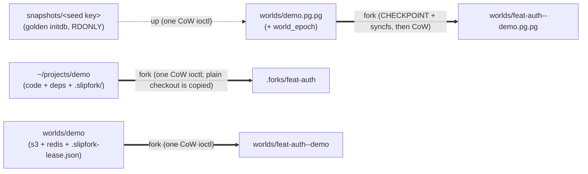
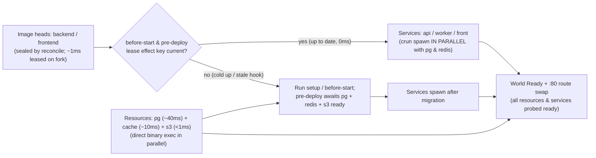
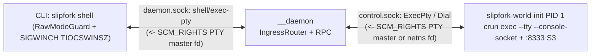
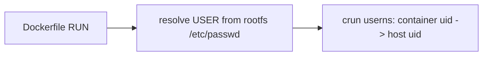
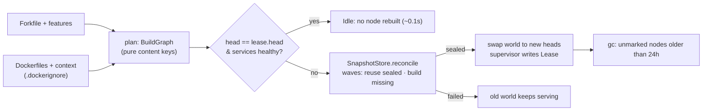
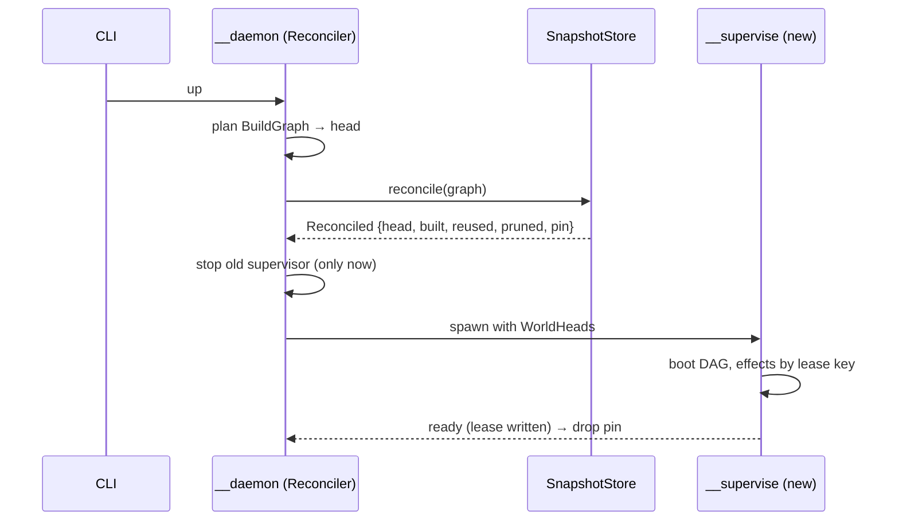
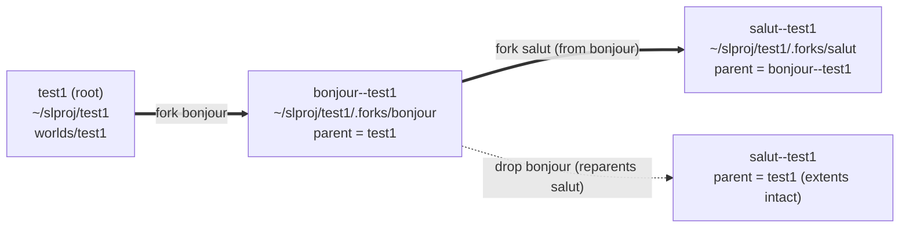
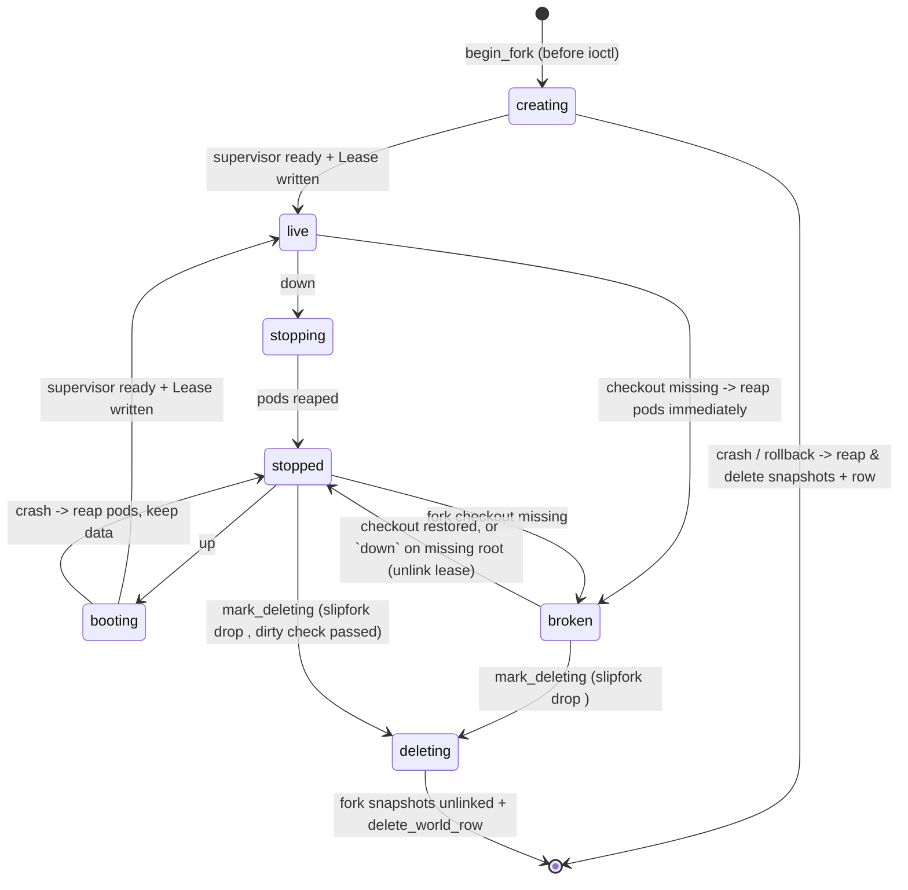

# 03 — How It Works Under the Hood

Slipfork runs your cloud environment locally in a box; CI is the clutch. It boots full-stack worlds and clones live 8-component branches on **Btrfs CoW subvolumes** (`100%` Docker-free) — Slipfork's own fork snapshot measures **`~150–365ms`** on the 4-vCPU droplet (asserted **`< 500ms`**), while a full cold start of the real FastAPI (`uvicorn --reload`) + SvelteKit (`vite dev`) demo reaches first `200 OK` at a median **`~5.5s`**, asserted **`< 8.0s`** for 2-vCPU GitHub Actions loop-Btrfs runners.

<!-- sample output -->
```console
$ slipfork up
✓ Ready -> http://demo.localhost  (4.8s)
$ slipfork fork feat-auth
✓ feat-auth (4.8s) -> http://feat-auth--demo.localhost
```

*Sample transcript above; the asserted contract is two-tier: `snapshot_ms` `~150–365ms` measured with a `< 500ms` asserted ceiling for the CoW clone, and a median end-to-end cold start `~5.5s` measured with a `< 8.0s` asserted ceiling (1 warm-up + 3 measured samples) on the 4-vCPU dev VM and 2-vCPU CI runners, via `std::time::Instant` in `critical_fork_live`.*

---

## 1. Pure Btrfs Layout, `<world>/.slipfork-lease.json` & Persistent Logs

Everything lives natively on one Btrfs mount — your checkout (`~/projects/demo`) works whether it is a Btrfs subvolume or a plain directory, and the store holds flat sibling subvolumes plus persistent component logs. The store root is `<btrfs_mount>/.slipfork-store` on a writable non-`/` mount, and `$XDG_DATA_HOME/slipfork/store` when the longest mount is `/` or is not writable, so a Btrfs-root host never writes `/.slipfork-store`:

`slipfork up` calls only `ensure_store` and never converts or rewrites your checkout. `slipfork fork` snapshots a subvolume checkout with one CoW ioctl and copies a plain checkout's tree instead, with no adoption or conversion step.

```text
<btrfs-mount>/
├── home/you/projects/demo/                       # Project subvolume (code + .venv + node_modules + .slipfork/)
│   └── .forks/feat-auth/                         # CoW project snapshot (one ioctl)
└── .slipfork-store/
    ├── snapshots/<key>/ + <key>.json             # Sealed content-addressed nodes: bases, Dockerfile steps, PG seed (§6)
    ├── images/{oci,refs,cache-mounts}/           # OCI blobs, remembered tag digests, RUN --mount=type=cache dirs
    ├── logs/<world>/<id>.log                     # Persistent pod/resource/service logs (survives failed up & down)
    ├── logs/<world>/runs/index.jsonl             # One catalog record per executed run (survives failed up & down)
    ├── logs/<world>/runs/<run_id>.log            # That run's captured stdout/stderr (`logs -r <id>`)
    ├── pods/<world>/                             # Ephemeral writable pod rootfs clones (deleted on down & drop)
    └── worlds/
        ├── demo/                                 # World subvolume: s3/ + redis/ + .slipfork-lease.json
        ├── demo.pg.pg/                           # Sibling PGDATA subvolume + .slipfork-pg-stamp.json
        ├── feat-auth--demo/                      # CoW snapshot of world subvolume + its lease
        └── feat-auth--demo.pg.pg/                # Crash-consistent CoW snapshot of live PGDATA + PG stamp
```

A project, world, or `PGDATA` clone is one `BTRFS_IOC_SNAP_CREATE_V2` ioctl (`~0.3ms` on local NVMe, single-digit ms on network block storage, `≤50ms` ceiling) — after a one-off direct-TCP PostgreSQL `CHECKPOINT` (`~1–3ms`, Simple Query over `Request::Dial { port: 5432 }` on `<pods>/control.sock`) and one `syncfs(2)` that commits its page-cache writes into the Btrfs tree.



!!! info "Epoch-paired leases, run catalog & persistent logs"
    When a world finishes booting, its supervisor writes one `world_epoch` into **both** `<world>/.slipfork-lease.json` and `worlds/<world>.pg.<id>/.slipfork-pg-stamp.json`, so `fork` reuses image heads and hook effects in `0ms` when epochs match (§6).

    Every executed image pull/build, setup, hook, resource, and service start mints a six-character `run_id` and appends one record (`run_id, kind, target, command, state, started_ms, finished_ms, duration_ms, project, world`) to `<store>/logs/<world>/runs/index.jsonl` **before** the step runs. The step's output lands in `runs/<run_id>.log`, while a live pod also keeps `<store>/logs/<world>/<id>.log`; so `slipfork logs <image>` replays a failed build and `slipfork logs -r <id>|last|failed` replays one record even after a failed cold `up` or `down`.

    Retention keeps the newest 20 successful runs per world and never prunes a `failed` or crashed (`running`) record, so the artifact an operator needs outlives every teardown; `down` deletes only `<runtime_dir>/pods/<world>` and `<store>/pods/<world>/`, and `drop` removes the world's logs.

**Pod user baseline.** Every pod runs as the invoking `$UID`/`$GID` (identity-mapped into the world user namespace) with a synthetic two-line `/etc/passwd`. Unprivileged pods get a writable `0755` `/home/slipfork` inside their CoW rootfs and `HOME=/home/slipfork` in `config.json` whenever the merged image/Forkfile env leaves `HOME` unset, empty, or `/root`; a declared non-`/root` `HOME` always wins and uid `0` keeps `/root`. Images such as `python:3.13-slim` and `node:22-slim` therefore need no `ENV HOME` change for `uv`, `pnpm`, `git`, or `bash` to write caches.

**Pod DNS.** Every pod joins its own network namespace, so the resolver file bound as `/etc/resolv.conf` always carries a non-loopback `nameserver`; when the host's `/etc/resolv.conf` only lists loopback stubs (`127.0.0.53`) and `/run/systemd/resolve/resolv.conf` holds the real upstream servers, pods bind that upstream file instead. An absent or still-loopback upstream keeps `/etc/resolv.conf` untouched, so pods fail closed rather than resolving through an invented server.

**World egress.** The world's network namespace ships only `lo`, so Slipfork supervises one `slirp4netns` forwarder for the world's whole lifetime: pods get `tap0` on `10.0.2.100/24` with a default route, which is how `uv sync`, `pnpm install`, and any HTTPS call reach PyPI, npm, and the wider internet without Docker. `--disable-host-loopback` keeps the host's `127.0.0.1` unreachable from pods, the forwarder is reaped with the world, and every pod still binds a non-loopback `nameserver` (see **Pod DNS**).

---

## 2. Native Btrfs-Backed Rust S3 (`< 1ms` Boot, Zero Extra Containers)

Slipfork pulls zero external S3 images and runs zero distributed daemons. Detached `__supervise` sends **one typed `Request::ConfigureS3(S3WorldConfig)` frame** over `0600` `control.sock`, and `slipfork-world-init` constructs `S3Server::new(config)` on `127.0.0.1:8333` in `< 1ms`:

| Capability | Exact Contract (`resources/s3/{server.rs,object_ops.rs,listing.rs,policy.rs}`) |
| :--- | :--- |
| `object_ops.rs` | Payload at `<world>/s3/<bucket>/objects/<key>` and atomic sidecar JSON at `<world>/s3/<bucket>/meta/<key>.json` (`content_type`, quoted `etag`, `content_length`, `last_modified`) — plain files cloned instantly on `fork`. |
| `server.rs` | `hyper` `1` (`http1`, `server`) on `127.0.0.1:8333` dispatching path-style (`/<bucket>/<key>`) and the ingress-forwarded `Host: <bucket>.<world>.localhost` `PUT`, `GET`, `HEAD`, `DELETE`, `HeadBucket`, and `?list-type=2`; `cdn <id>` adds no local authority and aliases the bucket host. |
| `listing.rs` | `ListObjectsV2` XML (`prefix`, `delimiter`, `max-keys`, `continuation-token`) sorted lexicographically over Btrfs bucket keys. |
| `policy.rs` | `BucketPolicy` (`Private` \| `PublicRead`) + `SigV4Verifier` (`hmac = "0.12"` `Mac::verify_slice` + `sha2 = "0.10"`, `SecretValue` from `slipfork-forkfile`, `<sha256-hex>` & `UNSIGNED-PAYLOAD`): `Private` denies anonymous `GET` (`403`); `PublicRead` allows anonymous `GET`/`HEAD` (`200`) and denies anonymous `PUT`/`DELETE`/list (`403`). |

---

## 3. Direct-Exec Databases, Parallel Fork Boot DAG & Two-Tier Latency Budget

- **PostgreSQL 18 (`~30–50ms` start, direct `postgres` exec, one `~1–3ms` pre-fork `CHECKPOINT` + `syncfs(2)`):**
  - When `PG_VERSION` already exists in `PGDATA`, `PostgresLauncher` unlinks stale `postmaster.pid`, `postmaster.opts`, and `pg_stat`, mounts `/dev/shm`, and `exec`s the `postgres` binary **directly** by absolute path (never `docker-entrypoint.sh` bash wrappers).
  - Dev flags `-c fsync=off -c synchronous_commit=off -c full_page_writes=off -c wal_level=minimal -c max_wal_senders=0 -c autovacuum=off -c shared_buffers=32MB -c dynamic_shared_memory_type=posix` replay any tail WAL in `< 5ms` while readiness polls `.sock/.s.PGSQL.5432` every **`2ms`**.
  - Before `fork`, `PostgresLauncher` sends `CHECKPOINT;` as a PostgreSQL v3 Simple Query over `Request::Dial { port: 5432 }` (`SCM_RIGHTS`, no `crun exec`/`psql` spawn) and then one `syncfs(2)` commits the flushed `shared_buffers`/`wal_buffers` page-cache writes into the Btrfs tree, so `INSERT`s committed immediately before `fork` survive.
- **Redis 7 (`~5–15ms` start, direct `redis-server` exec):** `RedisLauncher` `exec`s `redis-server` directly by absolute path (never `docker-entrypoint.sh`) with `--bind 127.0.0.1 --dir /data --save "" --appendonly yes --appendfsync no` on `<world>/redis/<id>`, polling `:6379` every **`2ms`**.
- **Leased image heads & verbatim Python commands:** On `fork` with a matching `world_epoch`, the forked world boots straight from the image heads recorded in the snapshotted `<world>/.slipfork-lease.json` (`cached`, `~1ms`, zero reconcile; §6). Runtime Python commands exec the project's `.venv/bin/<prog>` directly or run the `Forkfile`-authored command verbatim; Slipfork never injects `uv` flags, so a non-`dev` world writes `uv run --no-sync …` itself.
- **Direct-bin service launch (`@uv run <bin>` / `@pnpm exec <bin>`):** Once the setup node installed dependencies, the launcher resolves the verb straight to `<workdir>/.venv/bin/<bin>` or `<workdir>/node_modules/.bin/<bin>` and `exec`s it, skipping `uv`/corepack wrapper startup on every pod boot.



**Boot-DAG Concurrency & Readiness Rule (`BootScheduler`):**
1. **Stale or missing effect (cold `up`, schema/lockfile edit, or `world_epoch` mismatch):** `@<tool>` setup and `before-start` run after their `image` head resolves, `pre-deploy` awaits `image` + `setup`/`before-start` + **all backing `resource`s (`pg`, `redis`, `s3`) ready** before running migrations, and `service` container spawn waits for `pre-deploy` completion.
2. **Current effects (`fork` or warm `up` with matching `world_epoch` + effect keys in the lease):** `setup`, `before-start`, and `pre-deploy` verify immediately upon `image` completion (`0ms` `up to date`, **without** waiting on `pg`/`redis`), and `service` containers spawn **in parallel** alongside `pg` and `redis` startup — while `:80` ingress activation, `✓ Ready`, and `post-deploy` still await **every** `resource` and `service` readiness probe.

!!! note "Where the seconds go"
    Snapshot, world init and pod spawn stay in the low hundreds of milliseconds; the median is set by `uvicorn --reload` import/transform and `vite dev` first-request SSR inside the app pods. On a warm fork those steps print `cached`/`up to date`, mint no run id, and re-run zero commands.

| `slipfork fork <name>` Stage (Full 8-Component Stack) | Target | Hard Ceiling |
| :--- | :--- | :--- |
| `CHECKPOINT` + `syncfs(2)` on live PG, then parallel Btrfs CoW snapshots (project, world, PG) + git branch switch — reported as `snapshot_ms` | `150–365ms` | **`< 500ms`** |
| World `unshare` + `slipfork-world-init` + `ConfigureS3` `:8333` + leased image-head/effect reuse (`cached` `~1ms`) | `15–35ms` | — |
| Parallel `crun` pod boot (direct-exec PG18 `~40ms`, Redis `~10ms`, services spawning concurrently with `2ms` poll) + `:80` swap | `150–350ms` | — |
| App boot inside the pods: real `uvicorn --reload` import/transform + `vite dev` first-request SSR (external to Slipfork, dominates the total) | `1.5–3.5s` | — |
| **End-to-end (`Command::spawn` -> all 8 components ready + `http://<fork>--<world>.localhost` `200 OK`)** | **median `~5.5s`** | **`< 8.0s` (`8000ms`)** on 4-vCPU dev VM and 2-vCPU Actions loop-Btrfs |

---

## 4. Daemon `daemon.sock`, World `control.sock` & Real-PTY `SCM_RIGHTS`



| Socket (`0600`) | Direction & `SCM_RIGHTS` | Canonical Frames |
| :--- | :--- | :--- |
| `<runtime_dir>/daemon.sock` | CLI / `__ingress` → `__daemon`; `SCM_RIGHTS` passes `:80` client fd (`ingress.accept`, client → daemon) and `/dev/pts/N` master fd (`shell` TTY, daemon → CLI). | Request `{"v":1,"id","method","params"}` → streamed `event` frames (`started`, `log`, `finished`, `up-to-date`, `failed`, `ready`, `stopped`) → final `ok` / `error` (`log` streams `logs -f` / piped `exec`; `BootTui` never prints `log` frames). |
| `<pods_dir>/control.sock` | `__supervise` / `__daemon` → PID 1 `slipfork-world-init`; `SCM_RIGHTS` returns world-netns stream fd on `Dial` and `crun exec --tty --console-socket` PTY master fd on `ExecPty` (init → daemon). | `ConfigureS3(S3WorldConfig)`, `Dial { port }`, `List`, `Shutdown`, `ExecPty` (`"terminal": true`), `Exec` (piped stdio), `Logs` (live tail over `<store>/logs/<world>/<id>.log`; `__daemon` reads `<store>/logs/<world>/<id>.log` directly when `<pods_dir>` is absent). |

---

## 5. Composition Roots, Crate Map & Canonical Ports

Slipfork has **five explicit composition roots** and **zero** ambient OS/env probes in library crates:
1. `crates/slipfork/src/main.rs` (CLI, `__daemon`, `__ingress`) — parses `Cli`, builds `UiMode`, `BootTui` (`ScrollRegionGuard` / `AsciiLine`), `RawModeGuard`, `DaemonClient`, and `DaemonServer`. `__daemon` opens one `StateDb` + `ForkLedger` (§7) and constructs `BtrfsEngine`, `SnapshotStore`, `OciPuller`, `NativeImageBuilder`, and `Reconciler` per `store_root` (§6).
2. Detached `__supervise` (`crates/slipfork/src/main.rs` child mode) — owns the single boot `tokio::Runtime` and constructs `BootScheduler` (injecting `tokio::runtime::Handle`), `PostgresLauncher`, `RedisLauncher`, `BtrfsEngine`, `FileSecretVault`, and `S3WorldConfig`; it receives sealed `WorldHeads` from the daemon, never builds, and writes the world's `Lease`.
3. `crates/slipfork-world/src/bin/world_init/main.rs` (world PID 1) — binds `0600` `control.sock`, serves `ConfigureS3`/`Dial`/`List`/`Shutdown`/`ExecPty`/`Exec`/`Logs`, and hosts `S3Server` on `:8333`.
4. `crates/slipfork-lsp/src/main.rs` — standalone cross-platform stdio language server.
5. `packages/opencode-slipfork/src/index.ts` — OpenCode V2 plugin shelling the `slipfork` binary.

| Crate | Canonical Cohesive Structs / Modules (`<= 500` LOC each) | Port → Adapter |
| :--- | :--- | :--- |
| `slipfork` | `Cli` (`clap` 4.6 + `clap_complete` + `clap_mangen`), `UiMode`, `BootTui` (`ScrollRegionGuard` `DECSTBM` + `AsciiLine`), `RawModeGuard`, `TableLayout`, `Reconciler` (`daemon/reconcile/`), `ConvergeExecutor` (`daemon/lifecycle/converge.rs`), `DaemonClient`, `DaemonServer` | — |
| `slipfork-forkfile` | `ForkfileCompiler`, `SecretValue` (redacted `Debug`, zeroize-on-drop), `BucketPolicy`, `DnsLabel`, `Formatter`, `SnowMigrator` | — |
| `slipfork-world` | `BtrfsEngine`, `StateDb` + `ForkLedger` (`ledger/`), `BuildGraph` + `NodeKey` + `SnapshotStore` + `Lease` (`snapshot/`), `BootScheduler` (`Handle` + `spawn_blocking`), `PostgresLauncher`, `RedisLauncher`, `resources/s3/{server.rs,object_ops.rs,listing.rs,policy.rs}`, `WorldSupervisor` | `WorldEngine` → `BtrfsEngine` |
| `slipfork-image` | `NativeImageBuilder`, `BuildPlanner`, `OciPuller`, `DockerfileExecutor` | `BaseImageBuilder` → `NativeImageBuilder` |
| `slipfork-ingress` | `IngressRouter`, `HttpRelay` (`httparse` raw byte/WS proxy) | — |
| `slipfork-ospp` | `WsOsppClient`, `FileSecretVault`, `DeviceIdentity`, `DumpReader` | `OsppClient` → `WsOsppClient`, `SecretVault` → `FileSecretVault` |
| `slipfork-vcs` | `GitWorkspace` | `VcsWorkspace` → `GitWorkspace` |
| `slipfork-lsp` | `LspServer` | — |

The canonical port set is strictly `WorldEngine`, `BaseImageBuilder`, `SecretVault`, `OsppClient`, and `VcsWorkspace` — zero single-impl mock traits sit beside them.

`OciPuller` receives one injected `RegistryCredentials` store handle whose paths the composition root
resolves once (`<config>/slipfork/registries.json` at mode `0600`, plus Docker's read-only per-host
fallback). It re-reads those files on every registry resolve, so a CLI `docker login` reaches the
daemon-resident puller on its next pull without re-reading the environment or argv.

`COPY --from` accepts a stage index, a stage `AS` name, or an OCI image reference; the planner resolves the latter to a manifest digest and reconcile materializes it as an `external` node, so the network-free native builder only ever reads sealed rootfses.

**Build identity: single-owner images.**

Every build `RUN` is its own `crun` container with exactly **one** uid/gid mapping (`size: 1`): the step's effective container identity maps to the invoking host uid/gid. Default steps run as container root (`0:0`), just like a Dockerfile stage without `USER` — root inside the user namespace holds no host-root power, and every file written into the build rootfs is owned by the invoking user on the host.

`USER name` / `USER name:group` resolve against the image's own `/etc/passwd` and `/etc/group` (numeric ids accepted), and an undefined name fails the build closed instead of running as the wrong user. Earlier `RUN useradd …` steps stay visible because the image's real `/etc/passwd` is never shadowed by a synthetic one.

Root steps get Docker's default capability sets inside the user namespace, non-root steps get none, and `noNewPrivileges` is always on. Seccomp turns `chown/fchown/lchown/fchownat` into successful no-ops, so `dpkg`'s `root:shadow` chowns never fail.

`RUN` receives a read-only `APT_CONFIG` (`APT::Sandbox::User "root";`) so `apt-get` skips its sandbox user, which single mappings (forcing `setgroups=deny`) cannot support; it is never written into image metadata.

`COPY`/`ADD --chown` accepts names or numbers resolved against the destination image (fail closed on unknown users), but every copied entry is written owned by the invoking uid; `--chmod` sets the mode. The build context is never mounted, so `RUN` writes only to the rootfs and explicit cache mounts.

Under the built-in `dev` feature the runtime overlays `<project>/<build context>` at the target stage's effective `WORKDIR` and at any distinct whole-context `COPY`/`ADD` destination, so `slipfork exec` and `slipfork shell` read host edits through the live mounts; a `WORKDIR` already under `/project` keeps that bind. A stage whose effective `WORKDIR` is still `/` refuses the `dev` boot before any pod starts (one line + `next:`), because the rootfs root is never overlaid; `-F -dev` keeps the image copy and its `WORKDIR`.

Runtime pods are unchanged: they keep the identity `$UID` baseline.

!!! info "Why one mapping"
    A single uid mapping keeps ownership deterministic and clone-cheap: the invoking host uid owns the whole rootfs, so `fork` snapshots copy ids verbatim and need no translation pass.



| Known limit | Now |
| :--- | :--- |
| `chown` changes ownership | No-op (single mapping; files stay invoking-uid-owned). |
| `ls -n` / `stat` inside a step | Every path shows the step's single uid. |
| A `USER app` step | Sees image files as `app` (permissive, not Docker's per-file ownership). |
| Supplementary groups | None. |
| Subordinate uids / idmapped mounts | Not shipped: every build-store path is single-uid (invoking-uid) owned; a per-file ownership model is a later design. |

---

## 6. One Snapshot Graph: Plan, Reconcile, Lease & GC

Edit instruction 12 of a 20-instruction `Dockerfile` and `up` rebuilds exactly the steps from 12 on while the old world keeps serving. Edit nothing and `up` rebuilds no node (`~0.1s`); a failed `RUN` never takes the running world down.

<!-- sample output -->
```console
$ slipfork up                                   # backend/Dockerfile instruction 12 edited
✓ image     backend   built      14.2s
✓ service   api       ready       0.4s
✓ Ready -> http://demo.localhost  (15.1s)
$ slipfork up                                   # desired head == leased head, all healthy
✓ Ready -> http://demo.localhost  (0.1s)
```

A failed build prints the §4 row shape (02) while the old world keeps answering:

```text
✗ image     backend   failed      84ms
  `RUN pnpm run build` failed: `crun` exited with code 1
  next: slipfork logs -r 3f9c21
```



### 6.1 `BuildGraph`: nodes and the key grammar

`BuildPlanner` (`slipfork-image`) turns each `image` into nodes, and `WorldPlan` (`slipfork-world` boot) adds seed, effect, service, and world nodes. One pre-plan `RefResolver` step (`slipfork-image`, sole owner of `images/refs`) pins every `FROM` and `COPY --from` reference to a manifest digest; after that, `BuildGraph` is a pure value whose keys, edges, waves, and head are unit-tested without disk.

`BuildGraph` is the only node/edge algebra: each `BootStep` carries its `NodeKey`, and `BootGraph` becomes the scheduling view over the graph's world nodes, so the boot gate and the lease check compare the same key.

```text
key     = hex(sha256("slipfork-node-v2\0" kind "\0" arch "\0" parents "\0" canon "\0" inputs))
parents = parent keys in declared order, joined by ","          (empty for base / external)
canon   = canonical text: keyword + flags + arguments after ARG expansion, whitespace-normalized
inputs  = sorted "name=value\0" pairs listed per kind below
```

| Kind | Materialized as | Parents | `inputs` |
| :--- | :--- | :--- | :--- |
| `base` | sealed subvolume | — | `manifest=<sha256>` (`FROM` tag resolved), `platform` |
| `external` | sealed subvolume | — | `manifest=<sha256>` of a `COPY --from <ref>` image |
| `step` (`RUN`) | sealed subvolume | previous step | `config=<ENV/WORKDIR/USER/SHELL digest>`, every in-scope `ARG` value |
| `step` (`COPY`/`ADD`) | sealed subvolume | previous step (+ `--from` stage/external key) | context copy: `sources=<Merkle(path, mode, bytes or link target)>` over paths the sources match after `.dockerignore`; `--from`: `sources=from:<source key>:<paths>`; remote `ADD`: `--checksum`, else the URL |
| `image` | record only | last step | final config digest (`ENV`, `WORKDIR`, `USER`, `ENTRYPOINT`, `CMD`, `EXPOSE`) |
| `seed` | sealed subvolume (`PGDATA`) | `postgres` image | `initdb` argv + template version |
| `effect` | lease entry | image | phase, slot, rendered command, `when changed(...)` input Merkle |
| `service` | lease entry | image | canonical compiled service spec (command, env text with world values, ports, routes) |
| `world` | lease `head` | every seed, effect, service | `spec` = compiled runtime spec digest: resources, routes, domains, active features |

A `COPY --from`/`ADD --from` step's `sources` input is the **source node key** (`from:<key>:<paths>`), not a second Merkle walk of a rootfs that does not exist yet at plan time. That key already content-addresses the source tree transitively — the `external` node for an image digest, or the last materialized node of an earlier stage.

- `ENV`, `WORKDIR`, `USER`, `SHELL`, `ARG`, `LABEL`, `EXPOSE`, `CMD` create no subvolume; they fold into the next step's `config` and the `image` node.
- A `COPY` key sees only the files it copies, so an edit elsewhere in the context invalidates nothing.
- A floating `FROM` tag resolves through the remembered tag → digest map (`images/refs`); only first sight, `docker pull`, and `--no-cache` hit the registry.
- Secret values never enter a key: keys hash `Forkfile` text and secret references, and the compiler already refuses secret-tainted `arg`s.
- The graph **head** is the `world` key; an image's head is its `image` key.
- `WorldPlan` derives seed, effect, service, and world keys from any image-key map, so a fork re-keys its world entries over its parent's leased image keys without reading a `Dockerfile` (§6.5).

### 6.2 `SnapshotStore`: reconcile

One `SnapshotStore` (`slipfork-world`, owned by `__daemon`) holds every sealed node and drives the `WorldEngine` port. It is the only writer of `<store>/snapshots/`.

```text
<store>/snapshots/
├── .lock                    # flock(2): reconcile LOCK_SH, gc LOCK_EX|LOCK_NB
├── <key>/                   # sealed BTRFS_SUBVOL_RDONLY node (base, external, step, seed)
├── <key>.json               # kind, parents, canon, line, created_ms, last_used_ms + opaque materializer facts
└── .tmp-<key>-<pid>-<n>/    # writable slot, never read by anyone else
```

`reconcile(&graph, Cache::Warm | Cache::Cold, materialize)` runs the materialized nodes reachable from the head in topological waves:

1. Register a `Pin` on every desired key, then take `LOCK_SH`; nodes within one wave run in parallel, bounded by the injected `Parallelism` value.
2. **Reuse** a node only when `<key>/` carries `BTRFS_SUBVOL_RDONLY` and `<key>.json` parses; bump `last_used_ms`. A present `<key>/` that is unsealed or recordless is destroyed and rebuilt.
3. **Build** a missing node once per key (in-process singleflight): snapshot its first parent (or create an empty subvolume) into a slot, run `materialize`, seal, write `<key>.json` by tmp + rename, and only then `rename(2)` slot → `<key>/`. Losing a rename race destroys the slot and adopts the winner.
4. **Fail** on the first error: finish siblings already running in the wave, destroy every own slot, and schedule nothing further.
5. Drop the lock and run `gc` (§6.3); the pin from step 1 keeps the new head alive at any grace.

It returns `Reconciled { head, built, reused, pruned, pin }`, or `ReconcileFailed { node, run_id, line, cause, built, reused }`. Every executed node mints a run id in the world's run catalog (§1), so the failure row's `next: slipfork logs -r <id>` always resolves; nodes sealed before a failure stay valid, so the retry resumes after them.

`materialize: Fn(&Node, &Path, &mut dyn FnMut(&str)) -> Result<Facts> + Send + Sync` is a closure the `Reconciler` builds per node kind; there is no new trait. `OciPuller` unpacks a `base` into its slot from the planned manifest digest and clones a pre-pulled `external` rootfs into its slot, `NativeImageBuilder` applies one `step` or returns an `image` node's OCI config as facts, and `seed` runs `initdb` in a one-shot build container on the `postgres` image through the daemon's `StepHost` (the empty slot bound as `PGDATA`), never a world pod.

!!! note "Externals are pre-pulled before reconcile, for now"
    Until the daemon owns every pull (§6.7 slice 3), the composition root pre-pulls each `COPY --from` external into `images/oci/<digest>` and hands it to the plan, so the planner keys the `external` node by that digest and the materializer clones the sealed rootfs into the node slot.

    A `base` node (`FROM`) unpacks into its slot from the **planned manifest digest**, so a tag that moved between plan and materialize cannot change the bytes. A tag is re-resolved only when a tag-only registry returns `404` for the digest path, and the resolved digest is still required to equal the planned one.

`Cache::Cold` (`--no-cache`) re-resolves floating tags and rebuilds every materialized node. A rebuilt node replaces its same-key twin with `renameat2(RENAME_EXCHANGE)`; pods cloned from the twin are independent CoW subvolumes and keep running.

### 6.3 Leases, pins, and gc

A `Lease` is the durable record of what one world runs; it lives inside the world subvolume, so `fork` copies it in the same CoW ioctl.

```json
{"v":1,"world":"feat-auth--demo","origin":"demo","world_epoch":"k3v9…","spec":"<digest>",
 "head":"<world key over the entries below>","seeds":["<seed key>"],
 "services":{"api":{"key":"<service key>","image":"<image key>"}},
 "effects":{"backend:setup#1":{"key":"<effect key>","image":"<image key>"}}}
```

`head` is always the `world` key derived from the lease's own `spec` and entries. It therefore equals the desired head exactly when every entry is current, and any partial update recomputes it.

| Who | Does what with the lease |
| :--- | :--- |
| `__daemon` | Computes every key and hands them to the supervisor in `WorldHeads`; reads `head` for the Idle check. |
| `__supervise` | Writes the keys it was handed verbatim (tmp + rename) at the ready checkpoint, pairing `world_epoch` with every `.slipfork-pg-stamp.json`; it never derives a key. |
| `BootScheduler` | Skips an effect iff `world_epoch` matches and `effects[slot].key` equals the handed effect key. |
| `SnapshotStore::gc` | Reads every `worlds/*/.slipfork-lease.json` to mark. |

A `Pin` is the in-memory twin, registered before the first wave: a failed reconcile drops it on return, and a successful one hands it to the daemon, which drops it once the supervisor wrote the lease or the boot ended.

`gc` takes `LOCK_EX|LOCK_NB` and skips (`pruned: 0`) while any reconcile runs. It marks every `image` and `seed` key named by any lease entry or pin plus their parent closure through `<key>.json` records, then sweeps:

| Object | Kept |
| :--- | :--- |
| Node in a lease or pin closure | Always — a leased node is never destroyed. |
| Unmarked node | `24h` after `last_used_ms` (branch flips and a failed build's sealed prefix stay warm), then destroyed with its record. |
| `.tmp-*` slot | Destroyed: no reconcile holds the lock. |
| An unreadable lease | Fail closed: `gc` sweeps nothing and logs one line. |
| `worlds/`, `pods/`, `logs/`, `images/cache-mounts/` | Never touched; failed-run logs follow the run catalog retention (§1). |

### 6.4 Entry points

| Verb | Plans | Then |
| :--- | :--- | :--- |
| `up` | whole world | Idle iff `head == lease.head` and every service is healthy; equal head with sick pods heals them. Otherwise reconcile **while the old world serves**, and only on success stop it and boot the new heads. |
| `restart [-s S]` | whole world | Reconcile, then restart the targets on their desired image heads; the daemon hands their new entries plus the recomputed `head`, and the supervisor writes the whole lease. |
| `docker build C` | image `C` | Reconcile that subgraph and print the image id as today; no lease changes, and the next `up` reuses every node. |
| `docker pull R` | one `base` | Refresh the remembered digest for `R` and materialize it. |
| `fork` | world nodes only | Boot the parent's leased image heads, re-keying only service, effect, and world entries; no `Dockerfile` is read and nothing is materialized (§6.5). |
| `down` / `drop` | nothing | `down` keeps the lease (a stopped world restarts warm); `drop` destroys it with the world, and `gc` frees its unique nodes after the grace window. |

`up --no-cache` and `docker build --no-cache` reconcile with `Cache::Cold`. Every entry point runs in `__daemon`, which streams the same `plan`/`started`/`finished` frames as before; `__supervise` and the `docker` CLI never construct a builder.



### 6.5 Forks and world data

- World data (`worlds/<world>`, `worlds/<world>.pg.<id>`) stays mutable and named by world; only the PG `seed` is content-addressed, and every world that cloned it leases it.
- `fork` derives its service, effect, and world keys from its own compiled `Forkfile` values over the parent's leased image keys, so no context is hashed inside the `snapshot_ms` budget. Its next `up` is Idle unless an image key really differs.
- An image whose key differs because an `arg` reads a world URL keeps booting the parent's head (`cached ~1ms`); the fork's next `up` rebuilds just the steps that consume that `arg`.
- The fork's lease names its parent as `origin`; effect keys the parent already applied stay current, so hooks print `up to date`.
- A `world_epoch` mismatch between lease and PG stamp re-runs every effect, exactly as today.

### 6.6 What moves and what is deleted

| Today | Becomes |
| :--- | :--- |
| `StepCache`, `StepLayout`, `StepRecord` (`slipfork-image/src/steps.rs`) | `SnapshotStore` + node records; `cache_mount` dirs stay in `slipfork-image` as `CacheMounts`. |
| `state_key`, whole-context `BuildContext::hash`, `base-`/`external-` keys inside `NativeImageBuilder::build` | `BuildPlanner` keys computed before execution; the builder exposes `materialize(step, slot)` and never looks up a cache. |
| `images/oci/<digest>` sealed rootfses + `.partial-*` staging | `base`/`external` nodes; `OciPuller` keeps blobs and `refs` and unpacks into a slot. |
| `ImageCache` + `images/{flight,pull,log,record}.rs` | Deleted; singleflight moves into `SnapshotStore`, run notes and build logs into `Reconciler`. |
| `WorldStamp`, `ImageStamp`, `WorldStampStore`, `EpochState`, `.slipfork-world-stamp.json` | `Lease` (`.slipfork-lease.json`); `matches_hook` becomes the lease effect check. |
| `StampStore` + `.slipfork/setup-*.stamp` | Deleted; setup digests are lease `effects` (a dropped world re-runs setup once). |
| `StepStamp`, `stamp_key`, `step_digest`, `BootGraph::with_gated` | Deleted; `BootStep` carries its `NodeKey` and `BootGraph` indexes the world nodes of `BuildGraph`. |
| PG `templates/`, `InitLock`, `TemplateState`, `TEMPLATE_STAMP`, `run_pod_once` initdb | The `seed` node, materialized through `StepHost`; only the `initdb` argv survives. |
| `up_plan` `fingerprint`, `Fingerprint`, registry fingerprints, `inputs_predate`, `services_bundled` | Deleted; `up_plan` compares `graph.head()` with `lease.head`. |
| `BtrfsEngine`, `StoreLayout` | Unchanged primitives; `StoreLayout` gains `snapshots_root()` and drops `templates`. |

### 6.7 Refactor slices

| # | Crate · files (`<= 500` LOC each) | Depends | Proof |
| :--- | :--- | :--- | :--- |
| 1 | `slipfork-world` `snapshot/{graph,key,store,slot,gc,lease}.rs`; PG seed in `resources/pg/template.rs` | — | Unit: key grammar, waves, head, mark closure. Lab: real-Btrfs reconcile, mid-wave failure, `RENAME_EXCHANGE`, gc with zero grace. |
| 2 | `slipfork-image` `plan/{refs,planner,sources}.rs`, `builder/materialize.rs`, `OciPuller` slot unpack + re-read credentials; switch `ImageCache` and CLI `docker build` call sites to plan + `reconcile` in the same slice; delete `steps.rs` | 1 | Unit: per-`COPY` source Merkle honours `.dockerignore`. Lab: `critical_dockerfile_live` rebuilds only the edited suffix. |
| 3 | `slipfork` `daemon/reconcile/{mod,progress}.rs`; `up`/`restart`/`docker build`/`docker pull` reconcile in `__daemon` (which then owns every pull, `COPY --from` externals included); supervise takes `WorldHeads`; delete `ImageCache` | 2 | Up journey: failed `RUN` keeps the old world serving; `docker build` then `up` is all `cached`. |
| 4 | `slipfork-world` `boot/` (split `schedule.rs` into `schedule/{waves,gate}.rs`) + `slipfork` `up_plan` (split `up.rs` into `up/{plan,heal}.rs`) and `fork`: `Lease` replaces stamps; `BootStep` keys; Idle by head; fork re-keys world nodes; gc after reconcile; `--no-cache`; delete fingerprints; `specs/02` (§4 Idle rule, `--no-cache`) + `TESTING_PLAN.md` | 3 | Journey: Dockerfile/context edit leaves Idle; fork boots with zero materialization and its next `up` is Idle; `drop` + gc frees unique nodes. |

---

## 7. Transactional Fork Ledger, Flat Lineage & Convergence

Branch any live or stopped environment — root or fork — into a flat checkout at `<root>/.forks/<name>`. `slipfork ps` and `slipfork status` share one lineage renderer, and `slipfork drop` cleans up in one planned pass without stranding pods or snapshots.

<!-- sample output -->
```console
$ cd ~/slproj/test1/.forks/bonjour && slipfork fork salut
✓ fork      snapshot      184ms
✓ git       branch salut   19ms
• image     web          cached
✓ service   web           312ms
✓ salut (0.6s) -> http://salut--test1.localhost

$ cd ~/slproj/test1 && slipfork ps
● test1    ~/slproj/test1
  http://test1.localhost
    /  -> web  service  running

● bonjour  ~/slproj/test1/.forks/bonjour  ← test1
  http://bonjour--test1.localhost
    /  -> web  service  running

● salut    ~/slproj/test1/.forks/salut    ← bonjour ← test1
  http://salut--test1.localhost
    /  -> web  service  running

$ slipfork drop bonjour -f
✓ pod   web                stopped               41ms
✓ fork  snapshots bonjour  project + world data  51ms
✓ Dropped bonjour (92ms)

$ slipfork ps
● test1  ~/slproj/test1
  http://test1.localhost
    /  -> web  service  running

● salut  ~/slproj/test1/.forks/salut  ← test1
  http://salut--test1.localhost
    /  -> web  service  running
```

### 7.1 Store layer: `sea-orm` + `sea-orm-migration` on SQLite WAL

Control-plane state lives in `<state_dir>/state.db` (`0600`) via `sea-orm` (`default-features = false`, `features = ["sqlx-sqlite", "runtime-tokio", "macros"]`) and `sea-orm-migration` (`default-features = false`, `features = ["sqlx-sqlite", "runtime-tokio"]`).

The `sea-orm`/`sqlx` compile-time cost is accepted for typed `DeriveEntityModel` entities and checked `MigrationTrait` migrations; the schema is Rust code (`SchemaManager` / `sea_query`), never hand-written SQL.

`StateDb` (`ledger/db.rs`) owns a private `current_thread` `tokio::runtime::Runtime` and exposes a **100% synchronous** API — each public method enters `block_on` once over private `&DatabaseTransaction` helpers, leaking zero `async` or `block_on` outside `db.rs`.

SQLite owns **strictly** the world and fork ledger (`worlds`, `forks`). Snapshot records (`snapshots/<key>.json`, §6.2), world leases (`.slipfork-lease.json`, §6.3), and run logs (`runs/index.jsonl`, §1) stay in their file stores with zero duplicate copies.

### 7.2 Entities, migrations, pragmas & crash recovery

A second daemon is refused upfront by `flock(LOCK_EX|LOCK_NB)` on `<runtime_dir>/slipfork-daemon.lock` before `StateDb` opens.

Convergence scopes strictly to root checkouts registered in `state.db`, so isolated test daemons sharing `<mount>/.slipfork-store` never touch each other's worlds.

`StateDb::open_writer` pre-creates `state.db` (`0600`) and configures `SqliteConnectOptions` (`journal_mode(Wal)`, `synchronous(Full)`, `foreign_keys(true)`, `busy_timeout(5s)`).

It builds a `max_connections(1)` pool via `SqlxSqliteConnector::from_sqlx_sqlite_pool` and runs `Migrator::up` once before `UnixListener::bind`.

Offline CLI readers (`status` and `ps` when no daemon runs) call sync `StateDb::open_reader` (`read_only(true)`, `busy_timeout(5s)`, empty when `state.db` is absent): they never write, never walk `.forks/`, and **omit** untracked checkouts until `slipfork up` converges.

Entities live in `ledger/entity/{mod,worlds,forks}.rs` (`WorldState` as `DeriveActiveEnum`) and migrations in `ledger/migrations/{mod,m0001_create_ledger}.rs`:

| Entity (`DeriveEntityModel`) | Typed Columns & `sea_query` Constraints (`m0001_create_ledger`) |
| :--- | :--- |
| `worlds::Model` (`table_name = "worlds"`) | `id: i64` PK, `checkout_path: String` `UNIQUE`, `world_name: String`, `store_root: String`, `state: WorldState` (`Creating \| Booting \| Live \| Stopping \| Stopped \| Deleting \| Broken`, guarded by `Table::check(is_in)`), `supervisor_pid: Option<i64>`, `pods_dir: Option<String>`, `started_at_ms: Option<i64>`, `problem: Option<String>`, `updated_at_ms: i64`; `UNIQUE(store_root, world_name)` + partial unique `idx_worlds_active_name` (`Index::and_where` on `Creating..=Deleting`). |
| `forks::Model` (`table_name = "forks"`) | `world_id: i64` PK (`FK worlds.id ON DELETE CASCADE`), `root_id: i64` (`FK worlds.id ON DELETE RESTRICT`, `idx_forks_root`), `parent_id: i64` (`FK worlds.id ON DELETE RESTRICT`, `idx_forks_parent`), `name: String`, `branch: String` (default `""`), `created_at_ms: i64`; `UNIQUE(root_id, name)`. |

A root takes `<basename>` when free on `store_root`, else `<basename[..58]>-<4hex(sha256(checkout_path))>` (`world_name <= 63` bytes and `control.sock < 108` bytes enforced upfront); a duplicate active name fails closed with `next: slipfork down <world_name>`.

Every deletion runs through `delete_world_row` (the **single** delete path): inside one transaction it enforces `forks::Entity::find_by_id(id).is_some()` (refusing root rows closed), splices child `forks.parent_id` rows to the deleted fork's parent, then deletes `worlds`.

- **Forward-only `Migrator::up` (never auto-wipe):** `m0001_create_ledger` creates `worlds`/`forks` and later changes add numbered `MigrationTrait` files (`up` only; `down` migrations are not part of the shipped flow, and Slipfork **never** deletes `state.db` automatically).
- **Downgrade & pending-migration refusal:** `StateDb` checks `seaql_migrations` against `Migrator::migrations()` before running; unknown newer versions fail closed with `next: upgrade slipfork`, and `open_reader` refuses pending migrations with `next: slipfork up`.
- **Convergence vs DDL:** Data divergence (missing checkouts, leases, or untracked forks) is settled by `plan_converge` (§7.4), never by resetting schema; if a future migration cannot represent old rows, its `up` deletes only those rows and logs one stderr line.
- **Manual recovery (last resort, never a code path):** Stop the daemon and run `rm "$XDG_STATE_HOME/slipfork/state.db"`; the next start creates a fresh schema via `Migrator::up` and re-derives stopped worlds from disk and snapshots.
- **Process crash mid-transaction:** Mutations hold zero DB transactions across Btrfs ioctls, `CHECKPOINT`, or `git`, so uncommitted `-wal` frames lack a commit marker and are ignored on `SIGKILL`.
- **Machine crash or power loss:** `WAL` + `synchronous(Full)` (`fdatasync` on commit, `~0.3–1.2ms`) + Btrfs CoW checksums preserve every committed row across power loss, and startup convergence settles `Creating`/`Deleting` rows.

### 7.3 `ForkLedger`, flat `<root>/.forks/<name>` storage & lineage

`ForkLedger` (`slipfork-world/src/ledger/`) is a pure `StateDb` owner (`begin_fork(branch, ...)`, `publish_live`, `mark_stopping`, `mark_stopped`, `mark_deleting`, `delete_world_row`, `list`, `resolve`, `plan_converge`); `__daemon` resolves `BtrfsEngine` per row `store_root`.

`slipfork fork` branches the root **or any existing fork** with **no depth limit** into flat `<root>/.forks/<name>` under `<name>--<root>` (deleting nested `<fork>--<parent>` compounding). `begin_fork` checks `<name>--<root> <= 63` bytes and `control.sock < 108` bytes upfront.



!!! warning "Engine checkout invariant & ledger enumeration rule"
    A fork checkout **never** contains `.forks` or `.slipfork-store`: `BtrfsEngine` enforces this on both creation paths (unlinking non-recursive `ino == 2` `.forks` stubs immediately on subvolume snapshot, and skipping `.forks`/`.slipfork-store` on plain copy).

    `ForkLedger` rows — never directory walks — are the sole source of truth for `ps`, `status`, `drop`, and target resolution; shallow `read_dir("<root>/.forks")` runs strictly inside `converge` to detect disk-vs-ledger divergence.

- **CoW pyramid:** Btrfs snapshots are peer `FS_TREE` roots over refcounted extents, with zero backing-chain read penalty and zero clone-locks-parent restriction.
- **Image & GC reuse:** With `.git` out of build contexts, branch switches preserve `COPY` Merkles; `salut` clones `worlds/bonjour--test1` (`Lease.origin = "bonjour--test1"`), boots `bonjour`'s leased images (`cached ~1ms`), and marks its own lease for `gc`.
- **Single-node `drop`:** Dropping `bonjour` in `salut ← bonjour ← test1` splices `salut.parent_id = bonjour.parent_id` via `delete_world_row` and destroys only `bonjour`'s subvolumes, keeping `-f` strictly "discard dirty work in `bonjour`" without cascade data loss.
- **Single `plan` frame on `drop`:** `drop` announces one upfront `plan` frame (`pod <id>` rows when live + `fork snapshots <name>`, deleting `PrepFrame::fixed`), advancing `[1/N]..[N/N]` instead of `[1/1]..[4/4]`.
- **Target resolution:** Inside `<root>` or `<root>/.forks/*`, bare `<name>` resolves within that family (`UNIQUE(root_id, name)`, `name != root_world`); outside, bare `<name>` resolves if unique or fails closed (for example `next: slipfork drop salut--test1`).
- **Honest `ps` & `status` rows:** Both render root first, live forks in `(depth, name)` order with dim `← parent ← root` (`lineage: [...]` in `--json`), trailing dim `○` stopped forks, `✗`/`!` broken rows with zero sub-rows, and dim `stale` on offline daemonless `live` rows.

### 7.4 Deterministic convergence (`plan_converge` + `ConvergeExecutor`)

`ForkLedger::plan_converge` (`slipfork-world`) builds a pure `Vec<ConvergeAction>` from ledger rows and observed disk/liveness facts.

`ConvergeExecutor` (`slipfork/src/daemon/lifecycle/converge.rs`) runs inside `__daemon` on start and before `up`, `fork`, `drop`, `ps`, and `status`, scoped strictly to roots in `state.db`.



`creating`, `deleting`, and `delete_world_row` are **enforced** as fork-only (`delete_world_row` refuses any root row, and `BtrfsEngine::drop_world` refuses while forks exist with `next: slipfork drop <fork>`); Slipfork never unlinks a root's `checkout_path` or `worlds/<root>`.

On a `broken` root, `slipfork down <root>` unlinks `worlds/<root>/.slipfork-lease.json` (freeing `gc`) and settles the row at `stopped`, keeping `UNIQUE(store_root, world_name)` intact so no other checkout can claim its `PGDATA`.

| Observed Divergence (within a registered `<root>` family) | Action (`ConvergeExecutor`) | End State & `next:` (when user action needed) |
| :--- | :--- | :--- |
| Fork row in `creating` (never reached `ready`) or `deleting` (`drop` interrupted) | Reap `supervisor_pid` + `-pgid` tree, sweep pod dirs, destroy `worlds/<fork>--<root>*` + `<root>/.forks/<name>` + `.partial-*`, `delete_world_row` (splicing children). | **Deleted** (atomic fork rollback across crashes; root `checkout_path` is never touched). |
| Row in `booting` or `stopping`, or `live` whose `supervisor_pid` / `control.sock` is dead | Reap surviving `-pgid` / `world_init` / `slirp4netns` tree (`reap_world_tree`), sweep `<runtime_dir>/pods/<world>` + `<store>/pods/<world>`, clear `supervisor_pid`. | **`stopped`** (checkout and `worlds/<world>` data preserved). |
| `live` row (root or fork) or `stopped` fork row + checkout missing on disk | Reap supervisor + pods immediately so **no service stays `running`**; if `worlds/<world>` is also gone on a fork, `delete_world_row`; else keep `worlds/<world>` data and mark `broken`. | **`broken`** (or **Deleted** when fork data is gone); fork: `next: slipfork drop <fork>`, root: `next: restore <path> or run slipfork down <world>`. |
| Row in `broken` + checkout restored on disk | Clear `problem` and preserve `worlds/<world>` + `.slipfork-lease.json`. | **`stopped`** (ready for warm `slipfork up`). |
| World `live` + `.slipfork-lease.json` missing or corrupt | Reap supervisor + pods, sweep pod dirs, unlink unreadable `.slipfork-lease.json` so `gc` is unblocked, preserve `worlds/<world>` + `PGDATA`. | **`stopped`** (next `slipfork up` reconciles and writes a fresh `Lease`). |
| Pods alive in `<runtime_dir>/pods/<world>` or `<store>/pods/<world>` for this family with no `live` row | Send `Request::Shutdown` if `control.sock` answers, `reap_world_tree`, remove both pod directories. | **Deleted** (ephemeral pods without a `live` row are never adopted). |
| Checkout `<root>/.forks/<name>` on disk with no `forks` row | Delete `.partial-*` stages and empty `ino == 2` Btrfs stubs (no `Forkfile`); if `<name>/Forkfile` exists, insert `stopped` row (`branch = ''` filled on next `up`, immediate parent recovered from `Lease.origin` when present in `state.db` else `root`). | **Deleted** (stubs/stages) or **Adopted as `stopped`** (real checkouts). |
| Subvolume `worlds/<fork>--<root>*` on disk with no `forks` row and no `<root>/.forks/<fork>` checkout | Sweep `<store>/pods/<fork>--<root>` and destroy `worlds/<fork>--<root>` + `.<kind>.<pod>` clones for this `<root>`. | **Deleted** (frees mid-snapshot orphans so `slipfork fork <fork>` succeeds). |
| Snapshot in `<store>/snapshots/` with no lease | `SnapshotStore::gc` (§6.3) destroys `.tmp-*` slots immediately and unmarked `<key>/` + `<key>.json` past `24h`. | **Swept by `gc`** under `LOCK_EX\|LOCK_NB`. |

### 7.5 Ownership boundary with Snapshot Graph (§6) & refactor slices

Every runtime question has **one** canonical owner after §6 slice 4 and §7 land:

| Question | Sole Owner | Backing Store | Deleted Legacy Files / Types |
| :--- | :--- | :--- | :--- |
| Which worlds & forks exist, their parent lineage, checkout path, branch, and state? | `ForkLedger` (`StateDb`) | `<state_dir>/state.db` (`worlds`, `forks`) | `<state_dir>/worlds.json`, `RegistryEntry`, `daemon/registry.rs`, `.slipfork/world.json`, `WorldState`, `PrepFrame::fixed`, `fork_checkouts`, `world_id_for_project` |
| Which sealed image/seed nodes exist and what are their parent edges & OCI facts? | `SnapshotStore` (§6.2) | `<store>/snapshots/<key>/` + `<key>.json`, `images/refs` | `StepCache`, `ImageCache`, `StepRecord`, `images/oci/<digest>` rootfses (§6.6) |
| What `head`, images, and hook effects did a world commit, and is `PGDATA` paired? | `Lease` + `PgStamp` (§6.3) | `worlds/<world>/.slipfork-lease.json` + `.slipfork-pg-stamp.json` | `WorldStamp`, `ImageStamp`, `WorldStampStore`, `.slipfork-world-stamp.json`, `.slipfork/setup-*.stamp`, `worlds-fingerprints.json`, `Fingerprint` |
| Is snapshot `<key>` alive or eligible for GC? | `SnapshotStore::gc` (§6.3) | `worlds/*/.slipfork-lease.json` + in-memory `Pin` closure | — |
| Is world `<world>` healthy right now? | `Daemon` live probe (`ConvergeExecutor`) | `ForkLedger` `live` row + `/proc/<supervisor_pid>` + `control.sock` `List` | Stale `worlds.json` entries posing as live |
| Which step runs executed and where is their output? | `LogStore` + `RunCapture` (§1) | `<store>/logs/<world>/runs/index.jsonl` + `<run_id>.{log,idx}` | — |

| # | Crate · files (`<= 500` LOC each) | Depends | Proof |
| :--- | :--- | :--- | :--- |
| 1 | `Cargo.toml` (`sea-orm`, `sea-orm-migration`) + `slipfork-world` `ledger/{mod,db,resolve}.rs`, `ledger/entity/{mod,worlds,forks}.rs`, `ledger/migrations/{mod,m0001_create_ledger}.rs` | §6.7 #4 | Real-disk `/var/tmp` WAL suite: `Migrator::up`, concurrent read-only `open_reader`, unknown/pending migration fail-closed refusal, rollback on drop, `delete_world_row` splice, lineage & resolution. |
| 2 | `slipfork-world` `ledger/converge.rs`, `engine.rs`, `layout.rs`: flat `<root>/.forks/<name>` + `<name>--<root>` (deleting nested id compounding), `.forks` checkout-free invariant, pure `plan_converge` | 1 | Unit: `plan_converge` state matrix. Real-Btrfs lab: 3-deep fork (`salut ← bonjour ← test1`) lands flat with zero `.forks` inside checkouts and length bounds enforced. |
| 3 | `slipfork` `daemon/lifecycle/{converge,core,fork,down,ps,plan}.rs` + `daemon/mod.rs`: wire `ForkLedger` + `ConvergeExecutor`, unlink stale `worlds.json`, single-plan `drop`; delete `daemon/registry.rs`, `WorldState`, `PrepFrame::fixed`, `fork_checkouts`, `world_id_for_project` | 2 | Lab journey: `drop` emits one `plan` frame (`[1/N]..[N/N]`), `SIGKILL` mid-`fork` leaves zero ghosts on next `ps`, and `rm -rf .forks/<name>` reaps live pods immediately. |
| 4 | `slipfork` `status/{tree,rows,model}.rs`, `world/target.rs`, `commands/mod.rs` + `specs/02-cli-ux.md` (§3 `ps`/`status` lineage samples, §7 `drop` `plan`-frame & `--json` stream) + `TESTING_PLAN.md`: `← parent ← root` column, offline `StateDb::open_reader`, unified `Targets` | 3 | Full live Btrfs VM journey below (`tools/do_vm.py test`), zero ghosts remaining. |

Live Btrfs VM acceptance journey (Slice 4):
- Boot `test1`, fork `bonjour`, `cd .forks/bonjour && slipfork fork salut`, `cd ../salut && slipfork fork merci`: assert flat `test1/.forks/{bonjour,salut,merci}`, zero nested `.forks`, `ps` shows `merci ← salut ← bonjour ← test1`, and `snapshot_ms < 500ms`.
- Run `slipfork drop bonjour -f`: assert monotonic `[1/N]..[N/N]` plan frames, `bonjour` subvolumes removed, and `salut` (`← test1`) + `merci` (`← salut ← test1`) still answering `200 OK`.
- Remove `test1/.forks/merci` while `merci` is running, then run `slipfork ps`: assert `merci` pods are reaped (`0` `running` rows under `! checkout missing`) and `slipfork drop merci` clears all remaining subvolumes.
- Plant an untracked `worlds/ghost--test1` subvolume and a `creating` row, restart `__daemon`, and assert `ps` is clean and `slipfork fork ghost` succeeds.

### 7.6 Operational risks & latency budget

- **Pre-`1.0` `worlds.json` cutover:** `open_writer` unlinks stale `worlds.json` (zero importer); pre-upgrade worlds stay untracked until `slipfork up` (`next: slipfork up`) registers `<root>`, reaps old pods, strips `ino == 2` stubs, and adopts `.forks/*` as `stopped`.
- **SQLite WAL on Btrfs:** `state.db` sits in `<state_dir>` (outside snapshots) with normal Btrfs CoW kept on (`FS_NOCOW_FL` disables CRC32C checksums); `wal_autocheckpoint = 1000` plus `PRAGMA wal_checkpoint(TRUNCATE)` on daemon shutdown bounds `-wal` below `2 MiB`.
- **Daemon-vs-CLI binary skew:** `DaemonIdentity` replaces a stale daemon on upgrade before RPC dispatch, running `Migrator::up` once under `slipfork-daemon.lock`; downgraded binaries seeing unknown `seaql_migrations` fail closed with `next: upgrade slipfork`.
- **`fork` latency (`< 2ms` ledger cost):** `fork` commits two tiny `WAL` + `synchronous(Full)` SeaORM transactions (`creating` before `CHECKPOINT`, `live` on `ready`, `~0.5–2ms` total on SSD/NVMe), holding zero DB locks across Btrfs ioctls, `CHECKPOINT`, or `git`.
