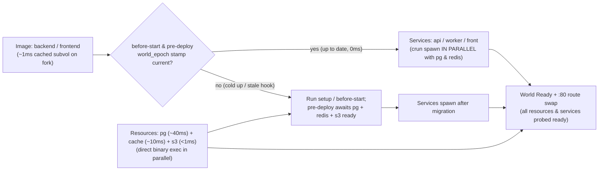
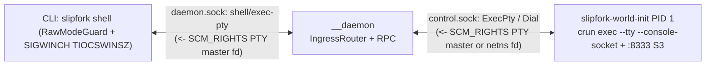

# 03 — How It Works Under the Hood

Slipfork runs your cloud environment locally in a box; CI is the clutch. It boots full-stack worlds and clones live 8-component branches in **`< 1.0s`** (`100%` Docker-free) by combining Btrfs CoW subvolumes, a native Rust S3 engine, direct-exec PG18 and Redis 7 pods, a parallel reactive `tokio` DAG, and one per-user daemon.

<!-- sample output -->
```console
$ slipfork up
✓ Ready -> http://demo.localhost  (<elapsed_ms>)
$ slipfork fork feat-auth
✓ Forked feat-auth (<elapsed_ms>) -> http://feat-auth--demo.localhost
```

*Sample transcript above; real `< 1.0s` median wall-clock ceiling (1 warm-up + 3 measured samples) on the 8-component stack is asserted via `std::time::Instant` in `critical_fork_live`.*

---

## 1. Pure Btrfs Layout, `<world>/.slipfork-world-stamp.json` & Persistent Logs

Everything lives natively on one Btrfs mount — your checkout (`~/projects/demo`) is a Btrfs subvolume (converted transparently on first `slipfork up`), and `<btrfs_mount>/.slipfork-store` holds flat sibling subvolumes plus persistent component logs:

```text
<btrfs-mount>/
├── home/you/projects/demo/                       # Project subvolume (code + .venv + node_modules + .slipfork/)
│   └── .forks/feat-auth/                         # CoW project snapshot (one ioctl)
└── .slipfork-store/
    ├── images/                                   # Read-only OCI & Dockerfile step subvolumes
    ├── logs/<world>/<id>.log                     # Persistent image/hook/resource/service logs (survives failed up & down)
    ├── pods/<world>/                             # Ephemeral writable pod rootfs clones (deleted on down & drop)
    ├── templates/postgres-18/                    # Golden initdb subvolume (sealed BTRFS_SUBVOL_RDONLY)
    └── worlds/
        ├── demo/                                 # World subvolume: s3/ + redis/ + .slipfork-world-stamp.json
        ├── demo.pg.pg/                           # Sibling PGDATA subvolume + .slipfork-pg-stamp.json
        ├── feat-auth--demo/                      # CoW snapshot of world subvolume + world stamp
        └── feat-auth--demo.pg.pg/                # Crash-consistent CoW snapshot of live PGDATA + PG stamp
```

A project, world, or `PGDATA` clone is one `BTRFS_IOC_SNAP_CREATE_V2` ioctl (`~0.3ms` on local NVMe, single-digit ms on network block storage, `≤50ms` ceiling) — after a one-off direct-TCP PostgreSQL `CHECKPOINT` (`~1–3ms`, Simple Query over `Request::Dial { port: 5432 }` on `<pods>/control.sock`) and one `syncfs(2)` that commits its page-cache writes into the Btrfs tree.


!!! info "Epoch-paired stamps & persistent `<store>/logs/<world>/<id>.log`"
    When a world finishes booting, Slipfork writes one `world_epoch` into **both** `<world>/.slipfork-world-stamp.json` and `worlds/<world>.pg.<id>/.slipfork-pg-stamp.json` so `fork` reuses stamps in `0ms` when epochs match. Every image build, setup, hook, resource, and service writes to `<store>/logs/<world>/<id>.log` (retained across failed cold `up` and `down`, truncated only on that component's next build/boot, and removed on `drop`), while `down` deletes only `<runtime_dir>/pods/<world>` and `<store>/pods/<world>/`.

---

## 2. Native Btrfs-Backed Rust S3 (`< 1ms` Boot, Zero Extra Containers)

Slipfork pulls zero external S3 images and runs zero distributed daemons. Detached `__supervise` sends **one typed `Request::ConfigureS3(S3WorldConfig)` frame** over `0600` `control.sock`, and `slipfork-world-init` constructs `S3Server::new(config)` on `127.0.0.1:8333` in `< 1ms`:

| Capability | Exact Contract (`resources/s3/{server.rs,object_ops.rs,listing.rs,policy.rs}`) |
| :--- | :--- |
| `object_ops.rs` | Payload at `<world>/s3/<bucket>/objects/<key>` and atomic sidecar JSON at `<world>/s3/<bucket>/meta/<key>.json` (`content_type`, quoted `etag`, `content_length`, `last_modified`) — plain files cloned instantly on `fork`. |
| `server.rs` | `hyper` `1` (`http1`, `server`) on `127.0.0.1:8333` dispatching path-style (`/<bucket>/<key>`) and the ingress-forwarded `Host: <bucket>.<world>.localhost` `PUT`, `GET`, `HEAD`, `DELETE`, `HeadBucket`, and `?list-type=2`; `cdn <id>` adds no local authority and aliases the bucket host. |
| `listing.rs` | `ListObjectsV2` XML (`prefix`, `delimiter`, `max-keys`, `continuation-token`) sorted lexicographically over Btrfs bucket keys. |
| `policy.rs` | `BucketPolicy` (`Private` \| `PublicRead`) + `SigV4Verifier` (`hmac = "0.12"` `Mac::verify_slice` + `sha2 = "0.10"`, `SecretValue` from `slipfork-forkfile`, `<sha256-hex>` & `UNSIGNED-PAYLOAD`): `Private` denies anonymous `GET` (`403`); `PublicRead` allows anonymous `GET`/`HEAD` (`200`) and denies anonymous `PUT`/`DELETE`/list (`403`). |

---

## 3. Direct-Exec Databases, Parallel Fork Boot DAG & `< 1.0s` Budget

- **PostgreSQL 18 (`~30–50ms` start, direct `postgres` exec, one `~1–3ms` pre-fork `CHECKPOINT` + `syncfs(2)`):**
  - When `PG_VERSION` already exists in `PGDATA`, `PostgresLauncher` unlinks stale `postmaster.pid`, `postmaster.opts`, and `pg_stat`, mounts `/dev/shm`, and `exec`s the `postgres` binary **directly** by absolute path (never `docker-entrypoint.sh` bash wrappers).
  - Dev flags `-c fsync=off -c synchronous_commit=off -c full_page_writes=off -c wal_level=minimal -c max_wal_senders=0 -c autovacuum=off -c shared_buffers=32MB -c dynamic_shared_memory_type=posix` replay any tail WAL in `< 5ms` while readiness polls `.sock/.s.PGSQL.5432` every **`2ms`**.
  - Before `fork`, `PostgresLauncher` sends `CHECKPOINT;` as a PostgreSQL v3 Simple Query over `Request::Dial { port: 5432 }` (`SCM_RIGHTS`, no `crun exec`/`psql` spawn) and then one `syncfs(2)` commits the flushed `shared_buffers`/`wal_buffers` page-cache writes into the Btrfs tree, so `INSERT`s committed immediately before `fork` survive.
- **Redis 7 (`~5–15ms` start, direct `redis-server` exec):** `RedisLauncher` `exec`s `redis-server` directly by absolute path (never `docker-entrypoint.sh`) with `--bind 127.0.0.1 --dir /data --save "" --appendonly yes --appendfsync no` on `<world>/redis/<id>`, polling `:6379` every **`2ms`**.
- **Parent `image` subvolume reuse (`ImageCache`) & `--no-sync` Python:** On `fork` with a matching `world_epoch`, `ImageCache` adopts the parent world's resolved read-only `image` subvolumes directly from `<world>/.slipfork-world-stamp.json` (`cached`, `~1ms`). Runtime Python commands execute with `UV_NO_SYNC=1` / `uv run --no-sync` or direct `.venv/bin/<prog>` exec so service pods never re-run `uv` lock checks.



**Boot-DAG Concurrency & Readiness Rule (`BootScheduler`):**
1. **Stale or unstamped hook (cold `up`, schema/lockfile edit, or `world_epoch` mismatch):** `@<tool>` setup and `before-start` run after their `image` resolves, `pre-deploy` awaits `image` + `setup`/`before-start` + **all backing `resource`s (`pg`, `redis`, `s3`) ready** before running migrations, and `service` container spawn waits for `pre-deploy` completion.
2. **Current stamps (`fork` or warm `up` with matching `world_epoch` + input digests):** `setup`, `before-start`, and `pre-deploy` verify stamps immediately upon `image` completion (`0ms` `up to date`, **without** waiting on `pg`/`redis`), and `service` containers spawn **in parallel** alongside `pg` and `redis` startup — while `:80` ingress activation, `✓ Ready`, and `post-deploy` still await **every** `resource` and `service` readiness probe.

| `slipfork fork <name>` Stage (Full 8-Component Stack) | Target | Hard Ceiling |
| :--- | :--- | :--- |
| `CHECKPOINT` + `syncfs(2)` on live PG, then parallel Btrfs CoW snapshots (project, world, PG) + git branch switch | `18–45ms` | — |
| World `unshare` + `slipfork-world-init` + `ConfigureS3` `:8333` + `world_epoch` image/hook reuse (`cached` `~1ms`) | `15–35ms` | — |
| Parallel `crun` pod boot (direct-exec PG18 `~40ms`, Redis `~10ms`, concurrent `--no-sync` services `2ms` poll) + `:80` swap | `150–350ms` | — |
| **End-to-end (`Command::spawn` -> all 8 components ready + `http://<fork>--<world>.localhost` `200 OK`)** | **`~0.5–0.8s`** | **`< 1.0s` (`1000ms`)** |

---

## 4. Daemon `daemon.sock`, World `control.sock` & Real-PTY `SCM_RIGHTS`



| Socket (`0600`) | Direction & `SCM_RIGHTS` | Canonical Frames |
| :--- | :--- | :--- |
| `<runtime_dir>/daemon.sock` | CLI / `__ingress` → `__daemon`; `SCM_RIGHTS` passes `:80` client fd (`ingress.accept`, client → daemon) and `/dev/pts/N` master fd (`shell` TTY, daemon → CLI). | Request `{"v":1,"id","method","params"}` → streamed `event` frames (`started`, `log`, `finished`, `up-to-date`, `failed`, `ready`, `stopped`) → final `ok` / `error` (`log` streams `logs -f` / piped `exec`; `BootTui` never prints `log` frames). |
| `<pods_dir>/control.sock` | `__supervise` / `__daemon` → PID 1 `slipfork-world-init`; `SCM_RIGHTS` returns world-netns stream fd on `Dial` and `crun exec --tty --console-socket` PTY master fd on `ExecPty` (init → daemon). | `ConfigureS3(S3WorldConfig)`, `Dial { port }`, `List`, `Shutdown`, `ExecPty` (`"terminal": true`), `Exec` (piped stdio), `Logs` (live tail over `<store>/logs/<world>/<id>.log`; `__daemon` reads `<store>/logs/<world>/<id>.log` directly when `<pods_dir>` is absent). |

---

## 5. Composition Roots, Crate Map & Canonical Ports

Slipfork has **five explicit composition roots** and **zero** ambient OS/env probes in library crates:
1. `crates/slipfork/src/main.rs` (CLI, `__daemon`, `__ingress`) — parses `Cli`, builds `UiMode`, `BootTui` (`ScrollRegionGuard` / `AsciiLine`), `RawModeGuard`, `DaemonClient`, and `DaemonServer`.
2. Detached `__supervise` (`crates/slipfork/src/main.rs` child mode) — owns the single boot `tokio::Runtime` and constructs `BootScheduler` (injecting `tokio::runtime::Handle`), `ImageCache`, `PostgresLauncher`, `RedisLauncher`, `WorldStampStore`, `BtrfsEngine`, `NativeImageBuilder`, `FileSecretVault`, and `S3WorldConfig`.
3. `crates/slipfork-world/src/bin/world_init/main.rs` (world PID 1) — binds `0600` `control.sock`, serves `ConfigureS3`/`Dial`/`List`/`Shutdown`/`ExecPty`/`Exec`/`Logs`, and hosts `S3Server` on `:8333`.
4. `crates/slipfork-lsp/src/main.rs` — standalone cross-platform stdio language server.
5. `packages/opencode-slipfork/src/index.ts` — OpenCode V2 plugin shelling the `slipfork` binary.

| Crate | Canonical Cohesive Structs / Modules (`<= 500` LOC each) | Port → Adapter |
| :--- | :--- | :--- |
| `slipfork` | `Cli` (`clap` 4.6 + `clap_complete` + `clap_mangen`), `UiMode`, `BootTui` (`ScrollRegionGuard` `DECSTBM` + `AsciiLine`), `RawModeGuard`, `TableLayout`, `ImageCache` (`world/runtime/images.rs` parent image-subvolume adoption), `DaemonClient`, `DaemonServer` | — |
| `slipfork-forkfile` | `ForkfileCompiler`, `SecretValue` (redacted `Debug`, zeroize-on-drop), `BucketPolicy`, `DnsLabel`, `Formatter`, `SnowMigrator` | — |
| `slipfork-world` | `BtrfsEngine`, `BootScheduler` (`Handle` + `spawn_blocking`), `WorldStampStore` (`world_epoch`), `PostgresLauncher`, `RedisLauncher`, `resources/s3/{server.rs,object_ops.rs,listing.rs,policy.rs}`, `WorldSupervisor` | `WorldEngine` → `BtrfsEngine` |
| `slipfork-image` | `NativeImageBuilder`, `OciPuller`, `DockerfileExecutor` | `BaseImageBuilder` → `NativeImageBuilder` |
| `slipfork-ingress` | `IngressRouter`, `HttpRelay` (`httparse` raw byte/WS proxy) | — |
| `slipfork-ospp` | `WsOsppClient`, `FileSecretVault`, `DeviceIdentity`, `DumpReader` | `OsppClient` → `WsOsppClient`, `SecretVault` → `FileSecretVault` |
| `slipfork-vcs` | `GitWorkspace` | `VcsWorkspace` → `GitWorkspace` |
| `slipfork-lsp` | `LspServer` | — |

The canonical port set is strictly `WorldEngine`, `BaseImageBuilder`, `SecretVault`, `OsppClient`, and `VcsWorkspace` — zero single-impl mock traits sit beside them.
