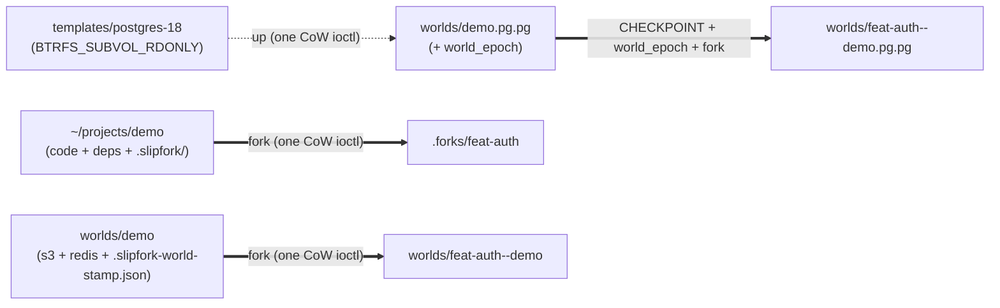
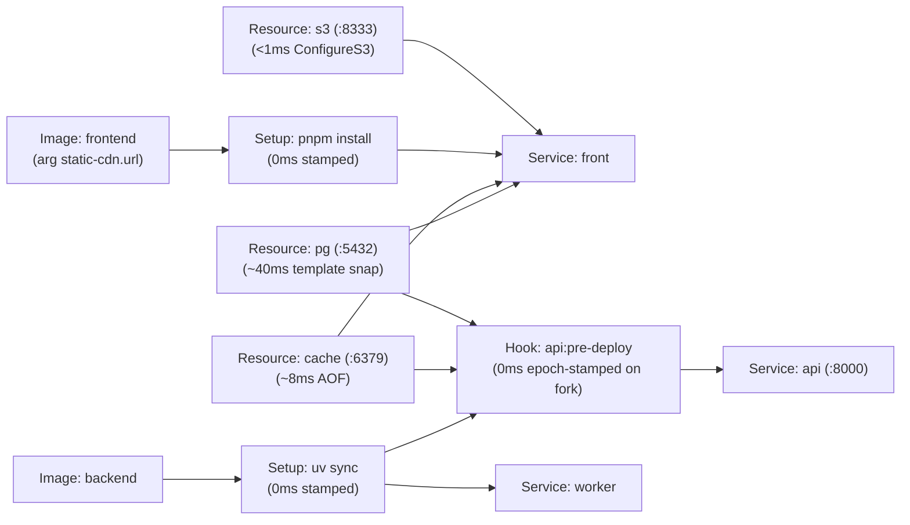
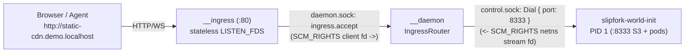

# 03 — How It Works Under the Hood

Slipfork runs your cloud environment locally in a box; CI is the clutch. It boots full-stack worlds and clones live branches in **`< 500ms`** (`100%` Docker-free) by combining Btrfs subvolumes, a native Rust S3 engine, a golden PG18 template, a reactive `tokio` DAG, and one per-user daemon.

<!-- sample output -->
```console
$ slipfork up
✓ Ready -> http://demo.localhost  (<elapsed_ms>)
$ slipfork fork feat-auth
✓ Forked feat-auth (<elapsed_ms>) -> http://feat-auth--demo.localhost
```

*Sample transcript above; real `< 500ms` target / `< 1.0s` wall-clock ceiling is asserted via `std::time::Instant` in `critical_fork_live`.*

---

## 1. Pure Btrfs Layout, `<world>/.slipfork-world-stamp.json` & `world_epoch`

Everything lives natively on one Btrfs mount — your checkout (`~/projects/demo`) is a Btrfs subvolume (converted transparently on first `slipfork up`), and `<btrfs_mount>/.slipfork-store` holds flat sibling subvolumes so snapshots never nest (`ino == 2` stubs and `ENOTEMPTY` are impossible):

```text
<btrfs-mount>/
├── home/you/projects/demo/                       # Project subvolume (code + .venv + node_modules + .slipfork/)
│   └── .forks/feat-auth/                         # CoW project snapshot (one ioctl)
└── .slipfork-store/
    ├── images/                                   # Read-only OCI & Dockerfile step subvolumes
    ├── templates/postgres-18/                    # Golden initdb subvolume (sealed BTRFS_SUBVOL_RDONLY)
    └── worlds/
        ├── demo/                                 # World subvolume: s3/ + redis/ + .slipfork-world-stamp.json
        ├── demo.pg.pg/                           # Sibling PGDATA subvolume + .slipfork-pg-stamp.json
        ├── feat-auth--demo/                      # CoW snapshot of world subvolume + world stamp
        └── feat-auth--demo.pg.pg/                # CoW snapshot of live PGDATA + PG epoch stamp
```

A project, world, or `PGDATA` clone is one `BTRFS_IOC_SNAP_CREATE_V2` ioctl: `~0.3ms` on local NVMe, single-digit ms on network block storage, against a documented `≤50ms` ceiling.



!!! info "Epoch-paired world & PG stamps (`world_epoch`)"
    `<world>/.slipfork-world-stamp.json` records resolved `image` subvolume paths plus completed `@<tool>`, `before-start`, and `pre-deploy` Merkle digests. At `CHECKPOINT`, Slipfork writes one `world_epoch` into **both** `<world>/.slipfork-world-stamp.json` and `worlds/<world>.pg.<id>/.slipfork-pg-stamp.json` (e.g. `worlds/demo.pg.pg`); `slipfork fork` reuses stamps in `0ms` when both epochs match and refuses stamp reuse (re-running hooks) if they differ.

---

## 2. Native Btrfs-Backed Rust S3 (`< 1ms` Boot, Zero Extra Containers)

Slipfork pulls zero external S3 images and runs zero distributed master, Raft, volume, or filer daemons. Detached `__supervise` builds the `S3WorldConfig` value and sends **one typed `Request::ConfigureS3(S3WorldConfig)` frame** over the `0600` world `control.sock` (never via argv or `/proc`), and `slipfork-world-init`'s own composition root constructs `S3Server::new(config)` on `127.0.0.1:8333` in `< 1ms`:

| Capability | Exact Contract (`resources/s3/{server.rs,object_ops.rs,listing.rs,policy.rs}`) |
| :--- | :--- |
| `object_ops.rs` | Payload at `<world>/s3/<bucket>/objects/<key>` and atomic sidecar JSON at `<world>/s3/<bucket>/meta/<key>.json` (`content_type`, quoted `etag`, `content_length`, `last_modified`) — plain files cloned instantly on `fork`. |
| `server.rs` | `hyper` `1` (`http1`, `server`) on `127.0.0.1:8333` dispatching path-style (`/<bucket>/<key>`) and virtual-host (`<bucket>.s3.localhost`, plus `:80` CDN `<cdn-id>.<world>.localhost`) `PUT`, `GET`, `HEAD`, `DELETE`, `HeadBucket`, and `?list-type=2`. |
| `listing.rs` | `ListObjectsV2` XML (`prefix`, `delimiter`, `max-keys`, `continuation-token`) sorted lexicographically over Btrfs bucket keys. |
| `policy.rs` | `BucketPolicy` (`Private` \| `PublicRead`) + `SigV4Verifier` (`hmac = "0.12"` `Mac::verify_slice` + `sha2 = "0.10"`, `SecretValue` from `slipfork-forkfile`, `<sha256-hex>` & `UNSIGNED-PAYLOAD`): `Private` denies anonymous `GET` (`403`); `PublicRead` allows anonymous `GET`/`HEAD` (`200`) and denies anonymous `PUT`/`DELETE`/list (`403`). |

---

## 3. Speed-of-Light Dev Databases, Reactive `tokio` DAG & `< 500ms` Fork Budget

- **PostgreSQL 18 (`~30–50ms` start, `0ms` per-world `initdb`):** Built once at `<btrfs_mount>/.slipfork-store/templates/postgres-18` and sealed `BTRFS_SUBVOL_RDONLY`. `PostgresLauncher` clones `PGDATA` in one CoW ioctl (`~0.3ms` local NVMe, single-digit ms on network block storage, `≤50ms` ceiling), unlinks stale `postmaster.pid`, mounts `/dev/shm`, runs `postgres -c fsync=off -c synchronous_commit=off -c full_page_writes=off -c wal_level=minimal -c max_wal_senders=0 -c autovacuum=off -c shared_buffers=32MB -c dynamic_shared_memory_type=posix`, writes `world_epoch` at `CHECKPOINT`, and polls readiness every **`2ms`**.
- **Redis 7 (`~5–10ms` start, live keys preserved on `fork`):** `RedisLauncher` runs `redis-server --dir /data --save "" --appendonly yes --appendfsync no` on `<world>/redis/<id>` and polls `:6379` every **`2ms`**.
- **Single `tokio::Runtime` owner & `spawn_blocking`:** Detached `__supervise` owns the **one** boot `tokio::Runtime` and injects `tokio::runtime::Handle` into `BootScheduler::new` (zero `Runtime::new()` inside `slipfork-world` library code); blocking steps (Btrfs ioctls, `unshare`, `crun` spawn) run via `spawn_blocking` around the injected sync step executor.

A project, world, or `PGDATA` clone is one `BTRFS_IOC_SNAP_CREATE_V2` ioctl: `~0.3ms` on local NVMe, single-digit ms on network block storage, against a documented `≤50ms` ceiling.



**True reactive `tokio` DAG (zero phase barriers):** Every node awaits strictly its own upstream `tokio::sync::watch` parent edges and records `node_start.elapsed()` once those edges resolve — never `dag_t0.elapsed()`.

| `slipfork fork <name>` Stage | Target | Hard Ceiling |
| :--- | :--- | :--- |
| `CHECKPOINT` + `world_epoch` + parallel Btrfs snapshots (project, world, PG) + branch switch | `25–55ms` | — |
| World `unshare` + `slipfork-world-init` + `ConfigureS3` `:8333` + epoch-verified stamp hit (`0` rebuilds/hooks) | `15–35ms` | — |
| Reactive `tokio` pod boot (PG18 `~40ms`, Redis `~8ms`, app services `2ms` poll) + `:80` route swap | `150–300ms` | — |
| **End-to-end (`Command::spawn` -> `http://<fork>--<world>.localhost` `200 OK`)** | **`< 500ms`** | **`< 1.0s` (`1000ms`)** |

---

## 4. Daemon `daemon.sock` & World `control.sock` Wire Contracts

A project, world, or `PGDATA` clone is one `BTRFS_IOC_SNAP_CREATE_V2` ioctl: `~0.3ms` on local NVMe, single-digit ms on network block storage, against a documented `≤50ms` ceiling.



| Socket (`0600`) | Direction & `SCM_RIGHTS` | Canonical Frames |
| :--- | :--- | :--- |
| `<runtime_dir>/daemon.sock` | CLI / `__ingress` → `__daemon`; `SCM_RIGHTS` passes accepted `:80` fd on `ingress.accept` (client → daemon). | Request `{"v":1,"id","method","params"}` → streamed `event` frames (`started`, `log`, `finished`, `failed`, `ready`, `stopped`) → final `ok` / `error`. |
| `<pods_dir>/control.sock` | `__supervise` / `__daemon` → PID 1 `slipfork-world-init`; `SCM_RIGHTS` returns connected world-netns stream fd on `Dial` (init → daemon). | `ConfigureS3(S3WorldConfig)`, `Dial { port }` (incl. `:8333` CDN & service `:port`s), `List`, `Shutdown`, `Exec` (+ base64 `ExecInput`), `Logs` (250 ms merge over `<pods>/logs/<id>.log`). |

Paired `__daemon` sessions also maintain `OSPP v1` in-memory `hpke-p256` secrets and DB dump streams, while `@slipfork/opencode` shells `slipfork fork` and `slipfork drop` per agent session.

---

## 5. Composition Roots, Crate Map & Canonical Ports

Slipfork has **five explicit composition roots** and **zero** ambient probes in library crates:
1. `crates/slipfork/src/main.rs` (CLI, `__daemon`, `__ingress`) — parses `Cli`, builds `UiMode`, `DaemonServer`, and `FileVault`.
2. Detached `__supervise` (`crates/slipfork/src/main.rs` child mode) — owns the single boot `tokio::Runtime` and constructs `BootScheduler` (injecting `tokio::runtime::Handle`), `PostgresLauncher`, `RedisLauncher`, `WorldStampStore`, `BtrfsEngine`, `NativeImageBuilder`, and `S3WorldConfig`.
3. `crates/slipfork-world/src/bin/world_init/main.rs` (world PID 1) — binds `0600` `control.sock`, serves `Dial`/`List`/`Shutdown`/`Exec`/`Logs`, and constructs `S3Server::new(config)` on `:8333` from `Request::ConfigureS3`.
4. `crates/slipfork-lsp/src/main.rs` — standalone cross-platform stdio language server.
5. `packages/opencode-slipfork/src/index.ts` — OpenCode V2 plugin shelling the `slipfork` binary.

| Crate | Canonical Cohesive Structs / Modules (`<= 500` LOC each) | Port → Adapter |
| :--- | :--- | :--- |
| `slipfork` | `Cli` (`clap` 4.6 + `clap_complete` + `clap_mangen`), `UiMode`, `BootTui`, `TableLayout`, `FileVault`, `DaemonServer` | `SecretVault`, `DaemonControl` |
| `slipfork-forkfile` | `ForkfileCompiler`, `SecretValue` (redacted `Debug`, zeroize-on-drop), `BucketPolicy`, `DnsLabel`, `Formatter`, `SnowMigrator` | — |
| `slipfork-world` | `BtrfsEngine`, `BootScheduler` (`Handle` + `spawn_blocking`), `WorldStampStore` (`world_epoch`), `PostgresLauncher`, `RedisLauncher`, `resources/s3/{server.rs,object_ops.rs,listing.rs,policy.rs}` (`S3Server`, `S3BucketStore`, `SigV4Verifier`), `WorldSupervisor` | `WorldEngine` → `BtrfsEngine` |
| `slipfork-image` | `NativeImageBuilder`, `OciRegistryClient`, `DockerfileExecutor` | `BaseImageBuilder` → `NativeImageBuilder` |
| `slipfork-ingress` | `IngressRouter`, `HttpRelay` (`httparse` raw byte/WS proxy) | — |
| `slipfork-ospp` | `WsOsppClient`, `DeviceIdentity`, `DumpStreamReader` | `OsppClient` → `WsOsppClient` |
| `slipfork-vcs` | `GitWorkspace` | `VcsWorkspace` → `GitWorkspace` |
| `slipfork-lsp` | `LspServer` | — |

The canonical port set is strictly `WorldEngine`, `BaseImageBuilder`, `SecretVault`, `DaemonControl`, `OsppClient`, and `VcsWorkspace` — zero single-impl mock traits sit beside them.
