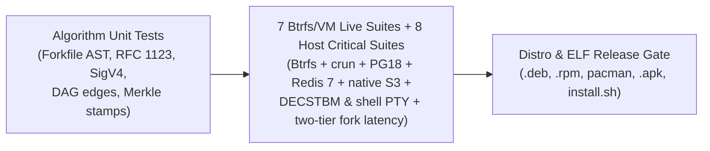

# 04 — The Testing Plan

Slipfork runs your cloud environment locally in a box; CI is the clutch. Every feature is proven end-to-end against real Btrfs subvolumes, real `crun` pods, real PostgreSQL 18 / Redis 7 / native Rust S3 services, and real kernel PTYs — with **zero mocks** outside the loopback `OSPP v1` reference server.

```console
$ tools/do_vm.py sync && tools/do_vm.py test
$ SLIPFORK_TEST_ROOT=/mnt/slipfork-live make live-test
```



!!! warning "Zero mocks & real disk only (never RAM `/tmp`)"
    `Mock*`, `Fake*`, `Stub*`, `Recording*`, in-memory vaults, `sleep()` benchmark simulations, and `chmod 0o555` shims are banned. Heavy test state (worktrees, OCI caches, `PGDATA`, Btrfs subvolumes, Cargo scratch) must live on real disk under `/var/tmp`, `~/.cache/slipfork`, `.slipfork/`, or the Btrfs mount — never on RAM-backed `/tmp` `tmpfs` — and `SLIPFORK_TEST_ROOT` must resolve to a real Btrfs disk path.

---

## 1. Enclosing `image` Scopes, Native Rust S3 & Ingress Parity

- **Enclosing `image` builds, non-secret `arg` vs runtime `env`, and OCI pulls (`critical_dockerfile_live`, `critical_oci_live`):** Build a multi-stage `Dockerfile` `image <id> <dir> { ... }` (`FROM ... AS`, `ARG`, `COPY --from`, `RUN --mount=type=cache`, `.dockerignore`) natively on Btrfs + `crun` passing `arg VITE_CDN_URL = assets.url`, keeping runtime `env` out of builds, and pulling `image ... from <ref>` (`mailpit`) over HTTPS.
- **Native Btrfs-backed Rust S3 matrix (`critical_world_journey`):** Over `Request::ConfigureS3` on `:8333` and `Dial { port: 8333 }` `:80` ingress, execute real `PUT`, `GET`, `HEAD`, `DELETE`, and `ListObjectsV2` (`?list-type=2` with `prefix`/`continuation-token`) across path-style and virtual-host addressing, verifying `Content-Type`/`ETag`/`Content-Length` sidecars, AWS SigV4 HMAC-SHA256 (`UNSIGNED-PAYLOAD` on `GET`/`HEAD` and `403` on bad signatures), `403` anonymous `GET` on `policy private` (`s3 uploads`), and `200` anonymous `GET` + `403` anonymous `PUT`/`DELETE` on `s3 assets { policy public-read; cdn edge }` at `http://assets.<world>.localhost`; a declared `cdn <id>` is a cloud-only binding that locally resolves to the bucket's own `<bucket>.<world>.localhost` domain.
- **Cloud-identical HTTP/WebSocket ingress (`critical_ingress`, `critical_world_journey`):** Verify preserved prefixes (`route /api`), `strip-prefix`, `rewrite`, `exact`, `domain <id>` (a route without one binds the primary world domain and the first declared `domain`) across HTTP and upgraded WebSockets with `$port` and `PORT` parity.
- **Fail-closed static checks before boot (`critical_forkfile`):** Refuse missing `# forkfile: 0.1`, symbol collisions, `cdn <id>` without `policy public-read` (`next: add 'policy public-read' inside 's3 <bucket>' to enable 'cdn <id>'`), invalid RFC 1123 labels (`_`, uppercase, leading/trailing `-`, `> 63` chars on declared `domain`/`cdn`, plus `< 3` chars or IPv4 literals on `s3 <bucket>`), `strip-prefix` + `rewrite`, and secret-tainted `image` `arg`s — and verify every `forkfile` fence in published `README.md` / `docs/*.md` passes static checking.

---

## 2. `clap` CLI, `DECSTBM` Bottom-Bar PTY TUI, Real-PTY `shell` & Terminal Hygiene

- **Real PTY `DECSTBM` scroll-region capture & `NO_COLOR`/`TERM=dumb` PTY purity (`critical_status_live`, `critical_cli_surface`):**
  - Drive `slipfork up`, `restart`, and `down` inside a real PTY (`openpty` / `script -qec`), asserting `ColorTty` (`rows >= 3`, `cols >= 80`) sets `\x1b[1;{rows-1}r`, pins the 24-cell `[██████████████████░░░░░░]` bar (`filled = round(done / total * 24)`) with consistent `done/total` and `pct%` on row `rows`, omits the bar below `80` cols without shearing counters, and never emits `\x1b[1;1r`/`\x1b[1;2r` when `rows < 3`.
  - Assert **strictly one** aligned line per task above row `rows` with **zero** `StepLog`/`sealed sha256:`/`dockerfile` debug lines, dim `• image <name> cached` on OCI/Dockerfile cache hits (never `pulled`/`built`), clean `SIGWINCH` redraws, and `ScrollRegionGuard` `\x1b[r` + row-`rows` clear on success and failure (`✗ Failed to build image <id> — check logs with: slipfork logs <id>`).
  - Re-run in the **same real PTY** with `NO_COLOR=1` and `TERM=dumb`, asserting the `\r`-rewritten plain-ASCII bottom line (`|/-\` spinner, 24-cell `[#.]` bar when `cols >= 80`), **`0` `\x1b[` bytes**, and **no SGR**.
- **Non-TTY replay, `--json` schemas & `clap` surface (`critical_cli_surface`, `critical_host_verbs`):**
  - On piped non-TTY stdio, assert `→ [i/n]` headers + `✓ <kind> <name> <state>  <dur>` replay with `0` `\x1b[` and `0` `\r` bytes, exact `--json` schemas (`up`/`restart`, `doctor`, structured `{"error":{code,message,next}}`) with `0` `\x1b[` bytes, and non-empty `completions` + `clap_mangen` `slipfork(1)` output.
  - In `critical_cli_surface`, assert `Cli::command()` shape and exit-`2` refusals only — explicitly superseding `crates/slipfork/tests/critical_cli_surface.rs:133,136,242,259,260` (`db`/`redis` subcommands and bare `shell` without `<target>`) — while `critical_host_verbs` covers `down` and SSH/headless-safe `open` (zero `shell` duplication).
- **One cohesive real-PTY `shell <target>`, `logs`, and `exec` journey (`critical_world_journey`):**
  - Inside one booted world, verify `slipfork shell <service|image>` over a real PTY attaches `/dev/pts/N` via `crun exec --tty --console-socket` + `SCM_RIGHTS` (`tty` exits `0`, zero `can't access tty; job control turned off`, `(<world>:<target>)` prompt, `SIGWINCH` `TIOCSWINSZ` resize, cooked mode restored on exit), `slipfork shell <pg|database>` runs `psql` (TTY and piped `-X -q -v ON_ERROR_STOP=1`), `slipfork shell <redis>` runs `redis-cli` (TTY and piped), and `s3`/unknown targets print exact `1 line + next:` refusals on stderr (`✗ 'uploads' is an s3 bucket, not a shell` / `✗ No shellable target 'apii'`).
  - In the same journey (plus one failed cold image build), verify `slipfork logs <image>` reads `<store>/logs/<world>/<id>.log` even when no pods are running and survives `down`, bare `slipfork logs` streams app `service`s only (`-a` adds images + resources), and `exec` forwards exit codes.
- **Timestamped log index and ranged reads (`critical_world_journey`):** `<store>/logs/<world>/<id>.idx` stores 16-byte `(ts_ms, offset)` records beside each `.log`, and `read_range(start_ms, end_ms)` proves a binary-search seek to the first in-range record before reading only that byte range. The journey runs `slipfork logs api worker --since <ms> --until <ms> -t` to assert multi-target merge order, `ts_ms` on every `--json` line, and a malformed `--since` exiting `2` with one stderr line plus `next:`.

---

## 3. Two-Tier `slipfork fork` Latency & Coding Agents

- **Asserted two-tier `fork` latency across the real FastAPI + SvelteKit demo's 8 components (`critical_fork_live`):**
  - On `165.232.86.174`, boot the full 8-row demo fixture: **4 resources** (`pg` with seeded rows, `cache` with live Redis 7 AOF keys, private `uploads` S3, `public-read` + CDN `assets` S3) and **4 services** (`api` and `worker` from one `Dockerfile` image, `front` from a second `Dockerfile` image, and one OCI `from <ref>` service), with `@uv`/`@pnpm` installs and a `pre-deploy` migration hook.
  - Run **1 discarded warm-up fork then 3 timed samples**, wrapping `Command::spawn` of `slipfork fork` until all **8** rows report ready and `http://<fork>--<world>.localhost` answers `200 OK` in `std::time::Instant`; print every sample and **assert** the reported `snapshot_ms < Duration::from_millis(500)` and `median end-to-end < Duration::from_secs(8)` (`~5.5s` target, never best-of), bounded on both the 4-vCPU dev VM and 2-vCPU GitHub Actions loop-Btrfs runner.
  - Assert direct binary `exec` + zero pre-fork `CHECKPOINT` observables: pod `/proc/<pid>/cmdline` argv[0] is the absolute `postgres` / `redis-server` binary path (no `docker-entrypoint.sh`), and parent `PGDATA` `PG_VERSION` + `pg_wal` mtimes remain unchanged across `fork` snapshot preparation.
  - Assert parent `image` subvolume reuse (`cached`) and boot-trace `[started_ms, finished_ms]` interval overlap proving a `service` `Started` before `pg` `Ready` when `world_epoch` stamps match (while a mismatched `world_epoch` or stale `pre-deploy` orders `pg` `Ready` → `pre-deploy` → `service` `Started`), plus isolated fork writes and dirty `drop` refusal without `-f`. Fork once more from the same parent and assert images report `cached`, `uv sync`/`pnpm install` and `pre-deploy` report `up to date`, and `runs/` gains zero new ids.
- **Parallel AI coding-agent sessions (`@slipfork/opencode`):** Open concurrent OpenCode worktrees against one repo, verifying `SLIPFORK_WORLD` + `SLIPFORK_URL` export, `_` -> `-` `.localhost` branch slug normalization, and clean fork reaping on session idle.

---

## 4. Installation, Distro Packaging, `OSPP v1` & Language Tooling

- **Install, `doctor`, packages & `install.sh` (`critical_daemon`, `critical_host_verbs`):** Verify `slipfork daemon install`, `sudo slipfork daemon install --ingress`, 3-row `slipfork doctor` (`✓ Ready` vs `✗ N issue(s)` with per-row `next:`), `.deb`/`.rpm`/`.pkg.tar.zst`/`.apk`/portable archives gated by `scripts/check-portable-elf.sh`, `docs/install.sh`, and `slipfork migrate` (`critical_fmt_migrate`).
- **`OSPP v1` secrets & offline fallback (`critical_ospp`):** Pair against the `127.0.0.1:0` loopback `OSPP v1` reference server, verify `hpke-p256` `SecretValue` decryption strictly on `tmpfs`, live `env_updated` restarts, sealed DB dumps, and offline `secret(KEY) ?? random_hex(32)` parity with TTY-gated `--reveal`.
- **Focused algorithm & editor suites (`critical_forkfile`, `critical_fmt_migrate`, `critical_lsp`):** Unit-test `# forkfile: 0.1` parsing, RFC 1123 + `3..=63` S3 bucket validation, `BucketPolicy` checking, `SecretValue` taint rules, DAG concurrency edges (parallel stamped vs resource-gated stale hooks), Merkle + `world_epoch` stamping, SigV4 canonicalization, `slipfork fmt`, `slipfork-lsp`, and the Zed extension.

---

## 5. Running the Protected Live & Workspace Gates

The seven Btrfs/VM live suites (`critical_btrfs_live`, `critical_oci_live`, `critical_dockerfile_live`, `critical_pod_runtime`, `critical_world_journey`, `critical_fork_live`, `critical_status_live`) run sequentially on real Btrfs + `crun` (`165.232.86.174` via `tools/do_vm.py sync && tools/do_vm.py test` or locally via real Btrfs `SLIPFORK_TEST_ROOT=<btrfs-mount> make live-test`) and **fail closed with a 1-line remedy** when Btrfs, namespaces, or `crun` are missing. Every other `critical_*` suite (`critical_ospp`, `critical_ingress`, `critical_cli_surface`, `critical_daemon`, `critical_host_verbs`, `critical_fmt_migrate`, `critical_forkfile`, `critical_lsp`) remains protected by `tools/critical_guard.py` and must stay green in the same gate (`cargo test --workspace`).
