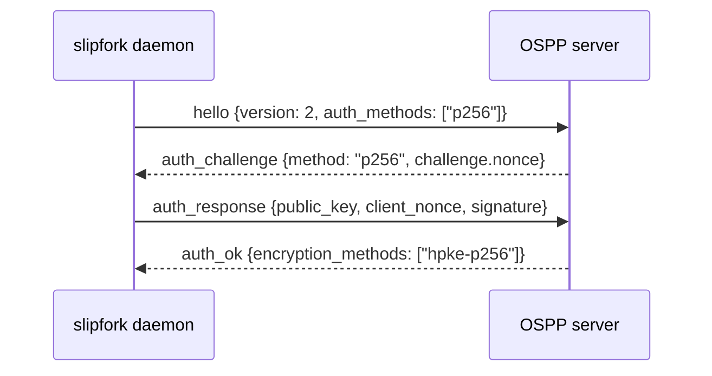
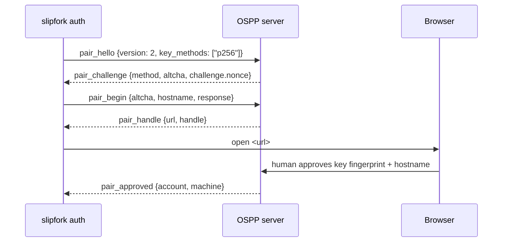

# 05 — The `OSPP v1` Wire Specification

OSPP v1 lets a local world ask CI for the authoritative values of its environment without copying `.env` files or pasting secrets into a terminal. You pair once, and the `slipfork` daemon receives secrets that are decrypted only in memory.

```console
$ slipfork auth
https://ci.acme-shop.example/pair#handle=<32-byte hex>
[auth] paired p256:02b1… account=alice
$ slipfork up
✓ Ready -> http://acme-shop.localhost   secrets: 6 from OSPP v1
```

This document is authoritative: frame names, field names, error codes, and byte layouts are exhaustive. Slipfork ships the **client** (`crates/slipfork-ospp`); the server belongs to the provider.

---

## 1. Transport & Framing

| Rule | Value |
| :--- | :--- |
| WebSocket subprotocol | `Sec-WebSocket-Protocol: ospp-v1` (stable across version bumps) |
| Frame encoding | One UTF-8 JSON **text** message per frame; a binary frame is a violation |
| Discriminator | `"type"`, snake_case |
| Version | `hello.version = 2` and `pair_hello.version = 2`; any other value → `unsupported_version`, socket closed |
| Unknown field | Protocol violation (`bad_frame`) — there is no catch-all `extra` bag |
| Unknown `type` | Protocol violation — the frame set is closed |
| Endpoint | `wss://` anywhere; plaintext `ws://` strictly on `localhost` / `127.0.0.1` / `::1` |

Fail-closed means exactly this: no version negotiation, no weaker auth, no local fallback, no partial decode.

---

## 2. Client → Server Frames (7)

| `type` | Fields (`name: type`, required unless marked) | Purpose |
| :--- | :--- | :--- |
| `hello` | `version: u32`, `auth_methods: string[]` | Open a session; `["p256"]` |
| `auth_response` | `response: AuthResponse` | Answer `auth_challenge` |
| `pair_hello` | `version: u32`, `key_methods: string[]` | Open first-time enrolment |
| `pair_begin` | `altcha: string`, `hostname: string`, `response: AuthResponse` | Proof of work + proof of possession |
| `subscribe` | `id: string`, `remote: string`, `encryption: Encryption`, `forkfile: string`, `claims: Claims` | Attach a project environment |
| `unsubscribe` | `id: string` | Release a subscription |
| `dump_request` | `id: string`, `subscription_id: string`, `resource: string` | Ask for a sealed resource dump |

## 3. Server → Client Frames (9)

| `type` | Fields (`name: type`, optional marked) | Purpose |
| :--- | :--- | :--- |
| `auth_challenge` | `method: string`, `challenge: { nonce: string }` | `method = "p256"`; `nonce` is 32-byte hex |
| `auth_ok` | `encryption_methods: string[]` | Session accepted; `["hpke-p256"]` |
| `pair_challenge` | `method: string`, `altcha: object`, `challenge: { nonce: string }` | ALTCHA challenge plus nonce |
| `pair_handle` | `url: string`, `handle: string` | Browser pairing URL (no fragment) and single-use handle |
| `pair_approved` | `account: string`, `machine: string` | Human verdict from the browser |
| `env_resolved` | `id: string`, `components: map<component, map<key, WireValue>>` | Initial environment |
| `env_updated` | `id: string`, `components: map<component, map<key, WireValue>>` | Push after an upstream change |
| `dump_ready` | `id: string`, `url: string` | Short-lived HTTPS download URL |
| `error` | `id: string \| null` (optional), `code: string`, `message: string` | Typed refusal |

### Nested objects

| Type | Fields | Notes |
| :--- | :--- | :--- |
| `AuthResponse` | `public_key: string`, `client_nonce: string`, `signature: string` | 66 hex / 64 hex / 128 hex |
| `Encryption` | `method: string`, `public_key: string` | `method = "hpke-p256"`; key is 130 hex (uncompressed) |
| `Challenge` | `nonce: string` | 32-byte hex, fresh per connection |
| `Claims` | `vars: string[]`, `secrets: string[]`, `resources: map<kind, string[]>`, `domains: string[]`, `components: string[]` | All optional; empty collections are omitted |
| `WireValue` | `string` **or** `{ "encrypted": string }` | Object form has exactly one key |

`components` keys are `service` (or `image`) ids; inner keys are variable names. A `{ "encrypted": … }` value is standard base64 of `enc(65 bytes) || AES-256-GCM ciphertext`.

---

## 4. Authentication (P-256)



| Element | Encoding |
| :--- | :--- |
| Machine public key | Compressed SEC1 P-256, 33 bytes → **66 lowercase hex** |
| Client nonce | 32 random bytes → 64 hex |
| Signature | ECDSA P-256 + SHA-256 over the transcript, **raw `r ‖ s`**, 64 bytes → **128 hex** (never ASN.1 DER) |
| Auth transcript | `b"ospp-v1" ‖ server_nonce ‖ client_nonce` |
| Pairing transcript | `b"ospp-v1-pair" ‖ server_nonce ‖ client_nonce` |

The machine key is a `0600` file (`<state_dir>/device-key.json`) and authenticates the machine only. It is never the per-subscription encryption key.

---

## 5. First-Time Pairing (ALTCHA + PoP)



| ALTCHA field | Meaning |
| :--- | :--- |
| `algorithm` | Must be `"SHA-256"` |
| `challenge` | `sha256(salt ‖ number)` as lowercase hex |
| `salt` | Server salt string |
| `maxnumber` | Search bound; the client never searches above `5_000_000` |

The solution `altcha` payload is **standard base64 of the challenge object plus `"number"`**. The handle is 32 bytes of hex and appears only in the URL fragment, so access logs and `Referer` headers never record it.

On approval the client persists one `0600` record, atomically replaced, at `<state_dir>/ospp.json`:

```json
{ "endpoint": "wss://ci.acme-shop.example/ospp", "account": "alice", "machine": "acme-laptop" }
```

`slipfork auth [<endpoint-url>]` resolves its endpoint by precedence: `--ospp-endpoint` > the positional URL > the saved `<state_dir>/ospp.json`. On success it prints the settled pair followed by `next: slipfork up`, and later daemons reconnect from the record while an explicit `--ospp-endpoint` still wins. A pairing attempt against a different URL fails closed.

The only test stand-in is the minimal `127.0.0.1:0` loopback reference server described in [04 §1](./04-testing-plan.md#1-testing-philosophy); production always requires `wss://`, with plaintext `ws://` allowed on loopback only.

---

## 6. Subscription & Claims

`subscribe` carries the **feature-evaluated `Forkfile`** (see [01](./01-forkfile.md)) exactly once; there is no separate `snow` field or alias. `remote` is the verbatim Git remote string with zero client-side canonicalization, and project identity is that string alone.

Claims are **IDs only** — never a value. A claimed entry is left untouched by the server and resolved locally; everything unclaimed is resolved server-side.

| Namespace | Claimed shape | Effect |
| :--- | :--- | :--- |
| `vars` | `["DEBUG"]` | `vars::DEBUG` stays local |
| `secrets` | `["LOCAL_DEV_KEY"]` | `secret(LOCAL_DEV_KEY)` stays local |
| `resources` | `{ "pg_databases": ["main"] }` | Local database wins over CI |
| `domains` | `["main"]` | Local domain id stays local |
| `components` | `["api"]` | Local service id stays local |

`env_updated` uses the same `components` shape; affected services restart in place. Slipfork keeps the subscription id stable across a claims or config update, so a re-subscribe replaces rather than duplicates.

---

## 7. Secret Encryption (`hpke-p256`)

| Parameter | Value |
| :--- | :--- |
| Mode | RFC 9180 Base |
| KEM | `DHKEM(P-256, HKDF-SHA256)` |
| KDF | `HKDF-SHA256` |
| AEAD | `AES-256-GCM` (16-byte tag) |
| `info` | `"ospp-v1-secret"` |
| `aad` | `"<service>:<env_key>"` — for example `api:SECRET_KEY` |
| Ciphertext layout | `enc` (65-byte uncompressed SEC1) ‖ sealed value |
| Wire form | `{ "encrypted": "<standard base64>" }` |

The recipient keypair is generated per subscription, sent as `encryption.public_key` (130 hex), and lives only in the `slipfork` daemon's memory. The AAD binding is what stops a ciphertext for `api:SECRET_KEY` from opening as `worker:SECRET_KEY`.

The per-user unit runs the same `slipfork` binary in its daemon mode; there is no separate `slipforkd` executable.

---

## 8. Sealed Resource Dumps

`dump_request` names a resource such as `pg_databases.main`. The server answers `dump_ready` with a short-lived URL; the body is an RFC 9180 **stateful** stream.

| Element | Value |
| :--- | :--- |
| Body layout | `enc` (65 bytes) then repeated frames, then one final frame |
| Frame | `4-byte big-endian plaintext length ‖ ctx.Seal(aad, chunk)` (length excludes the 16-byte tag) |
| EOF | A frame with `len = 0` and a sealed empty chunk — mandatory |
| `info` | `"ospp-v1-dump"` |
| `aad` | `"<subscription_id>:<resource>"` |
| Max chunk | `1 MiB` (`MAX_DUMP_CHUNK`) |
| Max response headers | `16 KiB` (`MAX_DUMP_HEADER_BYTES`) |
| `Content-Length` | Mandatory; the body is read through `take(len)` |
| Redirects | Zero — a redirect is a transport failure |
| Scheme | `https://` anywhere; `http://` loopback only |

A stream that ends before the `len = 0` EOF frame is truncated, and the world stays on its sealed base. The dump URL is single-use and short-lived; no pooled connection outlives the stream.

---

## 9. Errors (12 codes)

Every refusal is an `error` frame; handshake, pairing, and auth failures also close the socket.

| `code` | Meaning | Usual cause |
| :--- | :--- | :--- |
| `unsupported_version` | No shared protocol version | `hello.version != 2` |
| `unsupported_auth` | No `auth_methods` / `key_methods` entry supported | Client sent only unknown methods |
| `unsupported_encryption` | No shared `encryption_methods` | Client cannot do `hpke-p256` |
| `unauthorized_key` | Authenticated key may not act on this project | Wrong account for the remote |
| `unknown_remote` | Verbatim Git remote unknown to the server | Project not connected in CI |
| `bad_proof` | PoP signature did not verify | Wrong key, wrong transcript, bad encoding |
| `rejected` | A human rejected the pairing | Browser clicked deny |
| `already_paired` | Machine key enrolled elsewhere | Re-imaged host or cloned key file |
| `throttled` | Unauthenticated pairing rate-limited | Repeated `pair_hello` |
| `unresolved` | An unclaimed legacy template lookup could not resolve | Missing CI variable or resource |
| `dump_unavailable` | Requested dump is unavailable | Expired snapshot, wrong resource path |
| `bad_frame` | Frame, field, or value violated this spec | Unknown type/field, binary frame, bad value shape |

---

## 10. Legacy `snow.yml` Migration (`slipfork migrate`)

The converter is one-way, deterministic, and parses its own output before writing, so a migrated file is always statically valid `# forkfile: 0.1`.

### Input schema (top level)

| Key | Shape | Migrates to |
| :--- | :--- | :--- |
| `images` | `[{ id, context \| registry+repository+tag, dockerfile?, envs?[] }]` | enclosing `image <id> <dir>` / `image <id> from <ref>`, `build_env` |
| `resources.pg_clusters` | `[{ id, version? }]` (default `18`) | `postgres <id> { version … }` |
| `resources.pg_databases` | `[{ id, cluster, pool? }]` (default `true`) | `database <id>` inside its cluster |
| `resources.redis_clusters` | `[{ id, version? }]` (default `7`) | `redis <id> { version … }` |
| `resources.s3_buckets` | `[id]` or `[{ id }]` | `s3 <bucket>` |
| `domains` | `[id]` or `[{ id }]` | `domain <id>` |
| `envs` | `{ <group>: { KEY: "<template>" } }` | `env <group> { KEY = <expr> }` |
| `components` | `[{ id, image, run_command, envs?[], internal_ports?[], size_hint? }]` | `service <id>` inside its `image` |
| `ingresses` | `[{ match: { prefix }, target: { component, port } }]` | `port <n>` + `route <prefix>` |
| `hooks` | `[{ component, when, run_command }]` | `before-start:` / `pre-deploy:` / `post-deploy:` / `failed-deploy:` |
| `modes` | `{ all: { envs? }, <mode>: { envs?, components? } }` | `features { <mode> }` + `on <mode> { … }` |

An unknown top-level key is refused with its line and the list of valid keys — never silently dropped. A `modes.<mode>.components.<id>.disabled: true` override is refused, because a `Forkfile` cannot delete a declared service for one mode.

### Template rules

A legacy `snow.yml` env template carries lookups written as `secrets::KEY`, `vars::KEY`, `resources::pg_databases.<id>.<prop>`, `resources::redis_clusters.<id>.<prop>`, `resources::s3_buckets.<id>.<prop>`, `domains::<id>` and `components::<id>.<prop>`. Each becomes one `Forkfile` expression:

| Upstream lookup | `Forkfile` |
| :--- | :--- |
| `secrets::KEY` | `secret(KEY)` |
| `vars::KEY` | `var(KEY)` |
| `resources::pg_databases.<id>.<prop>` | `<id>.<prop>` |
| `resources::redis_clusters.<id>.<prop>` | `<id>.<prop>` |
| `resources::s3_buckets.<id>.<prop>` | `<id>.<prop>` |
| `domains::<id>` | `<id>.name` (a bare hostname) |
| `components::<id>.<prop>` | `<id>.<prop>` |

Literal text around a lookup becomes `"${...}"` interpolation: a `postgres://` prefix plus `resources::pg_databases.app_db.url` renders `"postgres://${app_db.url}"`. A non-secret default stays a deterministic `??`; random bytes belong to a generator argument (`secret(KEY, random_string(50))`), never `?? random_*`. An unknown lookup is refused at its exact path.

### Command and cross-reference rules

- `run_command` is split into direct `argv`; `| & ; < > $ ` * ? ( ) { } [ ] ~ !` and unterminated quotes are refused with "move the pipeline into `scripts/<name>.sh`".
- Every id shares one flat namespace, so `redis cache` plus `domain cache` is refused naming both kinds.
- Every reference is proven before rendering: unknown cluster, image, env group, component, or a component routed on two ports all fail with `path: message` plus a `next:` remedy.
- Output order is fixed (`features`, resources, env groups, mode-gated groups, services) with one blank line between blocks and a single `# migrated from snow.yml` header, so identical input yields byte-identical output.
