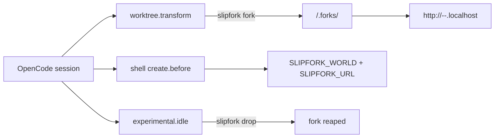

# 06 — Distribution & Documentation

One `slipfork` binary, native on every Linux distribution your team uses, plus a docs site that only promises what the binary does. A developer should get a working world from one command on a fresh machine.

```console
$ curl -fsSL https://offworldnexus.github.io/slipfork/install.sh | sh
$ slipfork up
✓ Ready -> http://acme-shop.localhost
```

---

## 1. Artifact Matrix

Two architectures only — `x86_64`/`amd64` and `aarch64`/`arm64` — and every leg runs natively (no emulated compilers as evidence).

| Family | Formats | Runtime contract | Manager |
| :--- | :--- | :--- | :--- |
| Debian / Ubuntu | `.deb` | `libc6 (>= <measured>)`, `libgcc-s1` when `DT_NEEDED` names it, `crun`, `btrfs-progs` | `dpkg-deb --root-owner-group` |
| Fedora / RHEL / Rocky / Alma / openSUSE | `.rpm` | `glibc >= <measured>`, `crun`, `btrfs-progs` | `rpmbuild` |
| Arch Linux | `.pkg.tar.zst` + AUR `PKGBUILD`/`.SRCINFO` | `glibc`, `crun`, `btrfs-progs` | `makepkg` |
| Alpine / musl | `.apk` + dynamic-musl `.tar.gz` | `libgcc`, `crun`, `btrfs-progs` | `abuild` / `apk` |
| Any glibc host | `slipfork-<target>-gnu.tar.gz` | glibc floor, no `RUNPATH` | `install.sh` |
| Any musl host | `slipfork-<target>-musl.tar.gz` | `libgcc`, dynamic (not static-pie) | `install.sh` |

`slipfork` needs `crun` and a Btrfs filesystem; both are declared, never bundled. The binary itself links only libc, libm, libgcc_s, and the dynamic loader — language runtimes are `dlopen`ed or containerized, never `NEEDED`.

---

## 2. Debian / Ubuntu `.deb`

```text
/usr/bin/slipfork                      -> ../share/slipfork/lib/slipfork
/usr/share/slipfork/{LICENSE,lib,share}
/usr/lib/systemd/system/slipfork-ingress.socket
/usr/lib/systemd/system/slipfork-ingress@.service
/usr/lib/systemd/system/slipfork-ingress.service
/usr/lib/systemd/user/slipfork-daemon.service
/etc/apparmor.d/slipfork
/usr/share/man/man1/slipfork.1.gz
/usr/share/bash-completion/completions/slipfork
/usr/share/zsh/site-functions/_slipfork
/usr/share/fish/vendor_completions.d/slipfork.fish
```

| Requirement | Contract |
| :--- | :--- |
| Ownership | Built with `dpkg-deb --root-owner-group`; no host install during the build |
| Dependency floor | `Depends: libc6 (>= X.Y)` is **measured** by `scripts/check-portable-elf.sh --max-glibc`, never typed by hand |
| Ceiling | `--max-glibc <declared>` refuses a bundle built on too new a host instead of shipping an unverified floor |
| Ingress on `:80` | Socket-activated: `slipfork-ingress.socket` listens on `127.0.0.1:80`, and one template instance per connection hands the fd to the user daemon |
| AppArmor | `/etc/apparmor.d/slipfork` ships and is enforced; `slipfork doctor` reports when it is not loaded |
| `lintian` | Clean — no errors and no warnings that name a real packaging defect |
| Reproducibility | `SOURCE_DATE_EPOCH` fixes ar-member timestamps; two builds of one commit are byte-identical |

The package never enables a root daemon. `slipfork daemon install` writes the **user** unit, so worlds stay in the developer's session. There is one binary: the per-user unit runs the same `slipfork` binary in its daemon mode, never a separate `slipforkd`. `sudo slipfork daemon install --ingress` is the one privileged step: it installs the system `slipfork-ingress.socket` + template instance and the AppArmor profile, and that instance forwards the accepted connection fd to `daemon.sock` while the daemon does the routing.

---

## 3. Fedora / RHEL / Rocky / Alma / openSUSE `.rpm`

| Requirement | Contract |
| :--- | :--- |
| Spec | `scripts/rpm/slipfork.spec` is checked in and only moves the staged tree into `%{buildroot}` |
| Builder | Host `rpmbuild` when present, else a `rockylinux:9` container; the builder is not the supported floor |
| Requires | `glibc >= <measured>` plus `crun`/`btrfs-progs`; measured by the same ELF check as `.deb` |
| Layout | Same paths as the `.deb` under `/usr`, with the systemd units in `/usr/lib/systemd/system` |
| Nightly stamp | `0.1.0-0.nightly.YYYYMMDD.rN.gSHA` — the `-0.` prefix sorts below the release |
| Verify | `rpm -qpl`, then install and boot one world inside a disposable root |

---

## 4. Arch Linux

- **Repository package:** `slipfork-<ver>-<rel>-x86_64.pkg.tar.zst` built by `makepkg` from the checked-in `PKGBUILD`; install with `pacman -U`.
- **AUR:** the same `PKGBUILD` plus a generated `.SRCINFO` and the release `sha256sums`, so `yay -S slipfork-bin` and `paru -S slipfork-bin` work.
- **Units:** a `slipfork-ingress.socket` + `slipfork-ingress@.service` pair on `127.0.0.1:80`, and a user `slipfork-daemon.service` — systemd, exactly as Debian. Install with `slipfork daemon install`, then `sudo slipfork daemon install --ingress` for the socket and AppArmor profile.
- **Dependencies:** `glibc`, `crun`, `btrfs-progs`; `btrfs-progs` is required because `mkfs`/subvolume flags matter, not just the kernel module.

---

## 5. Alpine / musl `.apk`

| Requirement | Contract |
| :--- | :--- |
| Build | `abuild` in an `alpine:3.21` container, `x86_64` and `aarch64` |
| Runtime | `crun`, `btrfs-progs`, `libgcc`; the binary is **dynamically** linked musl (a static musl binary cannot `dlopen`) |
| `:80` ingress | OpenRC service `slipfork-ingress` binds `127.0.0.1:80`; the per-user daemon connects over its Unix socket |
| Paths | `/usr/bin/slipfork`, `/usr/share/slipfork/**`, `/etc/conf.d/slipfork-ingress` |
| Verify | `apk add ./slipfork-*.apk`, `rc-service slipfork-ingress start`, boot one world, `slipfork down` |

Install with `slipfork daemon install` for the OpenRC user service, then `sudo slipfork daemon install --ingress` for the system `slipfork-ingress` script that owns `127.0.0.1:80`. Only `openrc` is supported on Alpine; do not ship a systemd unit that silently no-ops.

---

## 6. Portable Archives & Checksums

`slipfork-<target>.tar.gz` holds `slipfork`, `LICENSE`, and `SHA256SUMS` over both files.

| Target triple | Libc | Floor assertion |
| :--- | :--- | :--- |
| `x86_64-unknown-linux-gnu` | glibc | `--max-glibc` measured, `RUNPATH` refused |
| `aarch64-unknown-linux-gnu` | glibc | same |
| `x86_64-unknown-linux-musl` | musl | no glibc floor; must link `libgcc_s.so.1` |
| `aarch64-unknown-linux-musl` | musl | same |

`scripts/check-portable-elf.sh` is the gate and prints two machine-readable lines that packaging derives from:

```text
max-glibc: 2.28 (/path/to/slipfork)
needed: libc.so.6 libgcc_s.so.1 libm.so.6 ld-linux-x86-64.so.2
```

It refuses `NEEDED libpython*`/`libphp*`, any absolute `RPATH`/`RUNPATH` into a build host, and any `DT_NEEDED` that is not libc, libm, libgcc, the loader, or a pre-2.34 glibc object. `--allow-origin-rpath` is the single exception, for `$ORIGIN`-relative layouts only.

### `slipfork-lsp` language server

`slipfork-lsp` ships as a standalone portable binary, separate from `slipfork` (which stays Linux-only): it touches argv and stdio, never Btrfs or `crun`, so it builds for every desktop an editor runs on.

| Platform | Architecture | Asset |
| :--- | :--- | :--- |
| Linux | `x86_64`, `aarch64` | `slipfork-lsp-linux-<arch>.tar.gz` |
| macOS | `x86_64`, `aarch64` | `slipfork-lsp-darwin-<arch>.tar.gz` |
| Windows | `x86_64`, `aarch64` | `slipfork-lsp-windows-<arch>.zip` |

Each archive holds one top-level `slipfork-lsp-<platform>-<arch>/` directory with the executable and `LICENSE`. The Zed extension consumes these assets directly; a `cargo install --path crates/slipfork-lsp` build is the documented local override via `lsp.slipfork-lsp.binary.path`.

---

## 7. Universal `docs/install.sh`

One POSIX `sh` script, published at `https://offworldnexus.github.io/slipfork/install.sh`, with `set -eu` and no bashisms.

```console
$ curl -fsSL https://offworldnexus.github.io/slipfork/install.sh | sh
$ curl -fsSL https://offworldnexus.github.io/slipfork/install.sh | sh -s -- --user
$ curl -fsSL https://offworldnexus.github.io/slipfork/install.sh | sh -s -- --prefix "$HOME/.local"
```

| Path | When it is taken | What it does |
| :--- | :--- | :--- |
| Native repo (default) | Root or usable `sudo`, `apt-get`/`dnf`/`zypper` present | Adds the GPG-signed repo and installs the package, so upgrades come from the package manager |
| Cloudsmith primary | Default repository | `https://dl.cloudsmith.io/public/offworld-nexus/{apt,rpm}` — the install path |
| Forgejo mirror | `--mirror forgejo` or Cloudsmith unreachable | `https://forge.offworld.nexus` package registry, best-effort |
| Standalone archive | `--user`, `--prefix`, `--develop`, a musl host, no supported package manager, or no usable `sudo` | Verifies SHA-256 **before** unpacking, then stages under a prefix with `bin/` symlinks |

| Flag | Effect |
| :--- | :--- |
| `--version <ver>` | Install exactly this version |
| `--nightly` | Use the `nightly` component; re-run without it to return to releases |
| `--mirror cloudsmith\|forgejo` | Choose the repository |
| `--user` | No root; archive under `~/.local` |
| `--prefix <dir>` | No root; archive under an absolute directory you own |
| `--develop [ref]` | Archive CI built for that ref; the origin is unsigned, so a digest is mandatory |
| `-y`, `--yes` | Do not ask for confirmation |

Trust rules: the trust anchor is the package signature, never the setup script; `apt`/`dnf` verification is never disabled. An overridden release origin requires `SLIPFORK_SHA256` or `SLIPFORK_SHA256SUMS_FILE`. `stdin` carries the piped script, so questions and `sudo` read `/dev/tty` only and every non-interactive child gets `/dev/null`. `NO_COLOR`/`TERM=dumb` produce zero escape sequences; usage errors exit `2`.

---

## 8. Release CI Legs

| Job | Matrix | Proof |
| :--- | :--- | :--- |
| Build bundle | native runner per arch, in the declared floor image | `check-portable-elf.sh --max-glibc` passes; layout assert finds no strays |
| Package | `.deb` × 2 arch, `.rpm` × 2 arch, `.pkg.tar.zst`, `.apk`, 4 archives | Each artifact is built from that bundle, never from a host build |
| Install | Debian/Ubuntu, Fedora, Rocky, openSUSE, Arch, Alpine × 2 arch | Install the package in the distro image, boot one world, `slipfork doctor` reports `✓ Ready`, tear down |
| Publish | Cloudsmith primary + Forgejo mirror | `--dry-run` prints the exact request; a missing token fails closed for the primary and warns for the mirror |
| Docs | `zensical build --strict` | Honesty check passes; nav files exist |

Retention counts **runs**, not packages: a nightly produces two packages per format with one version string, so pruning deletes whole `(date, run)` groups and never splits an architecture.

---

## 9. Documentation Site

| File / tool | Contract |
| :--- | :--- |
| `zensical.toml` | `docs_dir = "docs"`, nav lists only shipped pages, Mermaid fences enabled, `validation.invalid_links = true` |
| `README.md` | Problem-first: what a world is, then a copy-pasteable `slipfork up` in the first 25 lines |
| `CHANGELOG.md` | Keep-a-Changelog sections per release; each entry names a user-visible behavior |
| `docs/*.md` | Scannable tables, `!!! info` / `!!! warning` admonitions, one Mermaid workflow diagram per page, paragraphs ≤ 2 sentences |
| Excluded dirs | `docs/design/`, `docs/decisions/`, `docs/research/`, `docs/knowledge/`, `docs/VISION.md` — blueprints and research never reach the public site |
| Forkfile highlighting | `docs/javascripts/forkfile-highlight.js` plus a `forkfile` fence language; no build-time plugin |
| Build gate | `uvx --offline zensical build --strict` — a warning is a failure |
| Honesty gate | `uv run --no-project tools/check_docs_honesty.py` — every `slipfork <cmd>` in published docs must exist in `slipfork --help` |

Every published command, flag, and output line is executed by the test plan in [04](./04-testing-plan.md); pre-code UX blueprints live only in `docs/design/dx-*.md`.

---

## 10. Repository Layout

One home per artifact: build/check/publish helpers live in `scripts/` (`build-deb`, `build-rpm`, `build-standalone`, `check-portable-elf.sh`, `publish_packages.py`), the universal installer is `docs/install.sh`, and distro recipes plus systemd units live in `packaging/`. `packaging/` never carries a second installer implementation, and `scripts/` never hardcodes a dependency floor that `check-portable-elf.sh` did not measure.

## 11. OpenCode Plugin (`@slipfork/opencode`)

Parallel agents editing one checkout collide on files, ports, and databases. `@slipfork/opencode` gives every OpenCode session its own Btrfs fork — code, `.venv`/`node_modules`, and live PostgreSQL/S3 state — behind one `http://<fork>--<world>.localhost` URL.

```console
$ bun add -d @slipfork/opencode
```

```jsonc
// .opencode/opencode.jsonc
{
  "plugin": ["@slipfork/opencode"]
}
```

The plugin shells out to the `slipfork` binary already on your `PATH` (or the `binary` option), so it adds no second CLI and no embedded world logic. Boot the parent world once with `slipfork up`; every fork then appears under it in `slipfork status`.



Inside a fork checkout the plugin exports `SLIPFORK_WORLD` and `SLIPFORK_URL` so your shell commands and previews can target the fork. It also appends one context line naming that URL and reaps the fork with `slipfork drop <fork>` when the session goes idle.

!!! warning "Sessions are ephemeral"
    A fork is snapshotted at create time. Commit work you need to keep before ending the session; the plugin drops only the forks it created and never touches an existing `.forks/<name>` checkout.

When the CLI refuses — a non-Btrfs project, a dirty checkout — the plugin surfaces the CLI's own `message` + `next:` remedy verbatim. Run `slipfork doctor` when no decoded remedy arrives, and set `binary` in the plugin options when `slipfork` is not on `PATH`.
