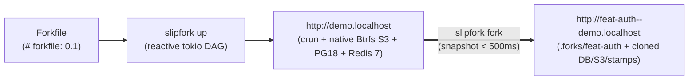

# Slipfork Specifications

Slipfork runs your cloud environment locally in a box; CI is the clutch. From one `Forkfile`, Slipfork builds and runs your images, databases, caches, S3 buckets, and workers behind one `.localhost` domain — **100% Docker-free** on native Btrfs + `crun`.

```console
$ slipfork up
• image     backend   cached                     1ms
✓ resource  pg        postgres 18 ready         38ms
✓ resource  assets    s3 public-read -> cdn      1ms
✓ service   api       listening :8000 -> /api   1.4s
✓ service   front     listening :5173 -> /      2.3s
✓ Ready -> http://demo.localhost

$ slipfork fork feat-auth
✓ feat-auth (4.8s) -> http://feat-auth--demo.localhost
  path  ~/projects/demo/.forks/feat-auth
```

Snapshotting is `~150–365ms` (asserted `< 500ms`); the full cold 8-component boot first responds at `~5.5s` on 4 vCPU, asserted `< 8.0s` on 2-vCPU CI.



!!! info "Clean-sheet contract"
    Published `README.md` and `docs/` document strictly what runs in the shipped `slipfork` binary. Pre-release target UX and system contracts live here in `specs/` first.

---

## Three Core Bets

1. **One zero-boilerplate `Forkfile` for cloud and local:** Services live inside their enclosing `image` block, `@uv` / `@pnpm` synthesize deduplicated lockfile setup nodes, and explicit `s3` policies (`private` vs `public-read` + `cdn <id>`) keep local dev and cloud in lockstep.
2. **Two-tier `fork` latency on Btrfs + `crun` (zero Docker):** Your checkout, cached image subvolumes, golden `postgres:18` template, Redis AOF, native Rust S3 store, and `.slipfork-world-stamp.json` live on Btrfs, so Slipfork's own clone measures `~150–365ms` on the 4-vCPU droplet (asserted `snapshot_ms < 500ms`). A full cold start of the real FastAPI (`uvicorn --reload`) + SvelteKit (`vite dev`) demo medians `~5.5s` on the 4-vCPU dev VM and is asserted `< 8.0s` on 2-vCPU GitHub Actions loop-Btrfs runners — dominated by first-request transforms inside the app pods, not by the clone; a warm fork reports `cached` and `up to date` and re-runs nothing.
3. **High-craft `clap` CLI, `DECSTBM` fixed bottom panel & real-PTY `shell`:** Interactive ANSI TTYs pin a 1-line `apt`-style bottom progress bar via VT100 `DECSTBM` (`\x1b[1;{rows-1}r`) with strictly one aligned line per task above it (`\r`-rewritten plain ASCII with zero `\x1b[` under `NO_COLOR`/`TERM=dumb`; clean `→ [i/n]` / `✓` lines on pipes; pure JSON on `--json`), and `slipfork shell <target>` attaches a real kernel PTY across services, images, Postgres, and Redis.

---

## Specification Suite

| Spec | Scope |
| :--- | :--- |
| **[01 — The `Forkfile` Specification](./01-forkfile.md)** | `# forkfile: 0.1` header, enclosing `image` scopes & build `arg`s, explicit `s3` `policy` + `cdn <id>`, strict RFC 1123 labels, `route`, and `@<tool>` auto-prequels. |
| **[02 — The CLI UX](./02-cli-ux.md)** | `clap` 4.6 derive CLI, VT100 `DECSTBM` fixed-bottom-bar 1-line-per-task TUI, unified real-PTY `slipfork shell <target>`, status trees, `~150–365ms` snapshot `fork` (asserted `< 500ms`) with `cached` warm boots, component `logs`, and `doctor`. |
| **[03 — How It Works Under the Hood](./03-under-the-hood.md)** | Btrfs subvolume layout, native Rust S3 on `:8333`, direct-exec PG18 + Redis 7, parallel fork boot DAG, `.slipfork-world-stamp.json`, and `SCM_RIGHTS` PTY/ingress IPC. |
| **[04 — The Testing Plan](./04-testing-plan.md)** | Real Btrfs + `crun` lab E2E journeys asserting the two-tier `fork` contract (`snapshot_ms < 500ms`, measured `~150–365ms`; median cold start `~5.5s`, asserted `< 8.0s`), native S3 SigV4/policy parity, real-PTY `DECSTBM` & `shell <target>` capture, and fail-closed gates. |
| **[05 — The `OSPP v1` Wire Specification](./05-ospp-v1.md)** | Closed 16-frame WebSocket protocol, P-256 pairing, `hpke-p256` in-memory secrets, sealed dump streams, and `snow.yml` migration. |
| **[06 — Distribution & Documentation](./06-distribution-and-docs.md)** | Native `.deb`/`.rpm`/Arch/Alpine/portable releases, generated completions & manpage, `docs/install.sh`, `@slipfork/opencode`, and honesty-gated Zensical docs. |
