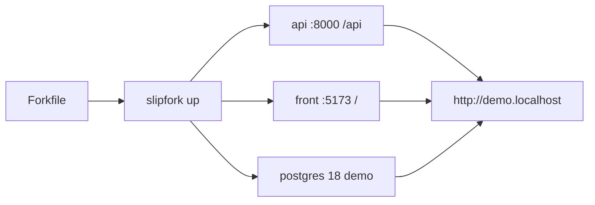

# Demo: a two-service world on PostgreSQL

One `Forkfile`: an API on `/api`, a static front on `/`, and one `postgres:18` database. `slipfork up` boots all three as separate containers in one copy-on-write world.



```console
$ cd ~/demo
$ slipfork up
$ curl -fsS http://demo.localhost/api
{"hello": "world", "host": "api", "world": "canonical", "debug": true, "secret_len": 32}
$ slipfork run migrate          # re-apply db/*.sql through the api service
$ slipfork fork demo-a          # second world at http://demo-a.demo.localhost
```

!!! info "No port to remember"
    `slipfork daemon install` gives systemd ownership of `:80`, so the origin is `http://demo.localhost`. When a world runs on an ephemeral port instead, `slipfork ps` prints the port.

`tools/do_vm.py sync` seeds this directory once at `/home/slipfork/demo` as one Git commit. Later edits are yours; a later `sync` never overwrites a seeded demo.

## What is inside

| File | Purpose |
|---|---|
| `Forkfile` | `project`, `env app`, both `service` blocks, `postgres pg`, and `task migrate` |
| `api/server.py` | JSON on `/api` and `/api/db`, on port `8000` |
| `api/migrate.py` | Applies `db/*.sql`; the `pre-deploy` hook and the `migrate` task |
| `front/index.html` | The page served on `/`, reading `/api/db` |
| `db/*.sql` | Schema and seed, applied idempotently on every boot |
| `migrate/snow.yml` | Legacy-shaped upstream manifest for a `slipfork migrate` rehearsal |

The services run their sources **from this checkout**, bind-mounted at the same path inside the world. Edit `api/server.py` or the SQL and run `slipfork restart`; there is no Docker rebuild.

`env app` carries the database URL, `secret(DEMO_SECRET) ?? random_hex(16)` (written once to the local `0600` vault), and `DEBUG`. Auto-generated secrets belong in the `env` group that consumes them.

## Forks

```console
$ slipfork fork demo-a     # .worktrees/demo-a plus its own subvolume and origin
$ slipfork drop demo-a     # stop it and remove the worktree
```

Each fork is its own Btrfs subvolume, its own `postgres:18` cluster, its own `.venv` volume, and its own subdomain. The canonical world and every fork run at the same time.

## Database and logs

```console
$ slipfork db demo         # psql 18 inside the world's postgres container (needs a TTY)
$ slipfork logs api        # retained service output
$ slipfork ps              # every service and crun container in the world
```

`db` takes the declared database id; with exactly one declaration the argument can be omitted. Each fork starts from the same tables and adds its own `boot` row scoped to the fork.

Cookbook: [`docs/getting-started.md`](../../docs/getting-started.md) and [`docs/forkfile.md`](../../docs/forkfile.md).
