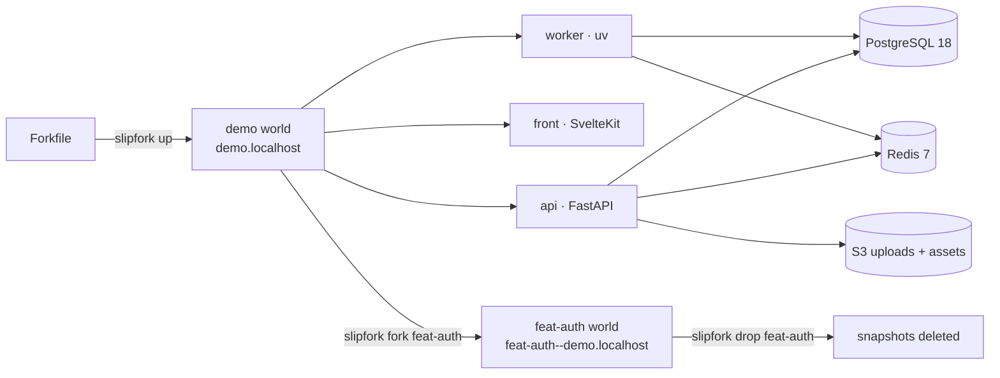

# Slipfork demo: a real polyglot world in one Forkfile

Boot PostgreSQL, Redis, two S3 buckets, a background worker, FastAPI and SvelteKit on one command,
then fork the entire running stack in under a second. Nothing here is mocked: the tasks you add are
real PostgreSQL rows, the counter is a real Redis key, and the email leaves through real SMTP.

```bash
git clone https://github.com/offworldnexus/slipfork
cd slipfork/support/demo && slipfork up
```

Your world answers on `http://demo.localhost`. Change a task, fork the world, and watch the parent
keep its own rows while the fork starts with a copy.

## Prove it with curl

```bash
curl -s  http://demo.localhost/api/status | jq '.world, .health, .counts'
curl -s  http://demo.localhost/api/items  | jq
curl -sX POST http://demo.localhost/api/items \
     -H 'content-type: application/json' -d '{"title":"Ship the fork"}' | jq
curl -sX PATCH http://demo.localhost/api/items/3 | jq '.done'
curl -sX POST http://demo.localhost/api/test-email | jq   # real Mailpit delivery
curl -sI http://assets.demo.localhost/badge.svg           # 200 public-read
curl -sI http://uploads.demo.localhost/audit.json         # 403 private
curl -sI http://mail.demo.localhost/                      # 200 Mailpit UI
```

The same matrix works on a fork with `feat-auth--demo` in place of `demo`, including
`http://assets.feat-auth--demo.localhost/badge.svg`.

## Eight components

| Component | Kind | Where it answers |
| :--- | :--- | :--- |
| `pg` | PostgreSQL 18, database `app_db` | `app_db.url` (secret) |
| `cache` | Redis 7 | `cache.url` |
| `uploads` | native S3 bucket, private | `uploads.demo.localhost` (`403` anonymous) |
| `assets` | native S3 bucket, `public-read` | `assets.demo.localhost` (`200` anonymous) |
| `api` | FastAPI on `uv` in `./api`, `route /api` | `demo.localhost/api` |
| `worker` | `uv` background loop in `./api`, `BRPOP` on Redis | no port, logs only |
| `front` | SvelteKit 2 + Svelte 5 on `pnpm` in `./front` | `demo.localhost/` on `3000` |
| `mailpit` | `from axllent/mailpit:latest` | `mail.demo.localhost` |

`pre-deploy: uv run --no-sync python -m app.migrate` runs in both modes — it creates the schema,
seeds two rows and writes `badge.svg` plus a private `audit.json`. Slipfork never rewrites `uv`
flags, so the explicit `--no-sync` (here and on `worker`'s `run:`) is what keeps a production pod
from syncing or installing. The worker handles a heartbeat job every 15 seconds, so the activity
counter on the page moves on its own.



## Dev boots never build

`dev` is built in and active, so each image selects its dependency-only stage with
`on dev: stage dev` and Slipfork bind-mounts this checkout at `/project`. Editing `api/app/` or
`front/src/` re-runs only `uvicorn --reload` / `vite dev`, so no production build is paid on every
save.

`api`'s prod stage runs `uv sync --no-dev`; `front`'s `build` stage runs `pnpm run build`, and each
prod stage owns only the `CMD` that serves the result. Drop `dev` to run that production shape —
no `/project` bind, no `mailpit`, and the built images answer on their declared ports:

```console
$ slipfork fork prod-check -F -dev
✓ Ready -> http://prod-check--demo.localhost
```

`@uv` and `@pnpm` are the "sync at boot" prequel markers, so they only appear under `on dev:`
(a dev world may sync; a non-`dev` world writes `--no-sync` itself). `/` and `/api/status` come
from `node build` and `uvicorn` inside the images, so neither `front` nor `api` needs an `else`
fallback: their `run:` lives only under `on dev` and prod runs the image `CMD`.

## What a fork carries

`slipfork fork feat-auth` snapshots the checkout, `.venv`, `node_modules`, PostgreSQL pages, Redis
keys and bucket objects with one Btrfs ioctl, then boots the clone on its own hostnames. The fork
inherits the parent's dependency stamps, so `uv sync` and `pnpm install` report `(up to date)`.

!!! tip "Isolation you can see"

    Add a task on `demo.localhost`, then open `feat-auth--demo.localhost`: the fork starts from the
    moment you forked and never sees later parent writes. Both worlds keep their own PostgreSQL and
    Redis subvolumes, so deleting the fork is one `slipfork drop feat-auth`.

## Where to look

* `api/` — FastAPI routes, psycopg access, boto3 client, SMTP test, migration and worker.
* `front/` — SvelteKit 2 + Svelte 5 UI reading `/api/status` every two seconds.
* `Forkfile` — resources, `env common`, `@uv` / `@pnpm` prequels, the `dev` and `mail` features.

Next: [the Forkfile reference](../../docs/forkfile.md) and [the CLI](../../docs/cli.md).
